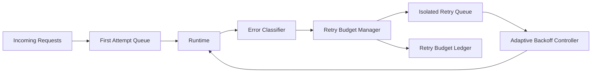

# Agent Retry Budget and Tenant Isolation Selection FAQ (Cycle 1835)

## 1) Three-minute decision
- **Core tension:** unbounded retries amplify failure storms, while over-restricting retries harms true recovery success.
- **Recommendation:** retry budgets plus tenant-isolated retry lanes plus adaptive backoff.
- **Goal:** suppress amplification during incidents while preserving recovery capability for critical tenants.

## 2) Q1 / Q2 / Q3
### Q1: Why is a unified retry policy unsuitable for multi-tenant agent platforms?
1) large-tenant retry storms consume shared capacity,
2) small-tenant successful traffic is drowned by retry noise,
3) without isolation, single-tenant incidents spill into global latency.

### Q2: What production-ready retry-budget strategy should be used?
- **Budget allocation:** per-tenant retry token caps by tier,
- **Isolated execution:** retries in separate queues from first-attempt traffic,
- **Backoff policy:** exponential backoff plus jitter,
- **Circuit linkage:** when budget is exhausted, move to degraded path and defer retries.

### Q3: How do we validate less noise without losing recovery ability?
- lower retry amplification factor,
- higher first-attempt success rate,
- bounded recovery latency for critical tenants.

## 3) Reference architecture

## 4) Decision matrix
| Dimension | Unified retries | Budget-isolated retries (Recommended) |
|---|---:|---:|
| Retry storm suppression | Low | High |
| First-attempt protection | Low | High |
| Multi-tenant isolation | Low | High |
| Implementation complexity | Low | Medium |
| Operational explainability | Medium | High |

## 5) Evidence and reproducibility
- Evidence files:
  - `workshops/azure-agent-infra/evidence/cycle-1835-benchmark.json`
  - `workshops/azure-agent-infra/evidence/cycle-1835-latency.csv`
  - `workshops/azure-agent-infra/evidence/cycle-1835-throughput.csv`
  - `workshops/azure-agent-infra/evidence/cycle-1835-policy.csv`
- Labels: `measured / synthetic / anonymized_reported`.
- validation7 enforces bilingual six-part structure, CSP self-contained 7-card output, strict cycle-evidence alignment, and replayability.

## 6) Production checklist
- [ ] Per-tenant retry budgets and tier policies are released.
- [ ] Retry and first-attempt queues are separated.
- [ ] Adaptive backoff parameters are integrated and load-tested.
- [ ] Budget-exhaustion degrade and alert flows are operational.
- [ ] FAQ/H5/SVG/7-card align with cycle evidence.
