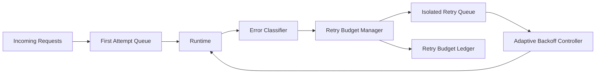

# Agent 重试预算与租户隔离选型 FAQ（Cycle 1835）

## 1) 3 分钟结论
- **核心矛盾：** 无约束重试会在故障期放大流量雪崩；过度抑制重试又会降低真实成功率。
- **推荐：** 重试预算（Retry Budget）+ 租户隔离队列 + 自适应退避。
- **目标：** 在故障窗口中抑制放大效应，同时保障关键租户请求恢复能力。

## 2) Q1 / Q2 / Q3
### Q1：为什么统一重试策略不适合多租户 Agent 平台？
1) 大租户重试风暴会吞噬共享资源；
2) 小租户成功请求被重试噪声淹没；
3) 无隔离时单租户异常会外溢到全局时延。

### Q2：可落地的重试预算策略是什么？
- **预算分配**：为每租户按等级分配最大重试令牌；
- **隔离执行**：重试流量进入独立队列，不与首次请求同池竞争；
- **退避机制**：指数退避 + 抖动，避免重试齐步冲击；
- **熔断联动**：预算耗尽后切换降级路径并延后重试。

### Q3：如何验证“降噪且不丢恢复能力”？
- 重试放大量下降；
- 首次请求成功率提升；
- 关键租户恢复时延受控。

## 3) 架构图

## 4) 选型矩阵
| 维度 | 统一重试 | 预算隔离重试（推荐） |
|---|---:|---:|
| 重试风暴抑制 | 低 | 高 |
| 首次请求保护 | 低 | 高 |
| 多租户隔离 | 低 | 高 |
| 实施复杂度 | 低 | 中 |
| 运维可解释性 | 中 | 高 |

## 5) 证据与复算口径
- 证据文件：
  - `workshops/azure-agent-infra/evidence/cycle-1835-benchmark.json`
  - `workshops/azure-agent-infra/evidence/cycle-1835-latency.csv`
  - `workshops/azure-agent-infra/evidence/cycle-1835-throughput.csv`
  - `workshops/azure-agent-infra/evidence/cycle-1835-policy.csv`
- 标签：`measured / synthetic / anonymized_reported`。
- validation7：双语六段结构、7-card CSP 自包含、轮次与 evidence 一致、可回放链路通过。

## 6) 生产检查清单
- [ ] 每租户重试预算与配额等级已发布。
- [ ] 重试隔离队列与首次请求队列已分离。
- [ ] 自适应退避参数已联调并压测。
- [ ] 预算耗尽降级与告警链路可用。
- [ ] FAQ/H5/SVG/7-card 与 evidence 轮次一致。
