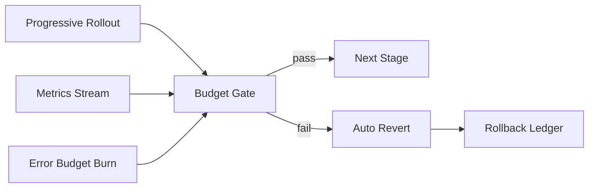

# Agent Rollout Revert Budget Selection FAQ (Cycle 1814)

## 1) Three-minute decision
- **Core problem:** not whether progressive rollout exists, but whether auto-revert can happen before error budget is exhausted.
- **Recommendation:** release budget + observation budget + revert budget as one gated policy.
- **Goal:** compress failure impact window and blast radius into auditable limits.

## 2) Q1 / Q2 / Q3
### Q1: Why do many canary rollouts still fail badly?
1) traffic ratio is tracked, burn rate is ignored,
2) thresholds are fragmented across systems,
3) manual judgment chains miss rollback timing.

### Q2: What is a practical budget-gated design?
- release budget defines allowed step size and concurrency increase,
- observation budget defines minimum dwell time and metric windows,
- revert budget triggers auto-revert and stage freeze when exceeded.

### Q3: How do we validate the model?
- lower MTTR from anomaly detection to revert completion,
- fewer impacted users during failed rollouts,
- faster post-revert stabilization.

## 3) Reference architecture

## 4) Decision matrix
| Dimension | Fixed-ratio canary | Budget-gated canary (Recommended) |
|---|---:|---:|
| Rollback timeliness | Medium | High |
| False-pass risk | High | Low |
| Implementation complexity | Low | Medium |
| Audit traceability | Medium | High |
| Multi-tenant stability | Medium | High |

## 5) Evidence and reproducibility
- Evidence files:
  - `workshops/azure-agent-infra/evidence/cycle-1814-benchmark.json`
  - `workshops/azure-agent-infra/evidence/cycle-1814-latency.csv`
  - `workshops/azure-agent-infra/evidence/cycle-1814-throughput.csv`
  - `workshops/azure-agent-infra/evidence/cycle-1814-policy.csv`
- Labels: `measured / synthetic / anonymized_reported`.
- validation7 enforces structure, cycle consistency, CSP self-contained cards, and replayability.

## 6) Production checklist
- [ ] Stage budget thresholds are fixed.
- [ ] Metric windows and sampling cadence are standardized.
- [ ] Auto-revert triggers and execution paths are integrated.
- [ ] Rollback ledger preserves auditable events.
- [ ] FAQ/H5/SVG/7-card align with cycle evidence.
