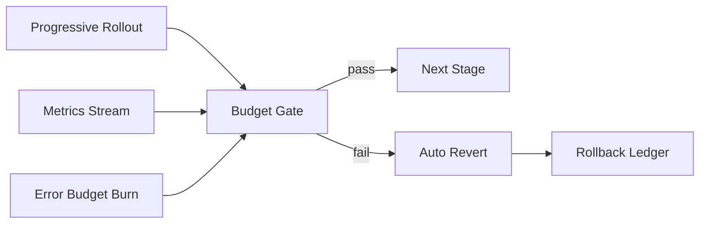

# Agent 发布回滚预算选型 FAQ（Cycle 1814）

## 1) 3 分钟结论
- **问题本质：** 不是“能不能灰度”，而是“在错误预算耗尽前能否自动回滚”。
- **推荐：** 发布预算、观测预算、回滚预算三预算联动门禁。
- **目标：** 将失败发布的影响时间与影响面压缩到可审计阈值内。

## 2) Q1 / Q2 / Q3
### Q1：为什么很多灰度仍然翻车？
1) 只看流量比例，不看错误预算消耗速率；
2) 触发阈值分散在多系统，回滚动作不一致；
3) 人工判定链路过长，错过黄金回滚窗口。

### Q2：可执行的预算门禁怎么设计？
- 发布预算：每阶段允许的变更幅度与并发增量；
- 观测预算：每阶段最短观测时长与关键指标窗口；
- 回滚预算：累计异常超过阈值即自动回退并冻结推进。

### Q3：如何验证预算模型有效？
- 异常触发到回滚完成时间（MTTR）下降；
- 失败发布影响用户数下降；
- 回滚后恢复稳定时间缩短。

## 3) 架构图

## 4) 选型矩阵
| 维度 | 固定比例灰度 | 预算门禁灰度（推荐） |
|---|---:|---:|
| 回滚及时性 | 中 | 高 |
| 误放行风险 | 高 | 低 |
| 实施复杂度 | 低 | 中 |
| 审计可追溯 | 中 | 高 |
| 多租户稳定性 | 中 | 高 |

## 5) 证据与复算口径
- 证据文件：
  - `workshops/azure-agent-infra/evidence/cycle-1814-benchmark.json`
  - `workshops/azure-agent-infra/evidence/cycle-1814-latency.csv`
  - `workshops/azure-agent-infra/evidence/cycle-1814-throughput.csv`
  - `workshops/azure-agent-infra/evidence/cycle-1814-policy.csv`
- 标签：`measured / synthetic / anonymized_reported`。
- validation7：结构完整、轮次一致、CSP 自包含、证据链可回放。

## 6) 生产检查清单
- [ ] 发布阶段预算阈值已固化。
- [ ] 指标窗口与采样频率已统一。
- [ ] 自动回滚触发条件与动作链路已联调。
- [ ] 回滚账本保留可审计事件。
- [ ] FAQ/H5/SVG/7-card 与 evidence 轮次对齐。
