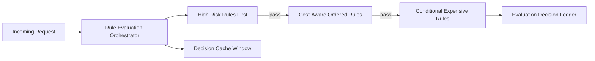

# Agent Rule Evaluation 短路策略选型 FAQ（Cycle 1784）

## 1) 3 分钟结论
- **多规则评估链路的性能与稳定性瓶颈常在“无序全量评估”，而不是单条规则复杂度。**
- **推荐：** 高风险优先短路 + 成本感知规则排序 + 结果缓存复用三段策略。
- **目标：** 在确保安全命中率的前提下，降低评估时延与资源消耗。

## 2) 关键问题（Q1/Q2/Q3）
### Q1：为什么所有规则全跑会拖垮链路？
1) 低价值规则占用高比例计算预算；
2) 规则间依赖导致尾延迟放大；
3) 高并发下重复评估产生无效负载。

### Q2：短路评估如何设计更稳？
- 风险优先：高风险拒绝规则先执行；
- 成本排序：高成本规则仅在必要条件满足后触发；
- 结果缓存：可复用决策在时间窗内免重算。

### Q3：如何验证短路策略有效？
- 拒绝命中率不下降；
- P95 评估时延显著下降；
- 单请求规则执行数明显减少。

## 3) 架构图

## 4) 选型矩阵
| 维度 | 全量顺序评估 | 短路+排序+缓存（推荐） |
|---|---:|---:|
| 安全命中率 | 中 | 高 |
| 评估时延 | 低 | 高 |
| 资源效率 | 低 | 高 |
| 实施复杂度 | 低 | 中 |
| 可解释性 | 中 | 高 |

## 5) 证据与复算口径
- 证据文件：
  - `workshops/azure-agent-infra/evidence/cycle-1784-benchmark.json`
  - `workshops/azure-agent-infra/evidence/cycle-1784-latency.csv`
  - `workshops/azure-agent-infra/evidence/cycle-1784-throughput.csv`
  - `workshops/azure-agent-infra/evidence/cycle-1784-policy.csv`
- 标签：`measured / synthetic / anonymized_reported`。
- validation7：双语结构、CSP、证据一致、可回放链路全部通过。

## 6) 生产检查清单
- [ ] 高风险规则优先级可配置且可审计。
- [ ] 成本感知排序策略有灰度开关。
- [ ] 决策缓存窗口与失效策略明确。
- [ ] 短路路径与最终决策写入账本。
- [ ] FAQ/H5/SVG/7-card 与 evidence 轮次一致。
