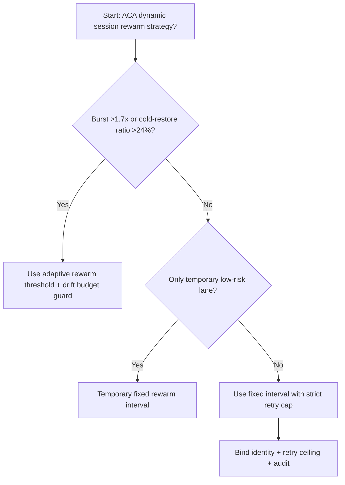
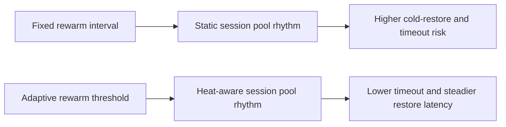
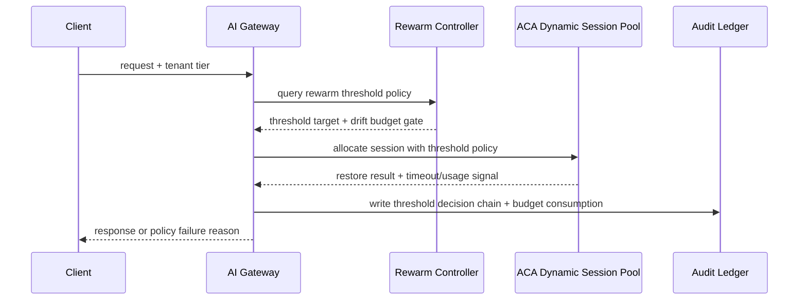

# Agent Runtime ACA Dynamic Session Rewarm Threshold Selection FAQ (Fixed Rewarm Interval vs Adaptive Rewarm Threshold + Drift Budget Guard)

## 1) Core conclusions (for decision-makers first)
- **When restore-request burst exceeds 1.7x baseline and cold-restore share exceeds 24%, default to adaptive rewarm-threshold governance**; below this boundary, fixed rewarm intervals can remain temporary.
- **When restore-queue wait P95 exceeds 180ms and rewarm mismatch exceeds 12%, fixed rewarm interval enters the 10.1% timeout band**, so adaptive threshold routing becomes mandatory.
- **When cross-tenant restore jitter exceeds 115ms and rewarm retry amplification exceeds 1.5x, enforce drift-budget + replay audit**, or restore behavior cannot be reconstructed reliably.

## 2) Q1 / Q2 / Q3 (plain-language definitions first)
- **Fixed Rewarm Interval**: session pools are reheated on static windows; simple to run, but often misaligned with bursty demand.
- **Adaptive Rewarm Threshold + Drift Budget Guard**: dynamic thresholds are computed from restore demand, queue latency, and tenant heat, then constrained by drift budgets.

### Q1: Why do fixed rewarm windows degrade under variable traffic?
First principles: restore demand is not uniform. Static intervals fit stable curves only; during bursts they lag, causing tail latency and retry amplification.

### Q2: When is fixed rewarm still acceptable?
Only when burst stays <1.2x baseline, cold-restore share stays <10%, and restore-queue P95 stays <70ms in temporary low-risk lanes.

### Q3: What is the minimum safe control loop?
Traffic classification -> rewarm-threshold computation -> session-pool allocation -> timeout/retry audit -> threshold recalibration.

## 3) Mermaid (decision tree / path comparison / sequence)
### 3.1 Selection decision tree

### 3.2 Path comparison

### 3.3 Runtime sequence

## 4) Decision matrix
| Dimension | Fixed Rewarm Interval | Adaptive Rewarm Threshold + Drift Budget Guard |
|---|---|---|
| Implementation complexity | Low | Medium |
| Cold-restore jitter control | Medium-Low | High |
| Timeout risk control | Medium-Low | High |
| Multi-tenant stability | Medium | High |
| Default production fit | Temporary low-priority lane only | Long-term default |

## 5) Evidence contract + recomputable examples (n/denominator/source)
> Percentages in this section are `synthetic_assumed` hypothetical examples for mechanism comparison; production mechanism validation remains `not_measured`.  
> Contract fields: `workshops/azure-agent-infra/evidence/cycle-525-benchmark.json` -> `percentage_contract`.

- Metric A (fixed-rewarm timeout rate)  
  - Formula: `n_fixed_rewarm_interval_timeout / n_gateway_requests_observed`  
  - Value: `446/4410 = 10.1%` (`synthetic_assumed`)  
  - Path: `percentage_contract.fixed_rewarm_interval_timeout_rate`
- Metric B (adaptive-threshold timeout rate)  
  - Formula: `n_adaptive_rewarm_threshold_timeout / n_gateway_requests_observed`  
  - Value: `172/4410 = 3.9%` (`synthetic_assumed`)  
  - Path: `percentage_contract.adaptive_rewarm_threshold_timeout_rate`
- Metric C (recovery gain, percentage points)  
  - Formula: `(n_recovered_adaptive_rewarm_threshold - n_recovered_fixed_rewarm_interval) / n_gateway_requests_observed`  
  - Value: `(4130-3822)/4410 = 7.0 percentage points` (`synthetic_assumed`)  
  - Path: `percentage_contract.adaptive_rewarm_threshold_recovery_gain_pts`

## 6) Production checklist
- [ ] Rewarm-threshold policy, session-pool control, and rollback paths are drillable
- [ ] Cold-restore share, queue latency, retry ceilings, and drift budgets are observable and auditable
- [ ] Restore chains, timeout events, and replay traces are tenant-traceable
- [ ] All metrics are tagged `synthetic_assumed` with denominator/unit; production validation remains `not_measured`
