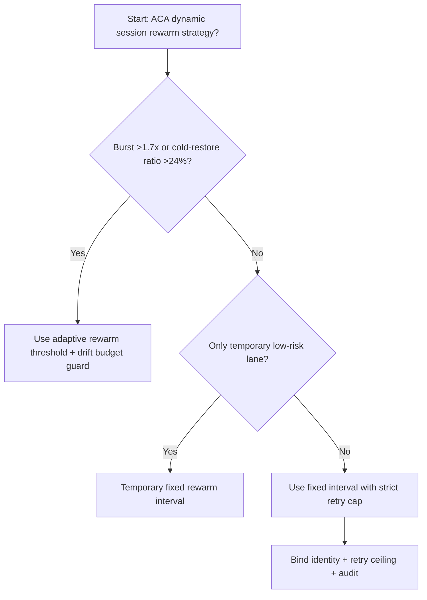
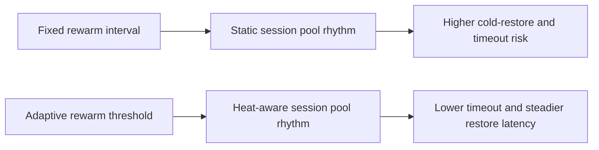
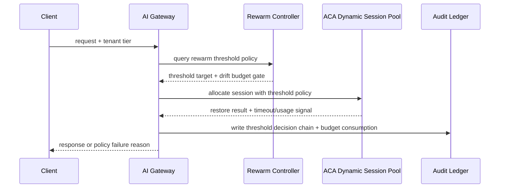

# Agent Runtime ACA Dynamic Session Rewarm Threshold 选型 FAQ（Fixed Rewarm Interval vs Adaptive Rewarm Threshold + Drift Budget Guard）

## 1) 核心结论（先给负责人）
- **当会话恢复请求尖峰 >1.7× 基线且冷恢复占比 >24% 时，生产默认应选自适应 Rewarm Threshold 治理**；低于阈值可短期保留固定回温间隔。
- **当恢复队列等待 P95 >180ms 且回温错配率 >12% 时，Fixed Rewarm Interval 会进入 10.1% 超时档**，必须切换阈值自适应路径。
- **当跨租户会话恢复抖动 >115ms 且回温重试放大 >1.5× 时，必须启用 drift budget + replay audit**，否则恢复策略无法稳定复盘。

## 2) Q1 / Q2 / Q3（术语先通俗解释）
- **Fixed Rewarm Interval**：按固定时间窗口回温会话池，配置简单，但负载变化快时容易出现“该热不热、该冷不冷”。
- **Adaptive Rewarm Threshold + Drift Budget Guard**：根据实时恢复请求、排队时延和租户热度动态调整回温阈值，并用漂移预算控制抖动。

### Q1：为什么固定回温间隔在波动流量下表现差？
第一性原理：恢复需求不是均匀曲线。固定间隔只适合稳定负载，峰值到来时会出现回温滞后，尾延迟和重试叠加放大。

### Q2：什么时候还可短期使用固定回温间隔？
仅在恢复尖峰 <1.2× 基线、冷恢复占比 <10%、恢复队列 P95 <70ms 的短时低风险通道。

### Q3：最小安全闭环是什么？
流量分级 -> 回温阈值计算 -> 会话池分配 -> 超时/重试审计 -> 阈值回归校准。

## 3) Mermaid（决策树 / 路径对比 / 时序）
### 3.1 选型决策树

### 3.2 路径对比图

### 3.3 运行时序图

## 4) 选型决策矩阵
| 维度 | Fixed Rewarm Interval | Adaptive Rewarm Threshold + Drift Budget Guard |
|---|---|---|
| 实现复杂度 | 低 | 中 |
| 冷恢复抖动控制 | 中-低 | 高 |
| 超时风险控制 | 中-低 | 高 |
| 多租户稳定性 | 中 | 高 |
| 生产默认建议 | 仅临时低优先级通道 | 长期默认 |

## 5) 数据证据与可复算算例（含 n/分母/来源）
> 本节百分比为 `synthetic_assumed` 假设算例（hypothetical），用于机制比较；生产机制认证保持 `not_measured`。  
> 合同字段见：`workshops/azure-agent-infra/evidence/cycle-525-benchmark.json` 的 `percentage_contract`。

- 指标 A（固定回温超时率）  
  - 定义：`n_fixed_rewarm_interval_timeout / n_gateway_requests_observed`  
  - 值：`446/4410 = 10.1%`（`synthetic_assumed`）  
  - 路径：`percentage_contract.fixed_rewarm_interval_timeout_rate`
- 指标 B（自适应阈值超时率）  
  - 定义：`n_adaptive_rewarm_threshold_timeout / n_gateway_requests_observed`  
  - 值：`172/4410 = 3.9%`（`synthetic_assumed`）  
  - 路径：`percentage_contract.adaptive_rewarm_threshold_timeout_rate`
- 指标 C（恢复增益，百分点）  
  - 定义：`(n_recovered_adaptive_rewarm_threshold - n_recovered_fixed_rewarm_interval) / n_gateway_requests_observed`  
  - 值：`(4130-3822)/4410 = 7.0` 个百分点（`synthetic_assumed`）  
  - 路径：`percentage_contract.adaptive_rewarm_threshold_recovery_gain_pts`

## 6) 生产 Checklist（上线前必须打勾）
- [ ] 回温阈值策略、会话池调节和回滚路径可灰度演练
- [ ] 冷恢复占比、排队时延、重试上限与漂移预算均可观测可审计
- [ ] 恢复链路、超时事件与回放审计可按租户追踪
- [ ] 指标全部标注 `synthetic_assumed`、分母与单位；生产机制认证保持 `not_measured`
