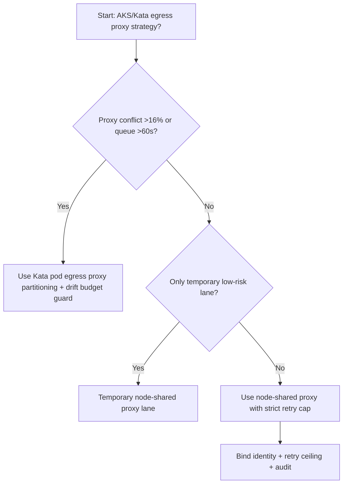
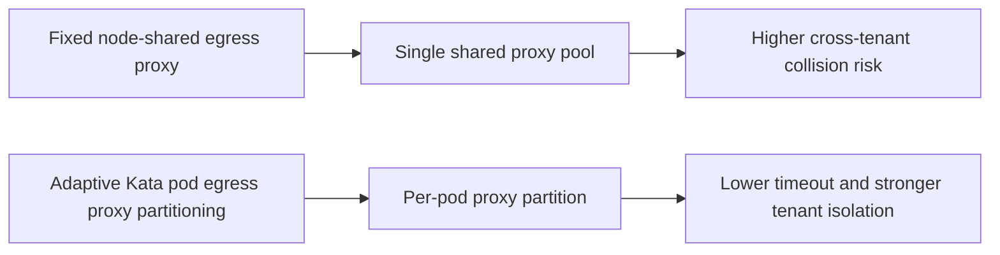
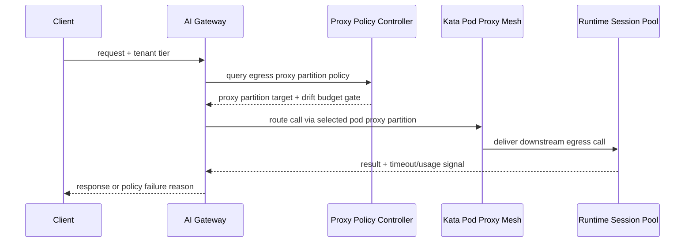

# Agent Runtime AKS Kata Egress Proxy Selection FAQ (Fixed Node-Shared Egress Proxy vs Adaptive Kata Pod Egress Proxy Partitioning + Drift Budget Guard)

## 1) Core conclusions (for decision-makers first)
- **When node-level proxy reuse conflict exceeds 16% and egress queueing exceeds 60s, default to Kata pod-level egress proxy partitioning**; below this boundary, node-shared proxy can remain temporary.
- **When proxy reconnect failure exceeds 1.0% and downstream handshake P95 exceeds 140ms, fixed node-shared egress proxy enters the 10.5% timeout band**, so pod-partitioned proxy routing becomes mandatory.
- **When cross-tenant proxy jitter exceeds 110ms and retry-storm amplification exceeds 1.5x, enforce drift-budget + replay audit**, or failures cannot be isolated and reconstructed per tenant.

## 2) Q1 / Q2 / Q3 (plain-language definitions first)
- **Fixed Node-Shared Egress Proxy**: all tenants on one node share one outbound proxy; easy to run, but vulnerable to connection-slot contention at peaks.
- **Adaptive Kata Pod Egress Proxy Partitioning + Drift Budget Guard**: split outbound proxy pools by Kata pod/tenant and govern retry and replay windows with drift budgets.

### Q1: Why does node-shared proxying collapse at high concurrency?
First principles: connection pools are finite. Once hotspot tenants saturate the shared pool, other tenants enter queue/retry loops that amplify tail latency.

### Q2: When is node-shared proxying still acceptable?
Only when conflict rate stays <7%, handshake P95 stays <70ms, and reconnect failure stays <0.3% in temporary low-risk lanes.

### Q3: What is the minimum safe control loop?
Traffic classification -> pod-level proxy partitioning -> retry-budget gate -> timeout/failure audit -> threshold recalibration.

## 3) Mermaid (decision tree / path comparison / sequence)
### 3.1 Selection decision tree

### 3.2 Path comparison

### 3.3 Runtime sequence

## 4) Decision matrix
| Dimension | Fixed Node-Shared Egress Proxy | Adaptive Kata Pod Egress Proxy Partitioning + Drift Budget Guard |
|---|---|---|
| Implementation complexity | Low | Medium |
| Connection-collision resilience | Medium-Low | High |
| Timeout risk control | Medium-Low | High |
| Multi-tenant stability | Medium | High |
| Default production fit | Temporary low-priority lane only | Long-term default |

## 5) Evidence contract + recomputable examples (n/denominator/source)
> Percentages in this section are `synthetic_assumed` hypothetical examples for mechanism comparison; production mechanism validation remains `not_measured`.  
> Contract fields: `workshops/azure-agent-infra/evidence/cycle-523-benchmark.json` -> `percentage_contract`.

- Metric A (node-shared proxy timeout rate)  
  - Formula: `n_fixed_node_shared_proxy_timeout / n_gateway_requests_observed`  
  - Value: `462/4410 = 10.5%` (`synthetic_assumed`)  
  - Path: `percentage_contract.fixed_node_shared_proxy_timeout_rate`
- Metric B (pod-partitioned proxy timeout rate)  
  - Formula: `n_adaptive_kata_egress_proxy_timeout / n_gateway_requests_observed`  
  - Value: `185/4410 = 4.2%` (`synthetic_assumed`)  
  - Path: `percentage_contract.adaptive_kata_egress_proxy_timeout_rate`
- Metric C (recovery gain, percentage points)  
  - Formula: `(n_recovered_adaptive_kata_egress_proxy - n_recovered_fixed_node_shared_proxy) / n_gateway_requests_observed`  
  - Value: `(4108-3794)/4410 = 7.1 percentage points` (`synthetic_assumed`)  
  - Path: `percentage_contract.adaptive_kata_egress_proxy_recovery_gain_pts`

## 6) Production checklist
- [ ] Pod-level proxy partition policy, retry-budget gates, and rollback paths are drillable
- [ ] Conflict rate, handshake latency, retry ceilings, and drift budgets are observable and auditable
- [ ] Timeout chains, reconnect failures, and replay traces are tenant-traceable
- [ ] All metrics are tagged `synthetic_assumed` with denominator/unit; production validation remains `not_measured`
