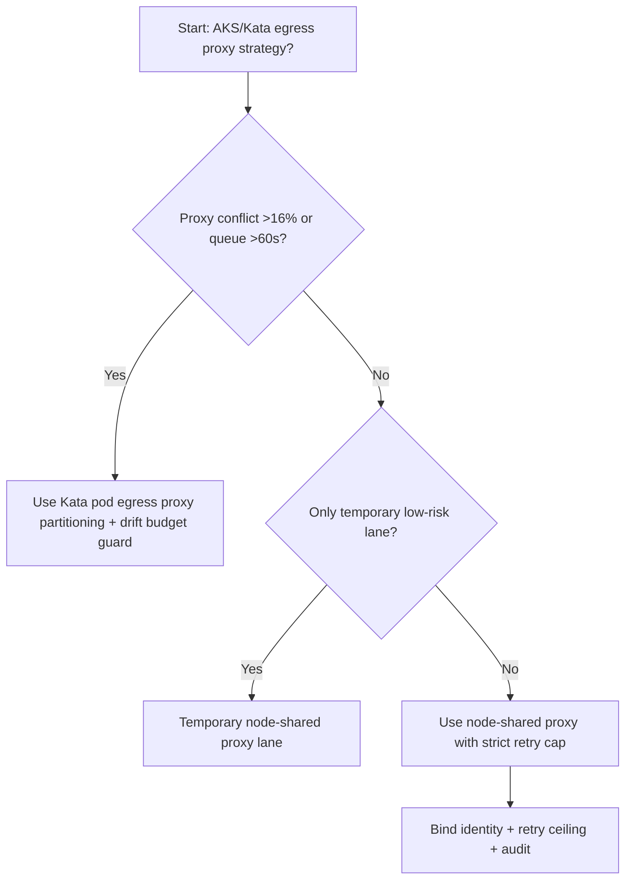
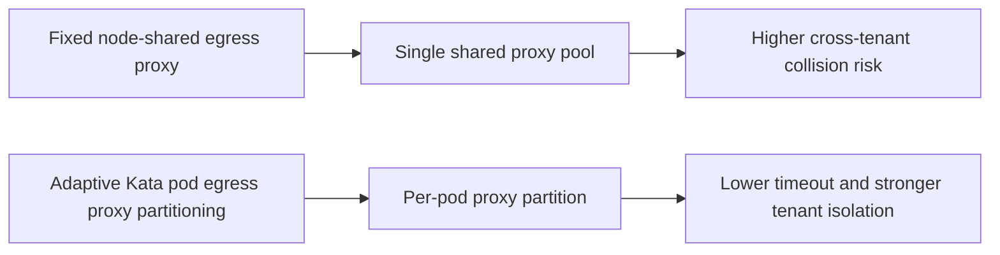
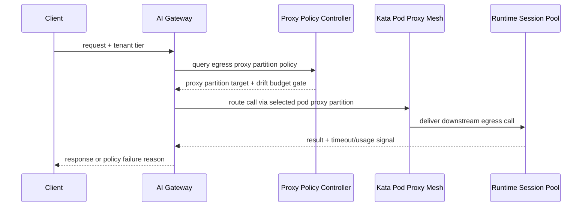

# Agent Runtime AKS Kata Egress Proxy 选型 FAQ（Fixed Node-Shared Egress Proxy vs Adaptive Kata Pod Egress Proxy Partitioning + Drift Budget Guard）

## 1) 核心结论（先给负责人）
- **当节点级代理连接复用冲突 >16% 且 egress 队列排队 >60s 时，生产默认应选 Kata Pod 级 egress proxy 分区治理**；低于阈值可短期保留节点共享代理。
- **当代理连接重建失败率 >1.0% 且下游握手 P95 >140ms 时，Fixed Node-Shared Egress Proxy 会进入 10.5% 超时档**，必须切换 Pod 分区代理路径。
- **当跨租户代理抖动 >110ms 且重试风暴放大 >1.5× 时，必须启用 drift budget + replay audit**，否则故障无法按租户隔离复盘。

## 2) Q1 / Q2 / Q3（术语先通俗解释）
- **Fixed Node-Shared Egress Proxy**：同一节点所有租户共享一个出口代理，部署简单但高峰时容易争抢连接槽位。
- **Adaptive Kata Pod Egress Proxy Partitioning + Drift Budget Guard**：按 Kata Pod/租户拆分出口代理池，联动重试预算与回放窗口控制抖动。

### Q1：为什么节点共享代理在高并发容易雪崩？
第一性原理：连接池是有限资源。共享池一旦被热点租户占满，其他租户会进入排队与重试循环，尾延迟持续放大。

### Q2：什么时候可短期保留节点共享代理？
仅在连接冲突率 <7%、握手 P95 <70ms、连接重建失败率 <0.3% 的短时低风险通道。

### Q3：最小安全闭环是什么？
流量分级 -> Pod 级代理分区 -> 重试预算门禁 -> 超时/失败审计 -> 阈值回归校准。

## 3) Mermaid（决策树 / 路径对比 / 时序）
### 3.1 选型决策树

### 3.2 路径对比图

### 3.3 运行时序图

## 4) 选型决策矩阵
| 维度 | Fixed Node-Shared Egress Proxy | Adaptive Kata Pod Egress Proxy Partitioning + Drift Budget Guard |
|---|---|---|
| 实现复杂度 | 低 | 中 |
| 连接冲突抗压能力 | 中-低 | 高 |
| 超时风险控制 | 中-低 | 高 |
| 多租户稳定性 | 中 | 高 |
| 生产默认建议 | 仅临时低优先级通道 | 长期默认 |

## 5) 数据证据与可复算算例（含 n/分母/来源）
> 本节百分比为 `synthetic_assumed` 假设算例（hypothetical），用于机制比较；生产机制认证保持 `not_measured`。  
> 合同字段见：`workshops/azure-agent-infra/evidence/cycle-523-benchmark.json` 的 `percentage_contract`。

- 指标 A（节点共享代理超时率）  
  - 定义：`n_fixed_node_shared_proxy_timeout / n_gateway_requests_observed`  
  - 值：`462/4410 = 10.5%`（`synthetic_assumed`）  
  - 路径：`percentage_contract.fixed_node_shared_proxy_timeout_rate`
- 指标 B（Pod 分区代理超时率）  
  - 定义：`n_adaptive_kata_egress_proxy_timeout / n_gateway_requests_observed`  
  - 值：`185/4410 = 4.2%`（`synthetic_assumed`）  
  - 路径：`percentage_contract.adaptive_kata_egress_proxy_timeout_rate`
- 指标 C（恢复增益，百分点）  
  - 定义：`(n_recovered_adaptive_kata_egress_proxy - n_recovered_fixed_node_shared_proxy) / n_gateway_requests_observed`  
  - 值：`(4108-3794)/4410 = 7.1` 个百分点（`synthetic_assumed`）  
  - 路径：`percentage_contract.adaptive_kata_egress_proxy_recovery_gain_pts`

## 6) 生产 Checklist（上线前必须打勾）
- [ ] Pod 级代理分区策略、重试预算门禁和回滚路径可灰度演练
- [ ] 连接冲突率、握手延迟、重试上限与漂移预算均可观测可审计
- [ ] 超时链路、重建失败与回放审计可按租户追踪
- [ ] 指标全部标注 `synthetic_assumed`、分母与单位；生产机制认证保持 `not_measured`
