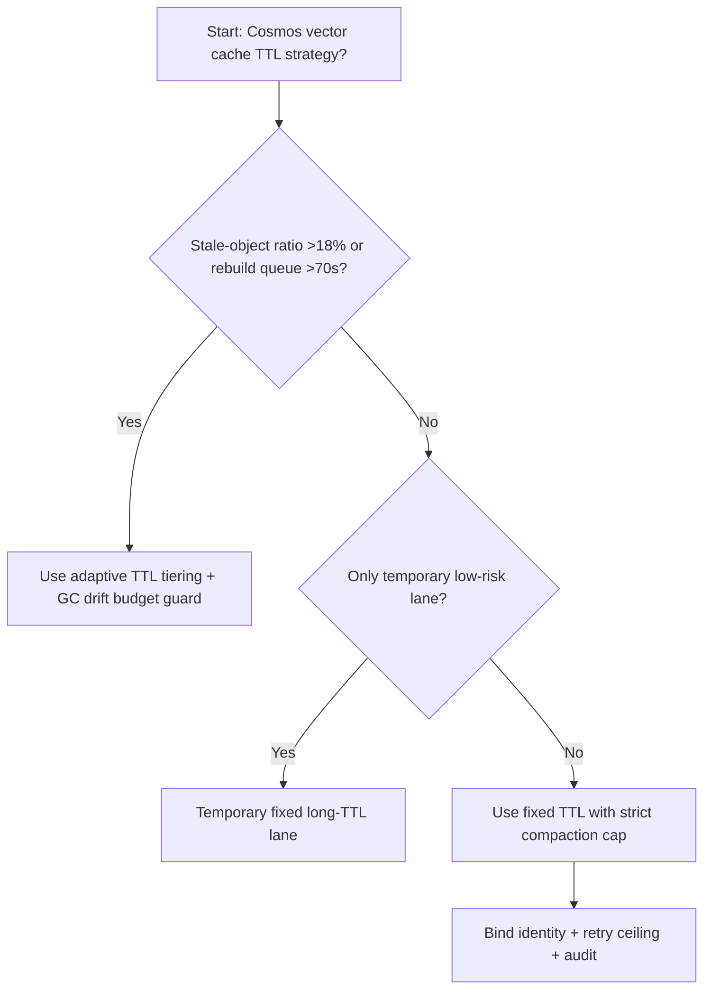
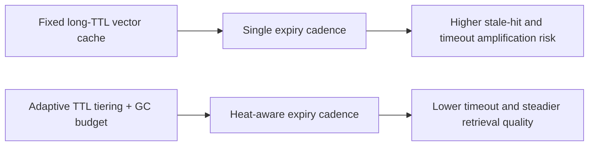
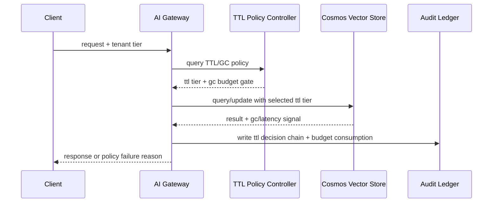

# Agent Runtime Cosmos Vector TTL + GC Selection FAQ (Fixed Long-TTL Vector Cache vs Adaptive TTL Tiering + GC Drift Budget Guard)

## 1) Core conclusions (for decision-makers first)
- **When stale-object share exceeds 18% and index-rebuild queue exceeds 70s, default to TTL tiering + GC drift-budget governance**; below this boundary, long-TTL simplification can remain temporary.
- **When partition tombstone growth exceeds 14% and query P95 jitter exceeds 95ms, fixed long-TTL vector cache enters the 11.1% timeout band**, so adaptive TTL+GC becomes mandatory.
- **When cross-partition compaction amplification exceeds 1.4x and reclaim-window skew exceeds 40s, enforce drift-budget + replay audit**, or retrieval consistency cannot be reproduced reliably.

## 2) Q1 / Q2 / Q3 (plain-language definitions first)
- **Fixed Long-TTL Vector Cache**: cache entries live long by default; simple write path, but stale-object buildup can degrade query and index maintenance behavior.
- **Adaptive TTL Tiering + GC Drift Budget Guard**: dynamically assign TTL tiers from tenant heat and hit quality, then gate GC cadence with drift budgets.

### Q1: Why does fixed long TTL degrade under high concurrency?
First principles: a cache hit is not always a fresh hit. As stale entries accumulate, retrieval scans more invalid candidates, amplifying tail latency and retry cascades.

### Q2: When is fixed long TTL still acceptable?
Only when stale-object share stays <8%, tombstone growth stays <6%, and rebuild queue stays <25s in temporary low-risk lanes.

### Q3: What is the minimum safe control loop?
Request classification -> TTL tier selection -> GC budget gate -> timeout/failure audit -> threshold recalibration.

## 3) Mermaid (decision tree / path comparison / sequence)
### 3.1 Selection decision tree

### 3.2 Path comparison

### 3.3 Runtime sequence

## 4) Decision matrix
| Dimension | Fixed Long-TTL Vector Cache | Adaptive TTL Tiering + GC Drift Budget Guard |
|---|---|---|
| Implementation complexity | Low | Medium |
| Stale-object control | Medium-Low | High |
| Timeout risk control | Medium-Low | High |
| Multi-tenant stability | Medium | High |
| Default production fit | Temporary low-priority lane only | Long-term default |

## 5) Evidence contract + recomputable examples (n/denominator/source)
> Percentages in this section are `synthetic_assumed` hypothetical examples for mechanism comparison; production mechanism validation remains `not_measured`.  
> Contract fields: `workshops/azure-agent-infra/evidence/cycle-522-benchmark.json` -> `percentage_contract`.

- Metric A (fixed long-TTL timeout rate)  
  - Formula: `n_fixed_long_ttl_vector_cache_timeout / n_gateway_requests_observed`  
  - Value: `489/4410 = 11.1%` (`synthetic_assumed`)  
  - Path: `percentage_contract.fixed_long_ttl_vector_cache_timeout_rate`
- Metric B (adaptive TTL+GC timeout rate)  
  - Formula: `n_adaptive_ttl_gc_vector_cache_timeout / n_gateway_requests_observed`  
  - Value: `194/4410 = 4.4%` (`synthetic_assumed`)  
  - Path: `percentage_contract.adaptive_ttl_gc_vector_cache_timeout_rate`
- Metric C (recovery gain, percentage points)  
  - Formula: `(n_recovered_adaptive_ttl_gc_vector_cache - n_recovered_fixed_long_ttl_vector_cache) / n_gateway_requests_observed`  
  - Value: `(4091-3782)/4410 = 7.0 percentage points` (`synthetic_assumed`)  
  - Path: `percentage_contract.adaptive_ttl_gc_vector_cache_recovery_gain_pts`

## 6) Production checklist
- [ ] TTL-tier policy, GC gates, and rollback paths are fully drillable
- [ ] Stale-object share, tombstone growth, retry ceilings, and drift budgets are observable and auditable
- [ ] Timeout chains, reclaim-cadence skew, and replay traces are tenant-traceable
- [ ] All metrics are tagged `synthetic_assumed` with denominator/unit; production validation remains `not_measured`
