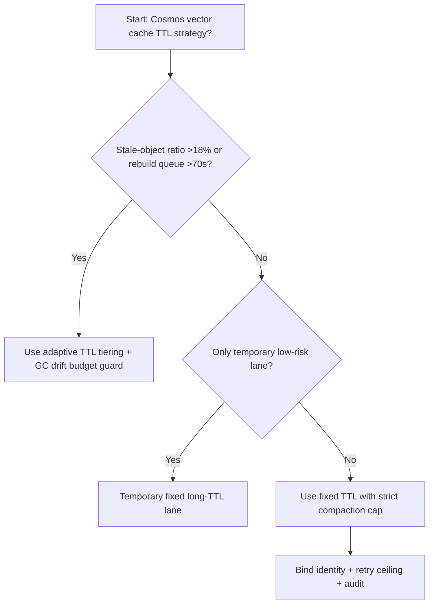
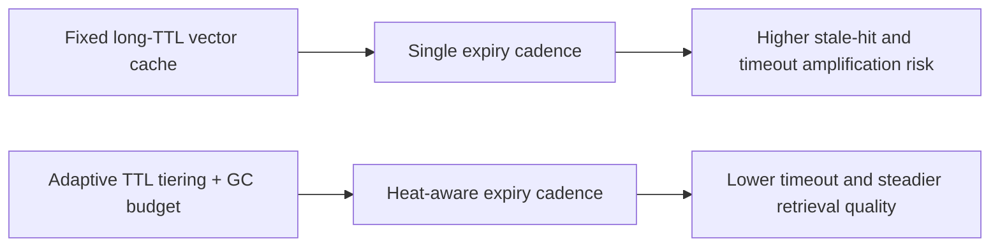
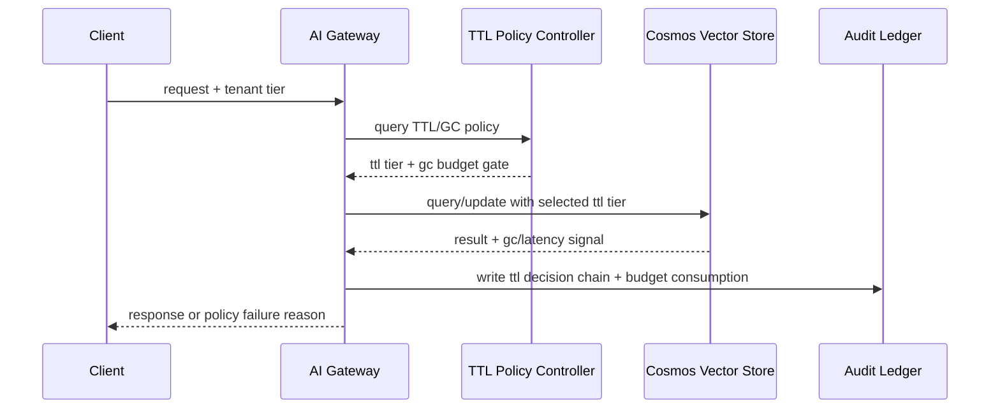

# Agent Runtime Cosmos Vector TTL + GC 选型 FAQ（Fixed Long-TTL Vector Cache vs Adaptive TTL Tiering + GC Drift Budget Guard）

## 1) 核心结论（先给负责人）
- **当向量缓存命中对象中“陈旧对象占比” >18% 且索引重建排队 >70s 时，生产默认应选 TTL 分层 + GC 漂移预算治理**；低于该阈值可短期保留长 TTL 简化方案。
- **当分区 tombstone 膨胀率 >14% 且查询 P95 抖动 >95ms 时，Fixed Long-TTL Vector Cache 会进入 11.1% 超时档**，必须切换自适应 TTL+GC 路径。
- **当跨分区 compaction 放大 >1.4× 且回收窗口偏斜 >40s 时，必须启用 drift budget + replay audit**，否则检索一致性无法稳定复现。

## 2) Q1 / Q2 / Q3（术语先通俗解释）
- **Fixed Long-TTL Vector Cache**：缓存对象默认长寿命，写路径简单，但过期对象回收滞后会拖慢查询与索引维护。
- **Adaptive TTL Tiering + GC Drift Budget Guard**：按租户热度和命中质量动态分配 TTL 档位，配合 GC 预算和回收节拍门禁限制抖动。

### Q1：为什么固定长 TTL 在高并发会逐步恶化？
第一性原理：缓存命中并不代表对象“新鲜”。当旧对象堆积时，查询链路会扫描更多无效候选，导致尾延迟和重试双重放大。

### Q2：什么时候还可短期使用固定长 TTL？
仅在陈旧对象占比 <8%、tombstone 膨胀 <6%、索引重建排队 <25s 的短时低风险流量通道。

### Q3：最小安全闭环是什么？
查询分级 -> TTL 档位选择 -> GC 预算门禁 -> 超时/失败审计 -> 阈值回归校准。

## 3) Mermaid（决策树 / 路径对比 / 时序）
### 3.1 选型决策树

### 3.2 路径对比图

### 3.3 运行时序图

## 4) 选型决策矩阵
| 维度 | Fixed Long-TTL Vector Cache | Adaptive TTL Tiering + GC Drift Budget Guard |
|---|---|---|
| 实现复杂度 | 低 | 中 |
| 陈旧对象控制能力 | 中-低 | 高 |
| 超时风险控制 | 中-低 | 高 |
| 多租户稳定性 | 中 | 高 |
| 生产默认建议 | 仅临时低优先级通道 | 长期默认 |

## 5) 数据证据与可复算算例（含 n/分母/来源）
> 本节百分比为 `synthetic_assumed` 假设算例（hypothetical），用于机制比较；生产机制认证保持 `not_measured`。  
> 合同字段见：`workshops/azure-agent-infra/evidence/cycle-522-benchmark.json` 的 `percentage_contract`。

- 指标 A（固定长 TTL 超时率）  
  - 定义：`n_fixed_long_ttl_vector_cache_timeout / n_gateway_requests_observed`  
  - 值：`489/4410 = 11.1%`（`synthetic_assumed`）  
  - 路径：`percentage_contract.fixed_long_ttl_vector_cache_timeout_rate`
- 指标 B（自适应 TTL+GC 超时率）  
  - 定义：`n_adaptive_ttl_gc_vector_cache_timeout / n_gateway_requests_observed`  
  - 值：`194/4410 = 4.4%`（`synthetic_assumed`）  
  - 路径：`percentage_contract.adaptive_ttl_gc_vector_cache_timeout_rate`
- 指标 C（恢复增益，百分点）  
  - 定义：`(n_recovered_adaptive_ttl_gc_vector_cache - n_recovered_fixed_long_ttl_vector_cache) / n_gateway_requests_observed`  
  - 值：`(4091-3782)/4410 = 7.0` 个百分点（`synthetic_assumed`）  
  - 路径：`percentage_contract.adaptive_ttl_gc_vector_cache_recovery_gain_pts`

## 6) 生产 Checklist（上线前必须打勾）
- [ ] TTL 档位策略、GC 门禁与回滚路径可灰度演练
- [ ] 陈旧对象占比、tombstone 膨胀、重试上限与漂移预算均可观测可审计
- [ ] 超时链路、回收节拍偏斜与回放审计可按租户追踪
- [ ] 指标全部标注 `synthetic_assumed`、分母与单位；生产机制认证保持 `not_measured`
