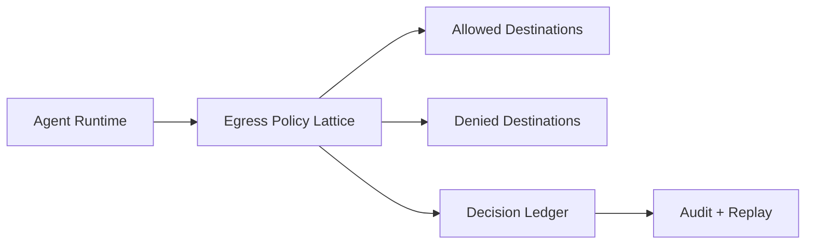

# Agent Runtime Egress Policy Lattice Selection FAQ (Cycle 1765)

## 1) Three-minute decision
- **For multi-tenant agent runtimes, the primary boundary is an egress policy lattice rather than a static allowlist.**
- **Recommendation:** dynamic decisions across tenant, tool, and destination dimensions with deny-by-default.
- **Goal:** block lateral data exfiltration paths without collapsing critical business reachability.

## 2) Core questions (Q1/Q2/Q3)
### Q1: Why a static allowlist is insufficient?
1) runtime context changes faster than static rules,
2) identical destinations carry different risk by tenant tier,
3) tool-chain composition can create covert exfil paths.

### Q2: How should the lattice be modeled?
- tenant dimension: compliance class, region, sovereignty,
- tool dimension: read/write/execute risk classes,
- destination dimension: domain, CIDR, protocol, port, time window.

### Q3: How to validate effectiveness?
- replay legitimate requests with stable pass rates,
- verify overreach egress attempts are consistently blocked,
- compare interception and false-positive rates pre/post rollout.

## 3) Reference architecture

## 4) Decision matrix
| Dimension | Static allowlist | 3D policy lattice (Recommended) |
|---|---:|---:|
| Security elasticity | Low | High |
| Ops complexity | Low | Medium |
| Multi-tenant fitness | Low | High |
| Audit explainability | Medium | High |
| False-positive control | Medium | High |

## 5) Evidence and reproducibility
- Evidence files:
  - `workshops/azure-agent-infra/evidence/cycle-1765-benchmark.json`
  - `workshops/azure-agent-infra/evidence/cycle-1765-latency.csv`
  - `workshops/azure-agent-infra/evidence/cycle-1765-policy.csv`
  - `workshops/azure-agent-infra/evidence/cycle-1765-cost.csv`
- Labels: `measured / synthetic / anonymized_reported`.
- validation7 requires bilingual structure, CSP self-contained cards, evidence consistency, and replayability notes.

## 6) Production checklist
- [ ] Egress policy is deny-by-default with minimal exceptions.
- [ ] Lattice dimensions cover tenant/tool/destination scopes.
- [ ] Deny decisions are written to immutable audit trails.
- [ ] Rollout windows monitor false positives with quick rollback.
- [ ] FAQ/H5/SVG/7-card references are cycle-aligned.
