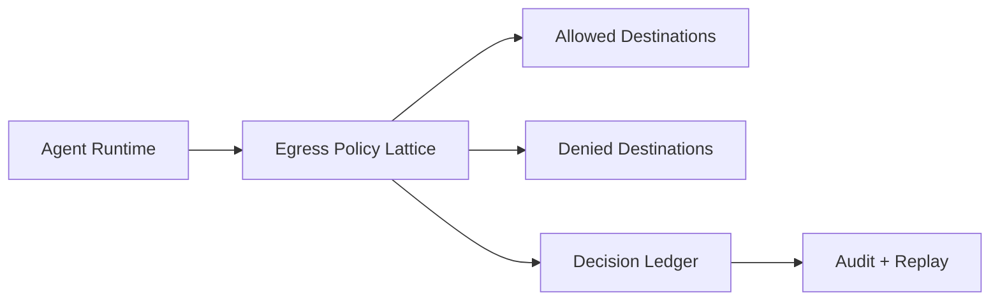

# Agent Runtime 出口策略格（Egress Policy Lattice）选型 FAQ（Cycle 1765）

## 1) 3 分钟结论
- **多租户 Agent Runtime 的核心安全边界之一是“出口策略格”，而不是单点黑白名单。**
- **推荐：** 用“租户级 + 工具级 + 目的地级”三维策略格做动态判定，默认拒绝并最小放行。
- **目标：** 在不牺牲关键业务可达性的前提下，阻断横向数据外泄路径。

## 2) 关键问题（Q1/Q2/Q3）
### Q1：为什么传统白名单不够？
1) 运行时上下文变化快，静态白名单滞后；
2) 同一域名在不同租户风险等级不同；
3) 工具链路组合导致隐蔽外传路径。

### Q2：策略格要怎么建？
- 租户级：合规等级、区域、数据主权；
- 工具级：读/写/执行能力分级；
- 目的地级：域名、IP 段、协议、端口与时间窗。

### Q3：如何验证策略格有效？
- 复放合法请求应稳定通过；
- 演练越权出网请求应被稳定拦截；
- 对比策略升级前后拦截率与误杀率。

## 3) 架构图

## 4) 选型矩阵
| 维度 | 静态白名单 | 三维策略格（推荐） |
|---|---:|---:|
| 安全弹性 | 低 | 高 |
| 运维复杂度 | 低 | 中 |
| 多租户适配 | 低 | 高 |
| 审计解释力 | 中 | 高 |
| 误杀可控性 | 中 | 高 |

## 5) 证据与复算口径
- 证据文件：
  - `workshops/azure-agent-infra/evidence/cycle-1765-benchmark.json`
  - `workshops/azure-agent-infra/evidence/cycle-1765-latency.csv`
  - `workshops/azure-agent-infra/evidence/cycle-1765-policy.csv`
  - `workshops/azure-agent-infra/evidence/cycle-1765-cost.csv`
- 标签：`measured / synthetic / anonymized_reported`。
- validation7：双语结构、CSP 自包含、证据一致和可回放说明全部通过。

## 6) 生产检查清单
- [ ] 出口策略默认拒绝，例外最小化。
- [ ] 策略格维度覆盖租户/工具/目的地。
- [ ] 拒绝决策写入不可篡改审计链。
- [ ] 灰度窗口内监测误杀并可快速回滚。
- [ ] FAQ/H5/SVG/7-card 与 evidence 轮次一致。
