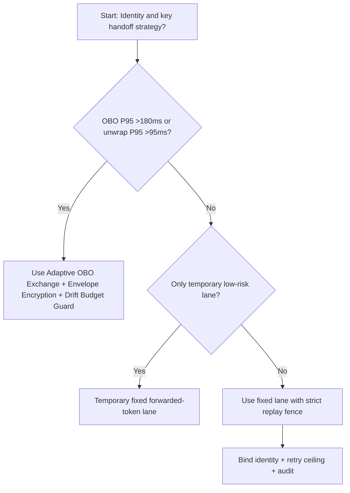
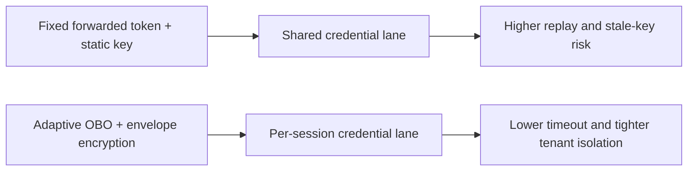
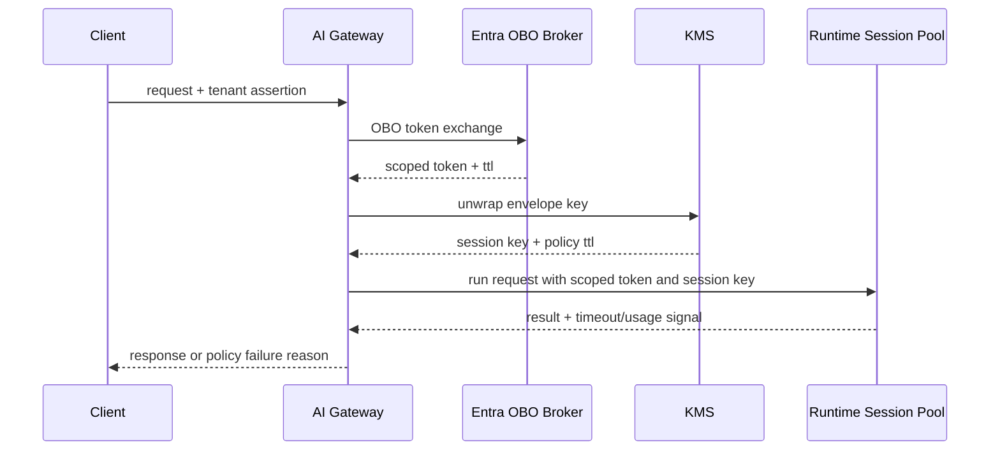

# Agent Runtime Entra OBO Token Exchange + KMS Envelope Encryption Selection FAQ (Fixed Forwarded Token + Static Key Injection vs Adaptive OBO Exchange + Envelope Encryption + Drift Budget Guard)

## 1) Core conclusions (for decision-makers first)
- **When OBO exchange P95 exceeds 180ms and KMS unwrap P95 exceeds 95ms, default to OBO exchange + envelope encryption**; below this boundary, fixed forwarding can remain temporary.
- **When cross-tenant replay alerts exceed 0.6% and key-rotation skew exceeds 30s, fixed forwarded token + static key injection enters the 11.9% timeout band**, so OBO + envelope control becomes mandatory.
- **When token-mint retry rate exceeds 8% and key-unwrap failure exceeds 1.5%, enforce drift-budget + replay audit**, or cross-tenant authorization consistency stops being auditable.

## 2) Q1 / Q2 / Q3 (plain-language definitions first)
- **Fixed Forwarded Token + Static Key Injection**: upstream forwards already minted tokens and static keys into runtime calls; simpler to integrate, but with wider blast radius on mismatch.
- **Adaptive OBO Exchange + Envelope Encryption + Drift Budget Guard**: each request remints a scoped token via OBO, unwraps per-session keys via tenant KMS, then enforces retry/replay drift budgets.

### Q1: Why does fixed token forwarding fail under high concurrency?
First principles: token lifetime and session lifetime diverge. Fixed forwarding couples stale tokens and stale keys into the execution lane, amplifying expiry and replay risk during retry bursts.

### Q2: When is fixed forwarding still acceptable?
Only when OBO exchange P95 is <95ms, unwrap P95 is <45ms, replay alerts stay <0.2%, and key-rotation windows are stable in low-risk temporary lanes.

### Q3: What is the minimum safe control loop?
Principal attestation -> OBO token exchange -> KMS envelope unwrap -> runtime execution -> drift-budget audit and replay recalibration.

## 3) Mermaid (decision tree / path comparison / sequence)
### 3.1 Selection decision tree

### 3.2 Path comparison

### 3.3 Runtime sequence

## 4) Decision matrix
| Dimension | Fixed Forwarded Token + Static Key Injection | Adaptive OBO Exchange + Envelope Encryption + Drift Budget Guard |
|---|---|---|
| Implementation complexity | Low | Medium |
| Cross-tenant isolation strength | Medium-Low | High |
| Timeout risk control | Medium-Low | High |
| Auditability | Medium | High |
| Default production fit | Temporary low-priority lane only | Long-term default |

## 5) Evidence contract + recomputable examples (n/denominator/source)
> Percentages in this section are `synthetic_assumed` hypothetical examples for mechanism comparison; production mechanism validation remains `not_measured`.  
> Contract fields: `workshops/azure-agent-infra/evidence/cycle-520-benchmark.json` -> `percentage_contract`.

- Metric A (fixed forwarded-token timeout rate)  
  - Formula: `n_fixed_forwarded_token_timeout / n_gateway_requests_observed`  
  - Value: `525/4410 = 11.9%` (`synthetic_assumed`)  
  - Path: `percentage_contract.fixed_forwarded_token_timeout_rate`
- Metric B (adaptive OBO+envelope timeout rate)  
  - Formula: `n_adaptive_obo_envelope_timeout / n_gateway_requests_observed`  
  - Value: `212/4410 = 4.8%` (`synthetic_assumed`)  
  - Path: `percentage_contract.adaptive_obo_envelope_timeout_rate`
- Metric C (recovery gain, percentage points)  
  - Formula: `(n_recovered_adaptive_obo_envelope - n_recovered_fixed_forwarded_token) / n_gateway_requests_observed`  
  - Value: `(4068-3746)/4410 = 7.3 percentage points` (`synthetic_assumed`)  
  - Path: `percentage_contract.adaptive_obo_envelope_recovery_gain_pts`

## 6) Production checklist
- [ ] OBO exchange and KMS envelope chain have versioning, staged rollout, and rollback controls
- [ ] Token TTL, unwrap latency, retry ceilings, and drift budgets are observable and auditable
- [ ] Replay alerts, cross-tenant auth failures, and replay traces are tenant-traceable
- [ ] All metrics are tagged `synthetic_assumed` with denominator/unit; production validation remains `not_measured`
