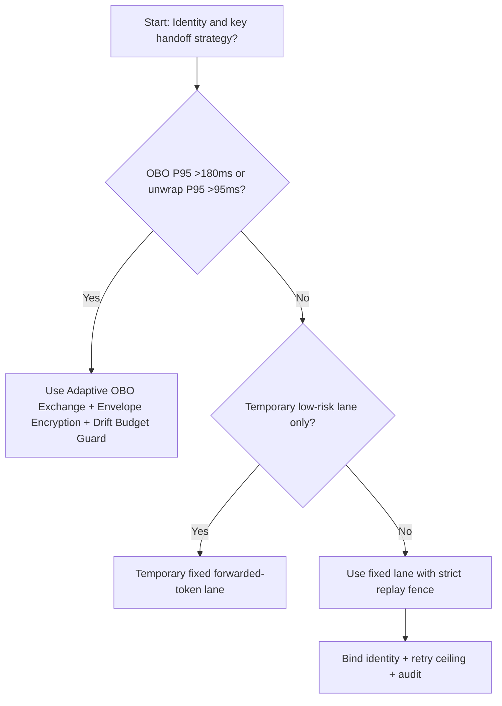
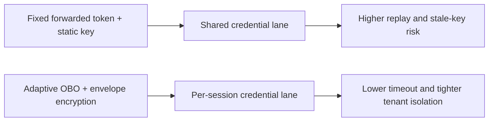
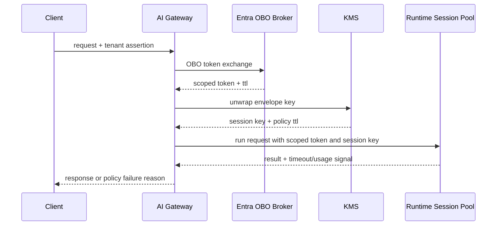

# Agent Runtime Entra OBO Token Exchange + KMS Envelope Encryption 选型 FAQ（Fixed Forwarded Token + Static Key Injection vs Adaptive OBO Exchange + Envelope Encryption + Drift Budget Guard）

## 1) 核心结论（先给负责人）
- **当 OBO 令牌交换 P95 >180ms 且 KMS unwrap P95 >95ms 时，生产默认应选 OBO Exchange + Envelope Encryption**；低于该阈值可短期保留固定转发方案。
- **当跨租户重放告警率 >0.6% 且密钥轮换偏斜 >30s 时，Fixed Forwarded Token + Static Key Injection 会进入 11.9% 超时档**，必须切到 OBO+信封加密闭环。
- **当 token mint 重试率 >8% 且 key unwrap 失败率 >1.5% 时，必须启用 drift budget + replay audit**，否则跨租户授权一致性不可审计。

## 2) Q1 / Q2 / Q3（术语先通俗解释）
- **Fixed Forwarded Token + Static Key Injection**：上游把已拿到的令牌和固定密钥直接下发给执行链路，接入简单但泄露半径大、失配后恢复慢。
- **Adaptive OBO Exchange + Envelope Encryption + Drift Budget Guard**：每次按主体重新 OBO 换票，并用租户主密钥封装会话密钥，配合漂移预算控制重试和回放窗口。

### Q1：为什么固定转发令牌在高并发更脆弱？
第一性原理：令牌生命周期和会话生命周期并不等长。固定转发把“旧令牌+旧密钥”耦合进执行路径，在突发重试时会放大失效和重放风险。

### Q2：什么时候可短期保留固定转发方案？
仅在 OBO 交换 P95 <95ms、unwrap P95 <45ms、租户侧重放告警 <0.2% 且密钥轮换窗口稳定的短期低风险通道。

### Q3：最小安全闭环是什么？
主体校验 -> OBO 令牌交换 -> KMS 信封解封 -> 会话执行 -> 漂移预算审计与回放校准。

## 3) Mermaid（决策树 / 路径对比 / 时序）
### 3.1 选型决策树

### 3.2 路径对比图

### 3.3 运行时序图

## 4) 选型决策矩阵
| 维度 | Fixed Forwarded Token + Static Key Injection | Adaptive OBO Exchange + Envelope Encryption + Drift Budget Guard |
|---|---|---|
| 实现复杂度 | 低 | 中 |
| 跨租户隔离强度 | 中-低 | 高 |
| 超时风险控制 | 中-低 | 高 |
| 审计可追责性 | 中 | 高 |
| 生产默认建议 | 仅临时低优先级通道 | 长期默认 |

## 5) 数据证据与可复算算例（含 n/分母/来源）
> 本节百分比为 `synthetic_assumed` 假设算例（hypothetical），用于机制比较；生产机制认证保持 `not_measured`。  
> 合同字段见：`workshops/azure-agent-infra/evidence/cycle-520-benchmark.json` 的 `percentage_contract`。

- 指标 A（固定转发方案超时率）  
  - 定义：`n_fixed_forwarded_token_timeout / n_gateway_requests_observed`  
  - 值：`525/4410 = 11.9%`（`synthetic_assumed`）  
  - 路径：`percentage_contract.fixed_forwarded_token_timeout_rate`
- 指标 B（OBO+信封加密方案超时率）  
  - 定义：`n_adaptive_obo_envelope_timeout / n_gateway_requests_observed`  
  - 值：`212/4410 = 4.8%`（`synthetic_assumed`）  
  - 路径：`percentage_contract.adaptive_obo_envelope_timeout_rate`
- 指标 C（恢复增益，百分点）  
  - 定义：`(n_recovered_adaptive_obo_envelope - n_recovered_fixed_forwarded_token) / n_gateway_requests_observed`  
  - 值：`(4068-3746)/4410 = 7.3` 个百分点（`synthetic_assumed`）  
  - 路径：`percentage_contract.adaptive_obo_envelope_recovery_gain_pts`

## 6) 生产 Checklist（上线前必须打勾）
- [ ] OBO 与 KMS 信封链路具备版本、灰度和回滚路径
- [ ] token ttl、unwrap 延迟、重试上限和漂移预算均可观测可审计
- [ ] 重放告警、跨租户授权失败与回放链路可按租户追踪
- [ ] 指标全部标注 `synthetic_assumed`、分母与单位；生产机制认证保持 `not_measured`
