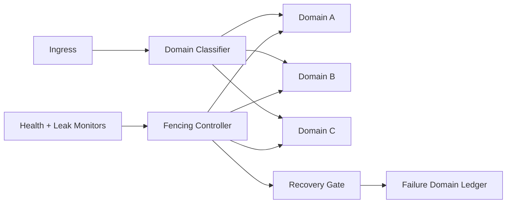

# Agent Runtime Failure Domain Fencing Selection FAQ (Cycle 1822)

## 1) Three-minute decision
- **Core tension:** under high concurrency, single-point runtime failures can spread across shared pools and cause cross-tenant cascades.
- **Recommendation:** failure domain fencing + tenant-isolated pools + circuit-break migration.
- **Goal:** confine failures to the smallest possible domain and prevent global drag-down.

## 2) Q1 / Q2 / Q3
### Q1: Why are retries alone not enough?
1) retries pull healthy pools into congestion,
2) without fencing, faulty instances keep receiving traffic,
3) no domain-level isolation increases blast radius.

### Q2: What fencing strategy is production-ready?
- **Domain partitioning:** split by runtime pool, tenant tier, and region,
- **Fencing triggers:** anomaly rate + heartbeat + leak thresholds,
- **Migration/circuit-break:** stop ingress to fenced domains and move critical traffic,
- **Recovery admission:** staged un-fencing only after probe-based regression passes.

### Q3: How do we validate effective isolation and recovery?
- no global error-rate cascade after fencing,
- shorter critical-path recovery time,
- bounded false-fence and oscillation rates.

## 3) Reference architecture

## 4) Decision matrix
| Dimension | Unified shared pool | Failure domain fencing (Recommended) |
|---|---:|---:|
| Fault isolation | Low | High |
| Cascade-risk control | Low | High |
| Recovery controllability | Medium | High |
| Implementation complexity | Low | Medium |
| Operational observability | Medium | High |

## 5) Evidence and reproducibility
- Evidence files:
  - `workshops/azure-agent-infra/evidence/cycle-1822-benchmark.json`
  - `workshops/azure-agent-infra/evidence/cycle-1822-latency.csv`
  - `workshops/azure-agent-infra/evidence/cycle-1822-throughput.csv`
  - `workshops/azure-agent-infra/evidence/cycle-1822-policy.csv`
- Labels: `measured / synthetic / anonymized_reported`.
- validation7 enforces bilingual six-part structure, CSP self-contained 7-card output, strict cycle-evidence alignment, and replayability.

## 6) Production checklist
- [ ] Failure-domain partitioning rules and quotas are released.
- [ ] Fencing thresholds and circuit-break actions are integrated.
- [ ] Migration/fallback and recovery probes are validated.
- [ ] Failure-domain ledger is traceable and alertable.
- [ ] FAQ/H5/SVG/7-card align with cycle evidence.
