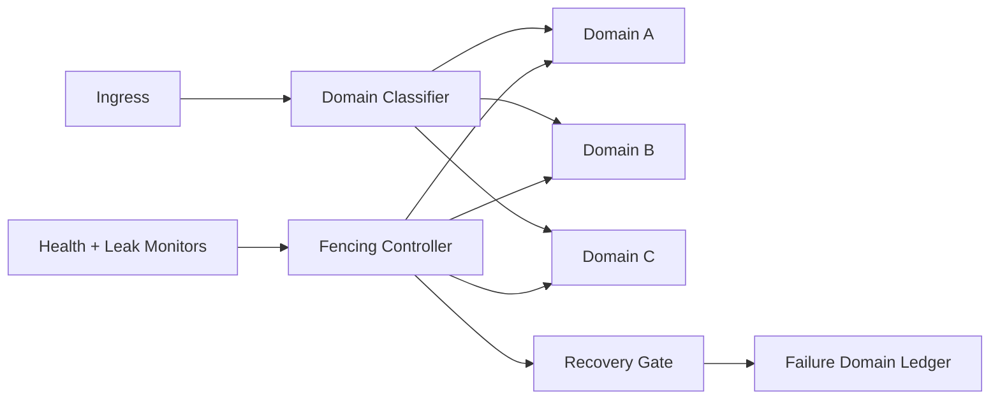

# Agent 运行时故障域围栏选型 FAQ（Cycle 1822）

## 1) 3 分钟结论
- **核心矛盾：** 高并发下单点故障会沿共享池快速扩散，导致跨租户级联失败。
- **推荐：** 运行时故障域围栏（Failure Domain Fencing）+ 租户隔离池 + 熔断迁移。
- **目标：** 把故障限制在最小域内，避免“一个坏实例拖垮全局”。

## 2) Q1 / Q2 / Q3
### Q1：为什么传统重试不足以止损？
1) 重试会把健康池也拖入拥塞；
2) 无围栏时故障实例持续接收流量；
3) 无域级隔离会放大 blast radius。

### Q2：可落地的故障域围栏策略是什么？
- **域切分**：按运行时池、租户等级、地域切分 failure domains；
- **围栏触发**：异常率、心跳、资源泄漏阈值联合判定；
- **迁移与熔断**：围栏域停止接入并将关键流量迁移到健康域；
- **恢复准入**：通过探针回归测试后分阶段解封。

### Q3：如何验证“隔离有效且可恢复”？
- 围栏触发后全局错误率不级联上升；
- 关键链路恢复时间下降；
- 被围栏域的误判率和反复抖动率可控。

## 3) 架构图

## 4) 选型矩阵
| 维度 | 统一共享池 | 故障域围栏（推荐） |
|---|---:|---:|
| 故障隔离能力 | 低 | 高 |
| 级联风险控制 | 低 | 高 |
| 恢复可控性 | 中 | 高 |
| 实施复杂度 | 低 | 中 |
| 运维可观测性 | 中 | 高 |

## 5) 证据与复算口径
- 证据文件：
  - `workshops/azure-agent-infra/evidence/cycle-1822-benchmark.json`
  - `workshops/azure-agent-infra/evidence/cycle-1822-latency.csv`
  - `workshops/azure-agent-infra/evidence/cycle-1822-throughput.csv`
  - `workshops/azure-agent-infra/evidence/cycle-1822-policy.csv`
- 标签：`measured / synthetic / anonymized_reported`。
- validation7：双语六段结构、7-card CSP 自包含、轮次与 evidence 一致、可回放链路通过。

## 6) 生产检查清单
- [ ] 故障域切分规则与配额已发布。
- [ ] 围栏触发阈值与熔断动作已联调。
- [ ] 迁移回切流程与回归探针已验证。
- [ ] 故障域账本可追溯并具备告警。
- [ ] FAQ/H5/SVG/7-card 与 evidence 轮次一致。
