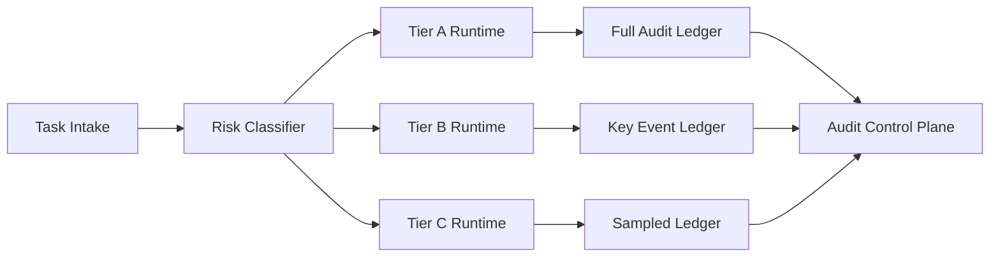

# Agent Runtime Isolation Tier Audit Selection FAQ (Cycle 1831)

## 1) Three-minute decision
- **Core tension:** higher runtime isolation increases security but also raises audit and operations cost.
- **Recommendation:** risk-tiered runtime isolation with matched audit depth.
- **Goal:** strong isolation and strong audit on critical paths while keeping low-risk paths cost-effective.

## 2) Q1 / Q2 / Q3
### Q1: Why is a single isolation tier unsustainable?
1) maximum isolation for all tasks is too expensive,
2) low-risk tasks do not need identical audit depth,
3) downgrading high-risk tasks creates compliance exposure.

### Q2: What production-ready tiering strategy should be used?
- **Tier A:** regulated and financial tasks, strong isolation plus full-chain audit,
- **Tier B:** core business tasks, medium-high isolation plus key-event audit,
- **Tier C:** standard workloads, baseline isolation plus sampled audit,
- **Gate rule:** risk labels decide tier at admission; runtime may escalate but not downgrade.

### Q3: How do we validate security-cost balance?
- reduced high-risk violation rate,
- per-session cost within budget,
- target audit trace-completeness achieved.

## 3) Reference architecture

## 4) Decision matrix
| Dimension | Single isolation policy | Tiered isolation audit (Recommended) |
|---|---:|---:|
| High-risk protection | Medium | High |
| Cost controllability | Low | High |
| Audit completeness | Medium | High |
| Implementation complexity | Low | Medium |
| Long-term scalability | Medium | High |

## 5) Evidence and reproducibility
- Evidence files:
  - `workshops/azure-agent-infra/evidence/cycle-1831-benchmark.json`
  - `workshops/azure-agent-infra/evidence/cycle-1831-latency.csv`
  - `workshops/azure-agent-infra/evidence/cycle-1831-throughput.csv`
  - `workshops/azure-agent-infra/evidence/cycle-1831-policy.csv`
- Labels: `measured / synthetic / anonymized_reported`.
- validation7 enforces bilingual six-part structure, CSP self-contained 7-card output, strict cycle-evidence alignment, and replayability.

## 6) Production checklist
- [ ] Isolation tiers and risk mappings are released.
- [ ] Audit depth and retention windows per tier are configured.
- [ ] Runtime escalation rules and alerts are integrated.
- [ ] Audit control-plane query/export paths are operational.
- [ ] FAQ/H5/SVG/7-card align with cycle evidence.
