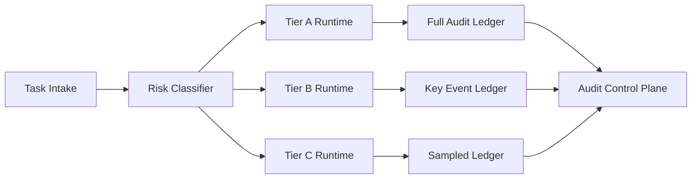

# Agent 运行时隔离等级审计选型 FAQ（Cycle 1831）

## 1) 3 分钟结论
- **核心矛盾：** 隔离等级越高越安全，但审计与运维成本也随之上升。
- **推荐：** 按业务风险分层隔离等级并绑定审计深度。
- **目标：** 在关键路径实现强隔离强审计，在低风险路径保持可接受成本。

## 2) Q1 / Q2 / Q3
### Q1：为什么单一隔离等级不可持续？
1) 所有任务都用最高隔离会显著拉高成本；
2) 低风险任务不需要同等审计粒度；
3) 高风险任务若被降级会带来合规暴露。

### Q2：可落地的隔离分级策略是什么？
- **Tier A**：金融与合规任务，强隔离+全链路审计；
- **Tier B**：业务核心任务，中强隔离+关键事件审计；
- **Tier C**：常规任务，标准隔离+采样审计；
- **门禁规则**：任务进入前由风险标签决定 tier，并在运行中可升级不可降级。

### Q3：如何验证“安全与成本平衡”？
- 高风险任务违规率下降；
- 单会话成本维持预算；
- 审计追溯完整率达到目标。

## 3) 架构图

## 4) 选型矩阵
| 维度 | 单一隔离策略 | 分级隔离审计（推荐） |
|---|---:|---:|
| 高风险防护 | 中 | 高 |
| 成本可控性 | 低 | 高 |
| 审计完整性 | 中 | 高 |
| 实施复杂度 | 低 | 中 |
| 长期可扩展性 | 中 | 高 |

## 5) 证据与复算口径
- 证据文件：
  - `workshops/azure-agent-infra/evidence/cycle-1831-benchmark.json`
  - `workshops/azure-agent-infra/evidence/cycle-1831-latency.csv`
  - `workshops/azure-agent-infra/evidence/cycle-1831-throughput.csv`
  - `workshops/azure-agent-infra/evidence/cycle-1831-policy.csv`
- 标签：`measured / synthetic / anonymized_reported`。
- validation7：双语六段结构、7-card CSP 自包含、轮次与 evidence 一致、可回放链路通过。

## 6) 生产检查清单
- [ ] 隔离等级与风险标签映射已发布。
- [ ] 各等级审计深度与保留周期已配置。
- [ ] 运行中升级规则与告警已联调。
- [ ] 审计控制面检索与导出可用。
- [ ] FAQ/H5/SVG/7-card 与 evidence 轮次一致。
