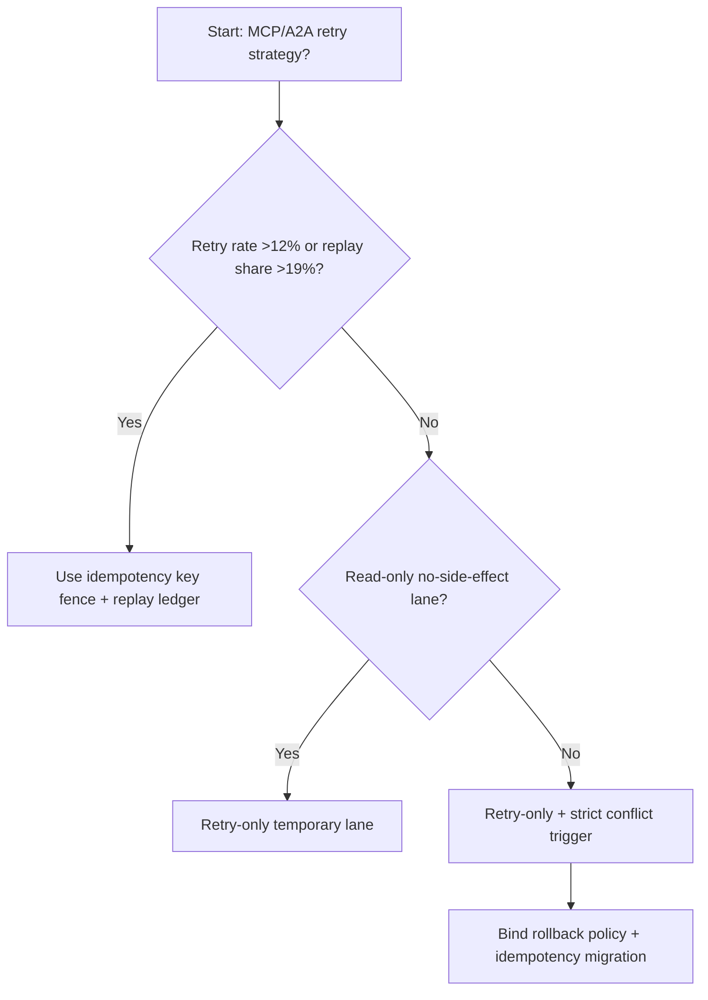
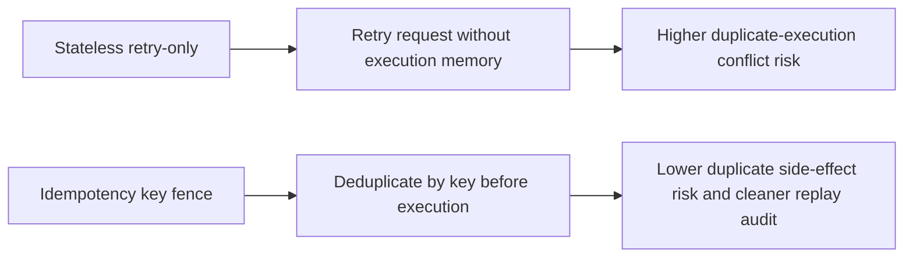
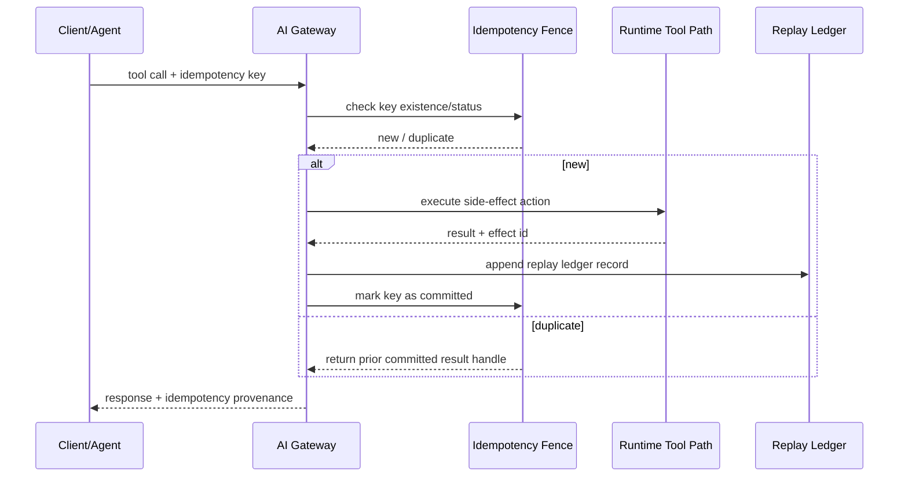

# Agent Runtime MCP/A2A Idempotency Key Fence Selection FAQ (Stateless Retry-only vs Idempotency Key Fence + Replay Ledger)

## 1) Core conclusions (for decision-makers first)
- **When MCP/A2A orchestration retry rate exceeds 12% and cross-region replay share exceeds 19%, default to Idempotency Key Fence + Replay Ledger**; retry-only paths amplify duplicate execution.
- **When duplicate-execution conflict exceeds 1.3% and compensation transaction P95 exceeds 280ms, stateless retry-only enters the 11.7% conflict band**, requiring idempotency fencing.
- **When workflows include side-effect writes (payments/tickets/compliance records), idempotency keys and replay ledgering are mandatory**, or cross-system consistency becomes non-auditable.

## 2) Q1 / Q2 / Q3 (plain-language definitions first)
- **Stateless Retry-only**: retries failed calls without remembering prior execution.
- **Idempotency Key Fence + Replay Ledger**: each request carries a unique key; fence lookup runs before execution and outcomes are ledgered for replay.

### Q1: Why is retry-only unsafe in A2A chains?
First principles: agent calls often cause side effects. Without idempotency fencing, retries can produce duplicate writes/payments/actions.

### Q2: When can retry-only still be temporarily acceptable?
Only on read-only tools with no side effects and no business-ledger impact.

### Q3: What is the minimum safe loop?
Ingress idempotency-key generation -> fence dedup check -> execution + commit writeback -> replay-ledger audit -> conflict alert/rollback.

## 3) Mermaid (decision tree / path comparison / sequence)
### 3.1 Selection decision tree

### 3.2 Path comparison

### 3.3 Runtime sequence

## 4) Decision matrix
| Dimension | Stateless Retry-only | Idempotency Key Fence + Replay Ledger |
|---|---|---|
| Implementation complexity | Low | Medium |
| Side-effect conflict control | Low | High |
| Replay auditability | Low | High |
| Cross-system consistency | Medium-Low | High |
| Default production fit | Read-only temporary lanes only | Long-term default |

## 5) Evidence contract + recomputable examples (n/denominator/source)
> Percentages in this section are `synthetic_assumed` hypothetical examples for mechanism comparison; production mechanism validation remains `not_measured`.  
> Contract fields: `workshops/azure-agent-infra/evidence/cycle-530-benchmark.json` -> `percentage_contract`.

- Metric A (retry-only conflict rate)  
  - Formula: `n_stateless_retry_conflict / n_gateway_requests_observed`  
  - Value: `517/4410 = 11.7%` (`synthetic_assumed`)  
  - Path: `percentage_contract.stateless_retry_conflict_rate`
- Metric B (idempotency-fence conflict rate)  
  - Formula: `n_idempotency_fence_conflict / n_gateway_requests_observed`  
  - Value: `203/4410 = 4.6%` (`synthetic_assumed`)  
  - Path: `percentage_contract.idempotency_fence_conflict_rate`
- Metric C (recovery gain, percentage points)  
  - Formula: `(n_recovered_idempotency_fence - n_recovered_stateless_retry) / n_gateway_requests_observed`  
  - Value: `(4078-3765)/4410 = 7.1 percentage points` (`synthetic_assumed`)  
  - Path: `percentage_contract.idempotency_fence_recovery_gain_pts`

## 6) Production checklist
- [ ] All side-effect tool calls carry idempotency keys with traceable provenance
- [ ] Fence state and replay ledger have cross-region consistency controls
- [ ] Retry conflict, compensation transaction, and duplicate-write metrics are observable/auditable
- [ ] All metrics are tagged `synthetic_assumed`; production validation remains `not_measured`
