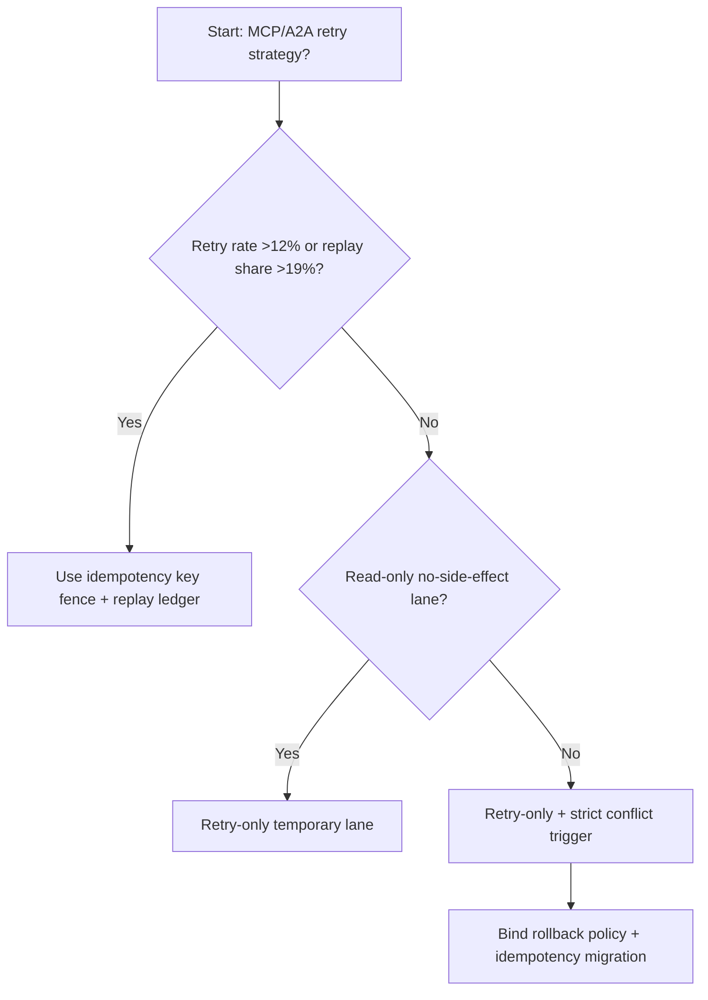
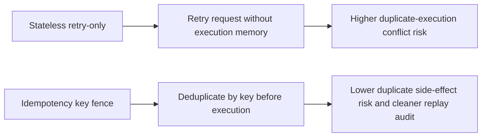
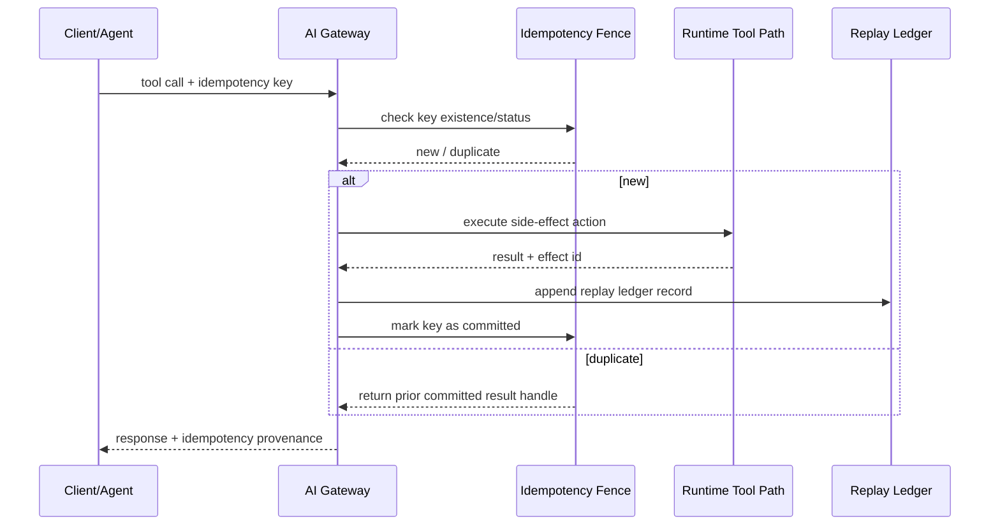

# Agent Runtime MCP/A2A Idempotency Key Fence 选型 FAQ（Stateless Retry-only vs Idempotency Key Fence + Replay Ledger）

## 1) 核心结论（先给负责人）
- **当 MCP/A2A 编排重试率 >12% 且跨区域回放请求占比 >19% 时，生产默认应选 Idempotency Key Fence + Replay Ledger**；仅重试策略会放大重复执行。
- **当工具调用重复执行冲突 >1.3% 且补偿事务 P95 >280ms 时，Stateless Retry-only 会进入 11.7% 冲突档**，需切换幂等围栏。
- **当支付/工单/合规模型包含副作用写操作时，必须引入幂等键和回放账本**，否则跨系统一致性不可审计。

## 2) Q1 / Q2 / Q3（术语先通俗解释）
- **Stateless Retry-only**：失败就重试，但不记录是否“已执行过”。
- **Idempotency Key Fence + Replay Ledger**：每次请求带唯一幂等键，先查围栏再执行，并写入回放账本。

### Q1：为什么只重试在 A2A 链路里不安全？
第一性原理：Agent 调用经常有副作用（写库、发消息、触发流程）。不做幂等围栏时，重试可能等价“重复扣款/重复执行”。

### Q2：什么时候还能临时用 Retry-only？
仅在纯只读工具、无副作用、短时压测链路里，且结果不进入正式业务账本。

### Q3：最小闭环是什么？
请求入站生成幂等键 -> 围栏查重 -> 执行与回写 -> 回放账本审计 -> 冲突告警与回退。

## 3) Mermaid（决策树 / 路径对比 / 时序）
### 3.1 选型决策树

### 3.2 路径对比图

### 3.3 运行时序图

## 4) 选型决策矩阵
| 维度 | Stateless Retry-only | Idempotency Key Fence + Replay Ledger |
|---|---|---|
| 实现复杂度 | 低 | 中 |
| 副作用冲突控制 | 低 | 高 |
| 回放可审计性 | 低 | 高 |
| 跨系统一致性 | 中-低 | 高 |
| 生产默认建议 | 仅只读临时链路 | 长期默认 |

## 5) 数据证据与可复算算例（含 n/分母/来源）
> 本节百分比为 `synthetic_assumed` 假设算例（hypothetical），用于机制比较；生产机制认证保持 `not_measured`。  
> 合同字段见：`workshops/azure-agent-infra/evidence/cycle-530-benchmark.json` 的 `percentage_contract`。

- 指标 A（Retry-only 冲突率）  
  - 定义：`n_stateless_retry_conflict / n_gateway_requests_observed`  
  - 值：`517/4410 = 11.7%`（`synthetic_assumed`）  
  - 路径：`percentage_contract.stateless_retry_conflict_rate`
- 指标 B（Idempotency Fence 冲突率）  
  - 定义：`n_idempotency_fence_conflict / n_gateway_requests_observed`  
  - 值：`203/4410 = 4.6%`（`synthetic_assumed`）  
  - 路径：`percentage_contract.idempotency_fence_conflict_rate`
- 指标 C（恢复增益，百分点）  
  - 定义：`(n_recovered_idempotency_fence - n_recovered_stateless_retry) / n_gateway_requests_observed`  
  - 值：`(4078-3765)/4410 = 7.1` 个百分点（`synthetic_assumed`）  
  - 路径：`percentage_contract.idempotency_fence_recovery_gain_pts`

## 6) 生产 Checklist（上线前必须打勾）
- [ ] 所有副作用工具调用都带幂等键并可追踪来源
- [ ] 幂等围栏状态与回放账本具备跨区一致性策略
- [ ] 重试冲突、补偿事务、重复写入可观测并可审计
- [ ] 指标全部标注 `synthetic_assumed`，生产机制认证保持 `not_measured`
