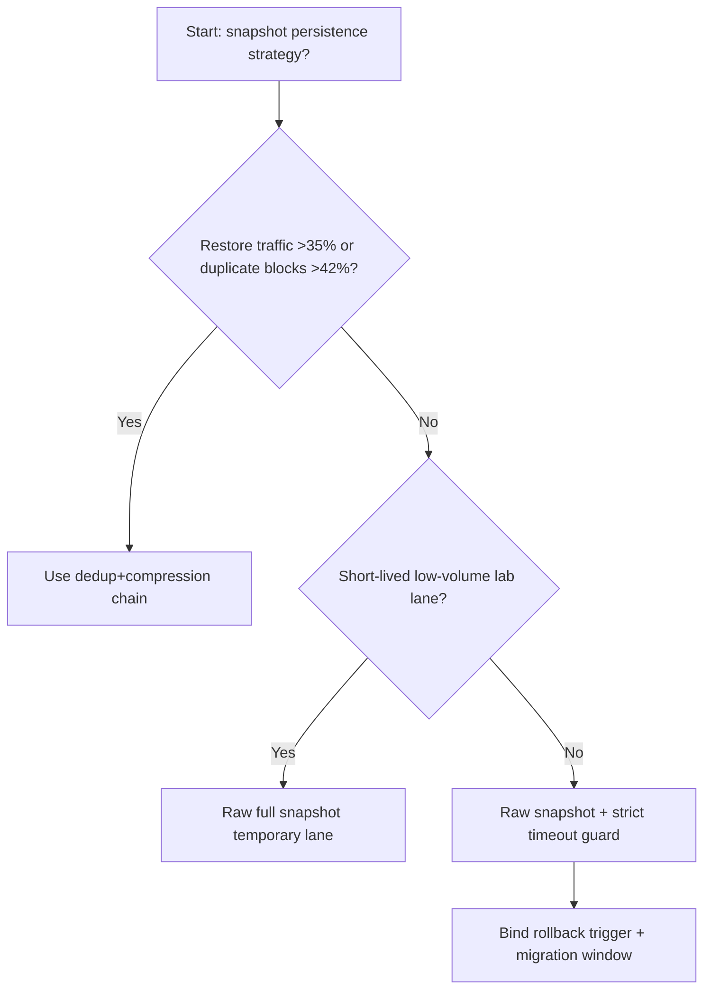
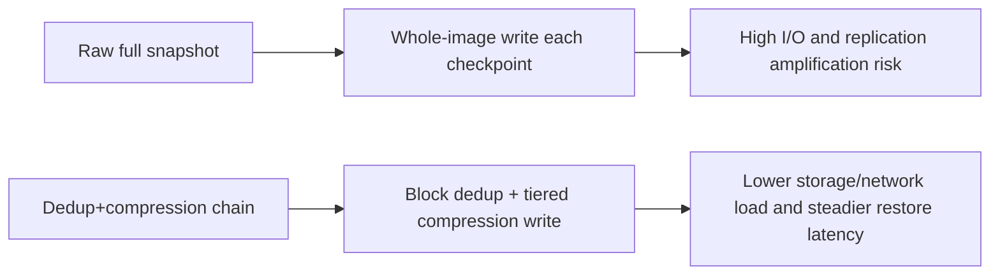
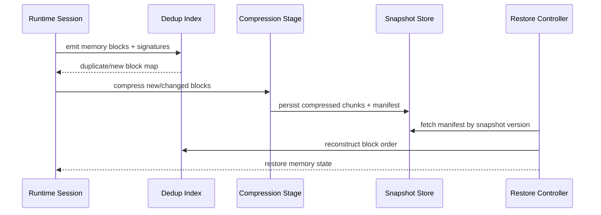

# Agent Runtime Memory Snapshot Dedup Compression Selection FAQ (Raw Full Snapshot vs Dedup+Compression Chain)

## 1) Core conclusions (for decision-makers first)
- **When restore-traffic share exceeds 35% and per-node memory snapshot volume exceeds 320GB/hour, default to a Dedup+Compression Chain**; raw full snapshots quickly amplify I/O pressure.
- **When restore-read P95 exceeds 240ms and duplicate-block ratio exceeds 42%, raw full snapshots enter the 11.1% restore-timeout band**, requiring dedup/compression migration.
- **When cross-AZ replication cost exceeds 18% and snapshot persistence windows exceed 45 minutes, tiered compression plus hot/cold snapshot stratification becomes mandatory**, or TCO drifts out of control.

## 2) Q1 / Q2 / Q3 (plain-language definitions first)
- **Raw Full Snapshot**: every checkpoint writes a full memory image; simple, but expensive under concurrency.
- **Dedup+Compression Chain**: block-level dedup first, tiered compression second, then indexed restore assembly.

### Q1: Why do raw full snapshots destabilize under concurrent restore load?
First principles: restore bottlenecks are dominated by I/O and replication bandwidth, not just CPU. Whole-image writes magnify contention.

### Q2: When is raw mode still acceptable?
Only for low-concurrency, short-session, single-region lab environments with small snapshot footprints.

### Q3: What is the minimum safe loop?
Block signatures -> dedup index -> compressed persistence -> versioned restore manifest -> latency/cost regression monitoring.

## 3) Mermaid (decision tree / path comparison / sequence)
### 3.1 Selection decision tree

### 3.2 Path comparison

### 3.3 Runtime sequence

## 4) Decision matrix
| Dimension | Raw Full Snapshot | Dedup+Compression Chain |
|---|---|---|
| Implementation complexity | Low | Medium |
| Restore stability | Medium-Low | High |
| I/O cost control | Low | High |
| Cross-AZ replication efficiency | Low | High |
| Default production fit | Low-volume temporary only | Long-term default |

## 5) Evidence contract + recomputable examples (n/denominator/source)
> Percentages in this section are `synthetic_assumed` hypothetical examples for mechanism comparison; production mechanism validation remains `not_measured`.  
> Contract fields: `workshops/azure-agent-infra/evidence/cycle-528-benchmark.json` -> `percentage_contract`.

- Metric A (raw-mode restore-timeout rate)  
  - Formula: `n_raw_snapshot_restore_timeout / n_gateway_requests_observed`  
  - Value: `489/4410 = 11.1%` (`synthetic_assumed`)  
  - Path: `percentage_contract.raw_snapshot_restore_timeout_rate`
- Metric B (dedup+compression restore-timeout rate)  
  - Formula: `n_dedup_compression_restore_timeout / n_gateway_requests_observed`  
  - Value: `185/4410 = 4.2%` (`synthetic_assumed`)  
  - Path: `percentage_contract.dedup_compression_restore_timeout_rate`
- Metric C (recovery gain, percentage points)  
  - Formula: `(n_recovered_dedup_chain - n_recovered_raw_snapshot) / n_gateway_requests_observed`  
  - Value: `(4088-3781)/4410 = 7.0 percentage points` (`synthetic_assumed`)  
  - Path: `percentage_contract.dedup_compression_recovery_gain_pts`

## 6) Production checklist
- [ ] Snapshot block-signature + dedup index support versioned replay
- [ ] Compression and restore chains are tenant/region auditable
- [ ] Restore timeout, replication bandwidth, and storage cost are tier-monitored
- [ ] All metrics are tagged `synthetic_assumed`; production validation remains `not_measured`
