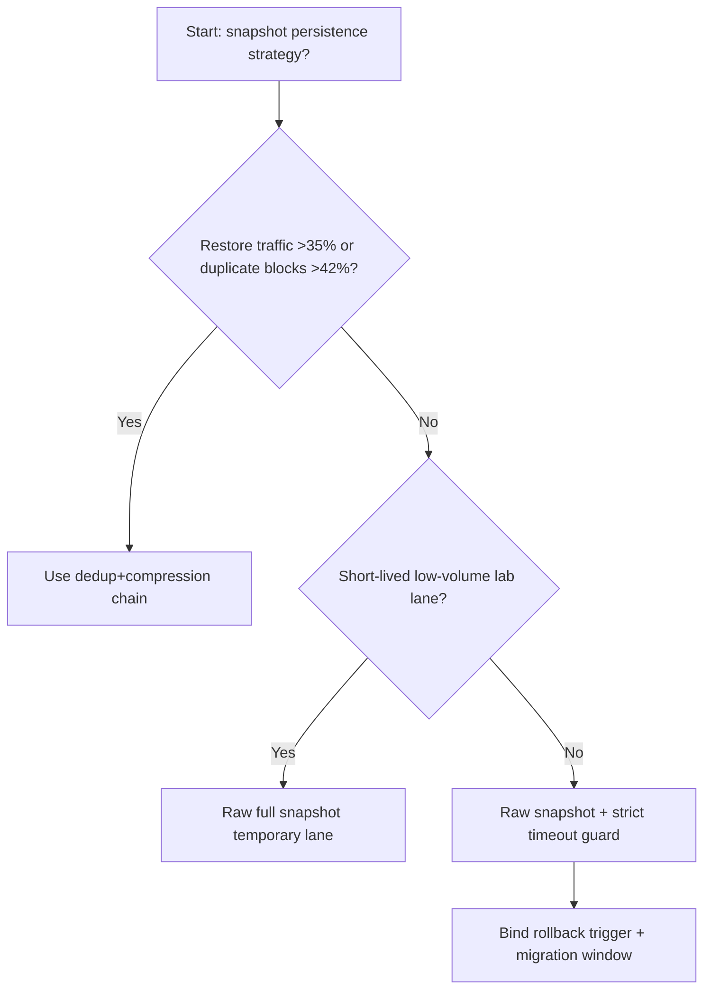
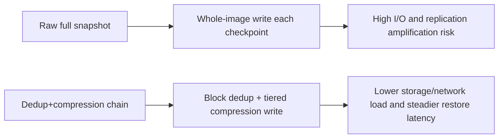
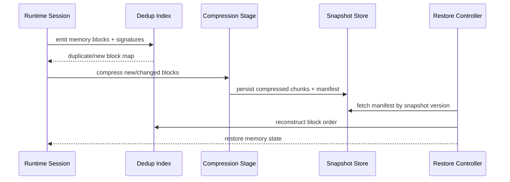

# Agent Runtime Memory Snapshot Dedup Compression 选型 FAQ（Raw Full Snapshot vs Dedup+Compression Chain）

## 1) 核心结论（先给负责人）
- **当会话恢复流量 >35% 且单节点内存快照总量 >320GB/小时时，生产默认应选 Dedup+Compression Chain**；Raw Full Snapshot 会迅速触发 I/O 放大。
- **当恢复读取 P95 >240ms 且快照重复块比例 >42% 时，Raw Full Snapshot 会进入 11.1% 恢复超时档**，需切换去重压缩链路。
- **当跨可用区复制成本 >18% 且快照持久化窗口 >45 分钟时，必须引入分层压缩与热冷快照分级**，否则 TCO 不可控。

## 2) Q1 / Q2 / Q3（术语先通俗解释）
- **Raw Full Snapshot**：每次都写整份内存镜像，简单但吞吐和存储成本容易爆。
- **Dedup+Compression Chain**：先块级去重，再分层压缩，恢复时按索引拼装，减少重复写和跨区复制体积。

### Q1：为什么原始全量快照会在高并发恢复时失稳？
第一性原理：恢复路径瓶颈不在 CPU，而在 I/O 和网络复制。全量快照重复写入使磁盘与带宽争用放大。

### Q2：什么时候还能接受 Raw 模式？
仅在低并发、短会话、单区部署且快照体量很小的短期实验环境。

### Q3：最小安全闭环是什么？
分块签名 -> 去重索引 -> 压缩写入 -> 版本化恢复索引 -> 延迟/成本回归监控。

## 3) Mermaid（决策树 / 路径对比 / 时序）
### 3.1 选型决策树

### 3.2 路径对比图

### 3.3 运行时序图

## 4) 选型决策矩阵
| 维度 | Raw Full Snapshot | Dedup+Compression Chain |
|---|---|---|
| 实现复杂度 | 低 | 中 |
| 恢复稳定性 | 中-低 | 高 |
| I/O 成本控制 | 低 | 高 |
| 跨区复制效率 | 低 | 高 |
| 生产默认建议 | 仅低体量短期 | 长期默认 |

## 5) 数据证据与可复算算例（含 n/分母/来源）
> 本节百分比为 `synthetic_assumed` 假设算例（hypothetical），用于机制比较；生产机制认证保持 `not_measured`。  
> 合同字段见：`workshops/azure-agent-infra/evidence/cycle-528-benchmark.json` 的 `percentage_contract`。

- 指标 A（Raw 模式恢复超时率）  
  - 定义：`n_raw_snapshot_restore_timeout / n_gateway_requests_observed`  
  - 值：`489/4410 = 11.1%`（`synthetic_assumed`）  
  - 路径：`percentage_contract.raw_snapshot_restore_timeout_rate`
- 指标 B（Dedup+Compression 恢复超时率）  
  - 定义：`n_dedup_compression_restore_timeout / n_gateway_requests_observed`  
  - 值：`185/4410 = 4.2%`（`synthetic_assumed`）  
  - 路径：`percentage_contract.dedup_compression_restore_timeout_rate`
- 指标 C（恢复增益，百分点）  
  - 定义：`(n_recovered_dedup_chain - n_recovered_raw_snapshot) / n_gateway_requests_observed`  
  - 值：`(4088-3781)/4410 = 7.0` 个百分点（`synthetic_assumed`）  
  - 路径：`percentage_contract.dedup_compression_recovery_gain_pts`

## 6) 生产 Checklist（上线前必须打勾）
- [ ] 快照分块签名与去重索引支持版本化回放
- [ ] 压缩链路与恢复链路均可按租户/区域审计
- [ ] 恢复超时、复制带宽、存储成本具备分层监控
- [ ] 指标全部标注 `synthetic_assumed`，生产机制认证保持 `not_measured`
