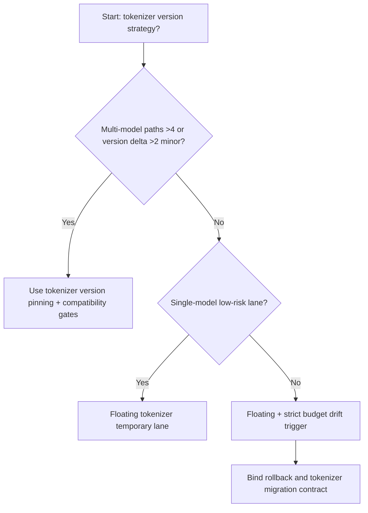
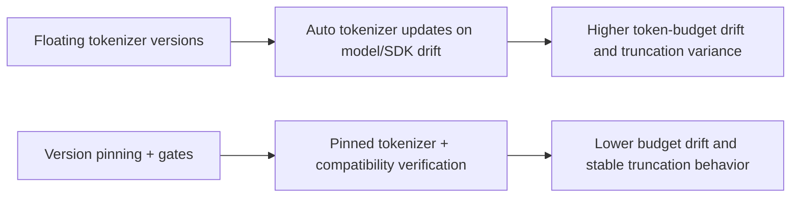
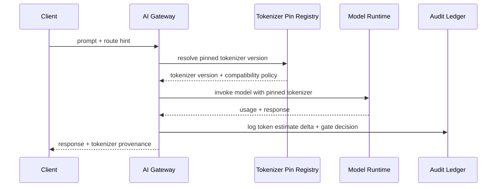

# Agent Runtime Multi-Model Tokenizer Version Pinning Selection FAQ (Floating Tokenizer Versions vs Version Pinning + Compatibility Gates)

## 1) Core conclusions (for decision-makers first)
- **When model-routing paths exceed 4 and tokenizer-version delta exceeds 2 minor versions, default to Version Pinning + Compatibility Gates**; floating versions amplify token-budget drift.
- **When prompt-length estimation error exceeds 6% and truncation fallback P95 exceeds 240ms, floating tokenizer versions enter the 12.1% overrun band**, requiring version pinning.
- **When tool-call chains depend on stable token boundaries (function args, JSON schema), tokenizer pinning and migration gates are mandatory**, or request chunking becomes unstable.

## 2) Q1 / Q2 / Q3 (plain-language definitions first)
- **Floating Tokenizer Versions**: tokenizer version follows automatic model/SDK upgrades.
- **Version Pinning + Compatibility Gates**: tokenizer version is explicitly pinned; upgrades require compatibility gate approval.

### Q1: Why do tokenizer version deltas affect production stability?
First principles: tokenizer defines segmentation for metering and truncation. Version changes alter token counts, budget behavior, and parameter boundary positions.

### Q2: When can floating versions still be acceptable temporarily?
Only in single-model, low-concurrency experiments without strict budget controls.

### Q3: What is the minimum safe loop?
Route-to-tokenizer binding -> budget estimation -> compatibility gate validation -> canary migration -> regression audit.

## 3) Mermaid (decision tree / path comparison / sequence)
### 3.1 Selection decision tree

### 3.2 Path comparison

### 3.3 Runtime sequence

## 4) Decision matrix
| Dimension | Floating Tokenizer Versions | Version Pinning + Compatibility Gates |
|---|---|---|
| Implementation complexity | Low | Medium |
| Token-budget stability | Low-Medium | High |
| Truncation consistency | Low | High |
| Multi-model controllability | Medium-Low | High |
| Default production fit | Experimental short-term only | Long-term default |

## 5) Evidence contract + recomputable examples (n/denominator/source)
> Percentages in this section are `synthetic_assumed` hypothetical examples for mechanism comparison; production mechanism validation remains `not_measured`.  
> Contract fields: `workshops/azure-agent-infra/evidence/cycle-532-benchmark.json` -> `percentage_contract`.

- Metric A (floating-version overrun rate)  
  - Formula: `n_floating_tokenizer_budget_overrun / n_gateway_requests_observed`  
  - Value: `534/4410 = 12.1%` (`synthetic_assumed`)  
  - Path: `percentage_contract.floating_tokenizer_budget_overrun_rate`
- Metric B (pinned-version overrun rate)  
  - Formula: `n_pinned_tokenizer_budget_overrun / n_gateway_requests_observed`  
  - Value: `216/4410 = 4.9%` (`synthetic_assumed`)  
  - Path: `percentage_contract.pinned_tokenizer_budget_overrun_rate`
- Metric C (recovery gain, percentage points)  
  - Formula: `(n_recovered_pinned_tokenizer - n_recovered_floating_tokenizer) / n_gateway_requests_observed`  
  - Value: `(4058-3728)/4410 = 7.5 percentage points` (`synthetic_assumed`)  
  - Path: `percentage_contract.pinned_tokenizer_recovery_gain_pts`

## 6) Production checklist
- [ ] Every model route has explicit tokenizer version + compatibility gate policy
- [ ] Budget-estimation error, truncation drift, and version migration are observable and auditable
- [ ] Upgrade flow supports canary rollout, rollback, and tenant-tier promotion
- [ ] All metrics are tagged `synthetic_assumed`; production validation remains `not_measured`
