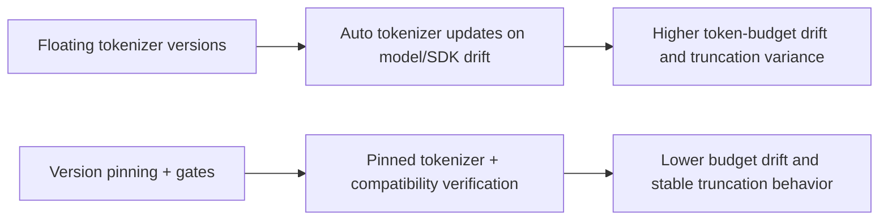
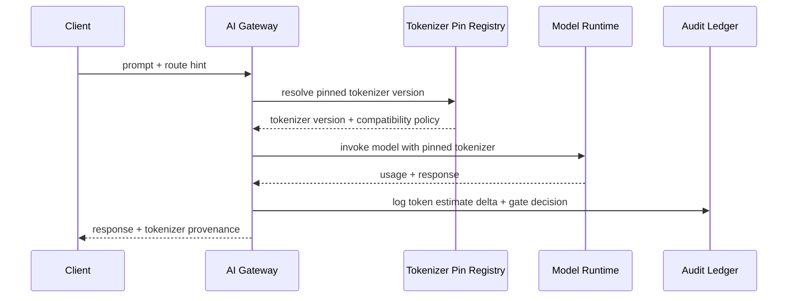

# Agent Runtime Multi-Model Tokenizer Version Pinning 选型 FAQ（Floating Tokenizer Versions vs Version Pinning + Compatibility Gates）

## 1) 核心结论（先给负责人）
- **当多模型路由路径 >4 条且 tokenizer 版本差异 >2 个小版本时，生产默认应选 Version Pinning + Compatibility Gates**；浮动版本会放大 token 预算漂移。
- **当提示长度估算误差 >6% 且截断回退 P95 >240ms 时，Floating Tokenizer 会进入 12.1% 超额档**，需切换版本锁定。
- **当工具调用链依赖固定 token 边界（函数参数、JSON schema）时，必须启用 tokenizer 版本锁定与迁移闸门**，否则请求分片结果不稳定。

## 2) Q1 / Q2 / Q3（术语先通俗解释）
- **Floating Tokenizer Versions**：随模型或 SDK 自动升级 tokenizer 版本。
- **Version Pinning + Compatibility Gates**：明确绑定 tokenizer 版本，升级先过兼容性闸门再放量。

### Q1：为什么 tokenizer 版本差异会影响生产稳定？
第一性原理：tokenizer 决定“如何切词计费和截断”。版本变化会改变 token 计数，进而影响预算、截断位置和工具参数边界。

### Q2：什么时候还能短时用浮动版本？
仅在单模型、低并发、无严格预算约束的实验环境。

### Q3：最小闭环是什么？
请求路由绑定 tokenizer 版本 -> 预算估算 -> 兼容闸门验证 -> 灰度迁移 -> 回归审计。

## 3) Mermaid（决策树 / 路径对比 / 时序）
### 3.1 选型决策树

```mermaid
flowchart TD
  A[Start: tokenizer version strategy?] --> B{Multi-model paths >4 or version delta >2 minor?}
  B -- Yes --> C[Use tokenizer version pinning + compatibility gates]
  B -- No --> D{Single-model low-risk lane?}
  D -- Yes --> E[Floating tokenizer temporary lane]
  D -- No --> F[Floating + strict budget drift trigger]
  F --> G[Bind rollback and tokenizer migration contract]
```

### 3.2 路径对比图

### 3.3 运行时序图

## 4) 选型决策矩阵
| 维度 | Floating Tokenizer Versions | Version Pinning + Compatibility Gates |
|---|---|---|
| 实现复杂度 | 低 | 中 |
| token 预算稳定性 | 低-中 | 高 |
| 截断行为一致性 | 低 | 高 |
| 多模型可控性 | 中-低 | 高 |
| 生产默认建议 | 仅实验短期 | 长期默认 |

## 5) 数据证据与可复算算例（含 n/分母/来源）
> 本节百分比为 `synthetic_assumed` 假设算例（hypothetical），用于机制比较；生产机制认证保持 `not_measured`。  
> 合同字段见：`workshops/azure-agent-infra/evidence/cycle-532-benchmark.json` 的 `percentage_contract`。

- 指标 A（浮动版本超额率）  
  - 定义：`n_floating_tokenizer_budget_overrun / n_gateway_requests_observed`  
  - 值：`534/4410 = 12.1%`（`synthetic_assumed`）  
  - 路径：`percentage_contract.floating_tokenizer_budget_overrun_rate`
- 指标 B（版本锁定超额率）  
  - 定义：`n_pinned_tokenizer_budget_overrun / n_gateway_requests_observed`  
  - 值：`216/4410 = 4.9%`（`synthetic_assumed`）  
  - 路径：`percentage_contract.pinned_tokenizer_budget_overrun_rate`
- 指标 C（恢复增益，百分点）  
  - 定义：`(n_recovered_pinned_tokenizer - n_recovered_floating_tokenizer) / n_gateway_requests_observed`  
  - 值：`(4058-3728)/4410 = 7.5` 个百分点（`synthetic_assumed`）  
  - 路径：`percentage_contract.pinned_tokenizer_recovery_gain_pts`

## 6) 生产 Checklist（上线前必须打勾）
- [ ] 每条模型路由都有明确 tokenizer 版本与兼容闸门策略
- [ ] 预算估算误差、截断差异、版本迁移均可观测可审计
- [ ] 升级流程具备灰度、回退与租户分级放量能力
- [ ] 指标全部标注 `synthetic_assumed`，生产机制认证保持 `not_measured`
