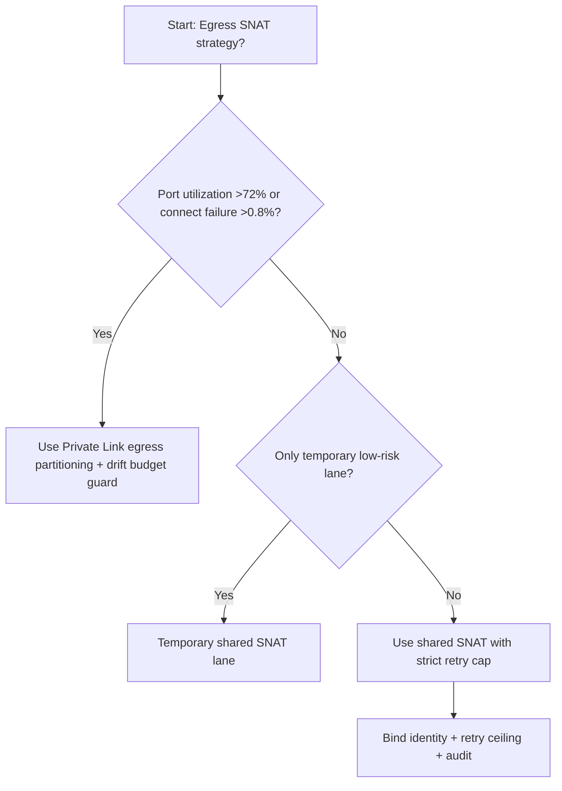
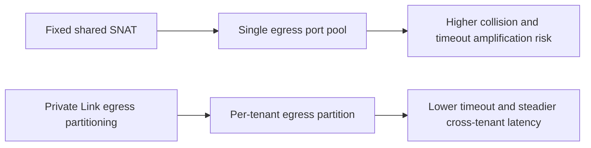
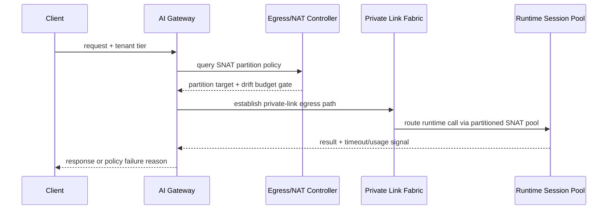

# Agent Runtime Private Link SNAT Port Exhaustion Selection FAQ (Fixed Shared Egress SNAT vs Adaptive Private Link Egress Partitioning + Drift Budget Guard)

## 1) Core conclusions (for decision-makers first)
- **When SNAT port utilization exceeds 72% and outbound connect failure exceeds 0.8%, default to Private Link + egress partitioning + NAT budget governance**; below this boundary, shared egress can remain temporary.
- **When port-reclaim lag exceeds 45s and retry-storm amplification exceeds 1.6x, fixed shared egress SNAT enters the 10.8% timeout band**, so partitioned egress becomes mandatory.
- **When cross-tenant egress jitter exceeds 120ms and reconnect failure exceeds 1.2%, enforce drift-budget + replay audit**, or link-stability incidents cannot be reconstructed.

## 2) Q1 / Q2 / Q3 (plain-language definitions first)
- **Fixed Shared Egress SNAT**: all tenants share one outbound port pool; easiest to run, but fragile under burst contention.
- **Adaptive Private Link Egress Partitioning + Drift Budget Guard**: split outbound lanes by tenant/session and enforce SNAT budget, reclaim cadence, and retry drift budgets.

### Q1: Why does shared SNAT destabilize at peak load?
First principles: SNAT ports are finite. Burst concurrency can desynchronize allocation and reclaim cadence, which amplifies queueing and retry-driven tail latency.

### Q2: When is shared SNAT still acceptable?
Only when utilization stays <55%, reclaim lag stays <20s, and connect-failure rate stays <0.3% in temporary low-risk lanes.

### Q3: What is the minimum safe control loop?
Traffic classification -> egress partition routing -> SNAT budget gate -> timeout/failure audit -> threshold recalibration.

## 3) Mermaid (decision tree / path comparison / sequence)
### 3.1 Selection decision tree

### 3.2 Path comparison

### 3.3 Runtime sequence

## 4) Decision matrix
| Dimension | Fixed Shared Egress SNAT | Adaptive Private Link Egress Partitioning + Drift Budget Guard |
|---|---|---|
| Implementation complexity | Low | Medium |
| Port-collision resilience | Medium-Low | High |
| Timeout risk control | Medium-Low | High |
| Multi-tenant stability | Medium | High |
| Default production fit | Temporary low-priority lane only | Long-term default |

## 5) Evidence contract + recomputable examples (n/denominator/source)
> Percentages in this section are `synthetic_assumed` hypothetical examples for mechanism comparison; production mechanism validation remains `not_measured`.  
> Contract fields: `workshops/azure-agent-infra/evidence/cycle-521-benchmark.json` -> `percentage_contract`.

- Metric A (shared-SNAT timeout rate)  
  - Formula: `n_fixed_shared_snat_timeout / n_gateway_requests_observed`  
  - Value: `476/4410 = 10.8%` (`synthetic_assumed`)  
  - Path: `percentage_contract.fixed_shared_snat_timeout_rate`
- Metric B (partitioned egress timeout rate)  
  - Formula: `n_adaptive_private_link_partition_timeout / n_gateway_requests_observed`  
  - Value: `203/4410 = 4.6%` (`synthetic_assumed`)  
  - Path: `percentage_contract.adaptive_private_link_partition_timeout_rate`
- Metric C (recovery gain, percentage points)  
  - Formula: `(n_recovered_adaptive_private_link_partition - n_recovered_fixed_shared_snat) / n_gateway_requests_observed`  
  - Value: `(4082-3761)/4410 = 7.3 percentage points` (`synthetic_assumed`)  
  - Path: `percentage_contract.adaptive_private_link_partition_recovery_gain_pts`

## 6) Production checklist
- [ ] Egress partition policy, NAT budget gates, and rollback paths are fully drillable
- [ ] SNAT utilization, reclaim lag, retry ceilings, and drift budgets are observable and auditable
- [ ] Collision events, timeout chains, and replay traces are tenant-traceable
- [ ] All metrics are tagged `synthetic_assumed` with denominator/unit; production validation remains `not_measured`
