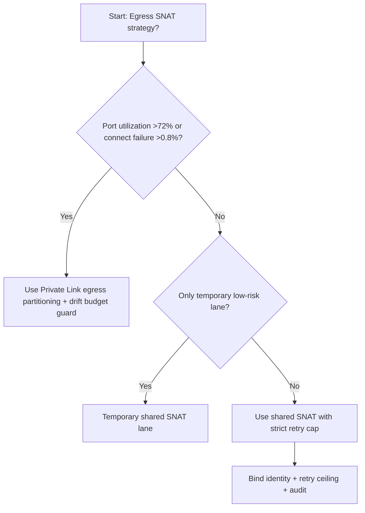
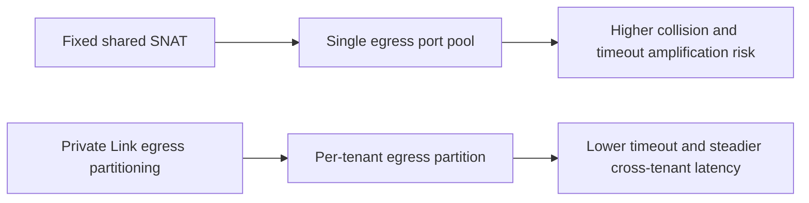
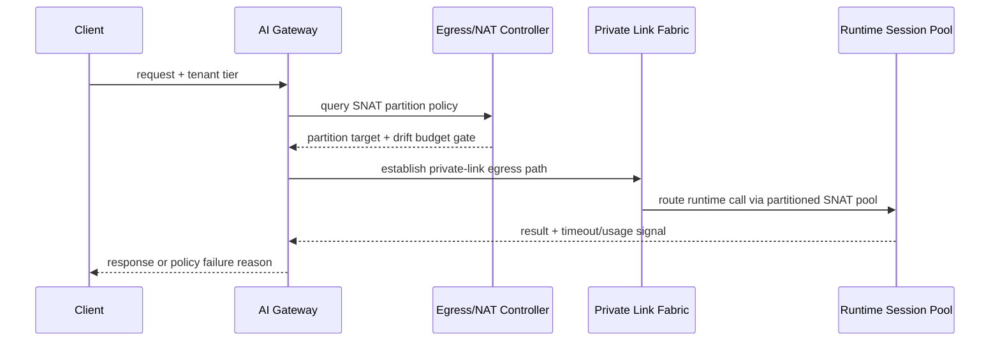

# Agent Runtime Private Link SNAT Port Exhaustion 选型 FAQ（Fixed Shared Egress SNAT vs Adaptive Private Link Egress Partitioning + Drift Budget Guard）

## 1) 核心结论（先给负责人）
- **当 SNAT 端口占用率 >72% 且 outbound connect failure >0.8% 时，生产默认应选 Private Link + Egress Partitioning + NAT 分层治理**；低于该阈值可短期保留共享出口。
- **当端口回收滞后 >45s 且重试风暴放大系数 >1.6× 时，Fixed Shared Egress SNAT 会进入 10.8% 超时档**，必须切换分区出口策略。
- **当跨租户 egress 抖动 >120ms 且连接重建失败率 >1.2% 时，必须启用 drift budget + replay audit**，否则链路稳定性无法复盘。

## 2) Q1 / Q2 / Q3（术语先通俗解释）
- **Fixed Shared Egress SNAT**：所有租户共享一组出口端口，配置最简单，但高峰期易端口争抢和连锁超时。
- **Adaptive Private Link Egress Partitioning + Drift Budget Guard**：按租户/会话拆分出口分区，配合 NAT 端口预算、回收节拍和漂移预算约束。

### Q1：为什么共享 SNAT 在并发高峰容易失稳？
第一性原理：SNAT 端口是有限池。并发连接暴涨时，端口分配与回收节奏失配会触发排队重试，尾延迟被持续放大。

### Q2：什么时候还能短期使用共享 SNAT？
仅在端口占用率 <55%、端口回收滞后 <20s、连接失败率 <0.3% 的短时低风险流量下可临时使用。

### Q3：最小安全闭环是什么？
流量分级 -> 出口分区路由 -> SNAT 预算门禁 -> 超时/失败审计 -> 阈值回归校准。

## 3) Mermaid（决策树 / 路径对比 / 时序）
### 3.1 选型决策树

### 3.2 路径对比图

### 3.3 运行时序图

## 4) 选型决策矩阵
| 维度 | Fixed Shared Egress SNAT | Adaptive Private Link Egress Partitioning + Drift Budget Guard |
|---|---|---|
| 实现复杂度 | 低 | 中 |
| 端口冲突抗压能力 | 中-低 | 高 |
| 超时风险控制 | 中-低 | 高 |
| 多租户稳定性 | 中 | 高 |
| 生产默认建议 | 仅临时低优先级通道 | 长期默认 |

## 5) 数据证据与可复算算例（含 n/分母/来源）
> 本节百分比为 `synthetic_assumed` 假设算例（hypothetical），用于机制比较；生产机制认证保持 `not_measured`。  
> 合同字段见：`workshops/azure-agent-infra/evidence/cycle-521-benchmark.json` 的 `percentage_contract`。

- 指标 A（共享 SNAT 超时率）  
  - 定义：`n_fixed_shared_snat_timeout / n_gateway_requests_observed`  
  - 值：`476/4410 = 10.8%`（`synthetic_assumed`）  
  - 路径：`percentage_contract.fixed_shared_snat_timeout_rate`
- 指标 B（分区出口方案超时率）  
  - 定义：`n_adaptive_private_link_partition_timeout / n_gateway_requests_observed`  
  - 值：`203/4410 = 4.6%`（`synthetic_assumed`）  
  - 路径：`percentage_contract.adaptive_private_link_partition_timeout_rate`
- 指标 C（恢复增益，百分点）  
  - 定义：`(n_recovered_adaptive_private_link_partition - n_recovered_fixed_shared_snat) / n_gateway_requests_observed`  
  - 值：`(4082-3761)/4410 = 7.3` 个百分点（`synthetic_assumed`）  
  - 路径：`percentage_contract.adaptive_private_link_partition_recovery_gain_pts`

## 6) 生产 Checklist（上线前必须打勾）
- [ ] 出口分区策略、NAT 预算门禁和回滚路径完整可演练
- [ ] SNAT 端口占用、回收滞后、重试上限和漂移预算均可观测可审计
- [ ] 冲突事件、超时链路与回放审计可按租户追踪
- [ ] 指标全部标注 `synthetic_assumed`、分母与单位；生产机制认证保持 `not_measured`
