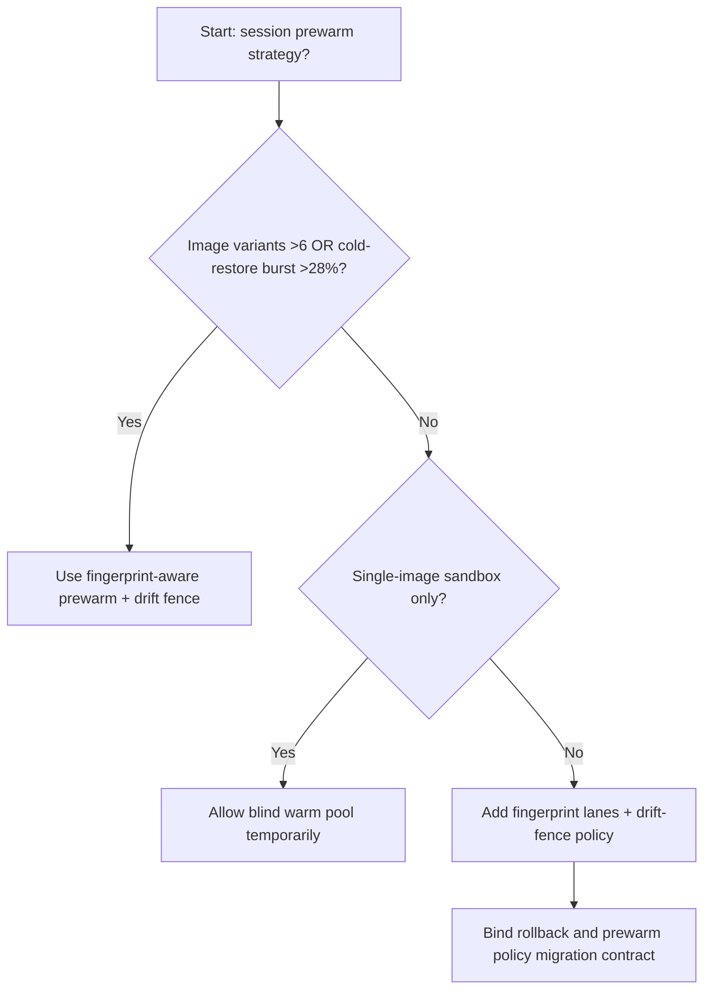
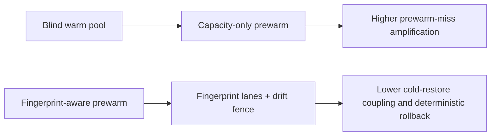
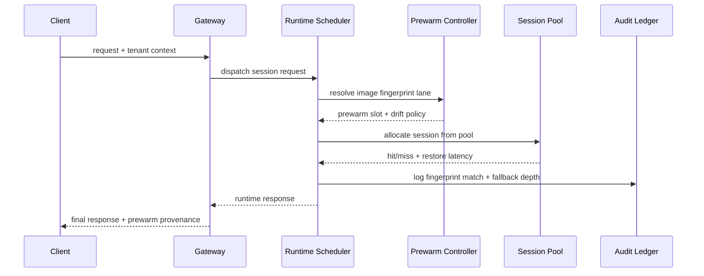

# Agent Runtime Session Image Prewarm Fingerprint Selection FAQ (Blind Warm Pool vs Fingerprint-Aware Prewarm + Drift Fence)

## 1) Core conclusions (for decision-makers first)
- **When image variants exceed 6 and cold-restore burst share is >28%, production should default to Fingerprint-Aware Prewarm + Drift Fence**; blind warm pools amplify misses.
- **When prewarm-hit estimation error is >9% and cold-restore fallback P95 is >260ms, Blind Warm Pool enters the 12.1% mismatch band**, requiring fingerprint-aware prewarm.
- **When agent paths depend on tool-image version consistency, fingerprint fences and prewarm-drift audits are mandatory**, or cross-tenant fallback jitter becomes uncontrollable.

## 2) Q1 / Q2 / Q3 (plain-language definitions first)
- **Blind Warm Pool**: prewarms by total capacity only, without image-fingerprint awareness; simple but mismatch-prone.
- **Fingerprint-Aware Prewarm + Drift Fence**: prewarms by image fingerprint and tenant profile, and fences drift before promotion.

### Q1: Why does prewarm fingerprinting affect agent SLA?
First principles: restore speed depends on whether the warmed image is exactly the required image. Fingerprint mismatch pushes traffic back to cold start.

### Q2: When is blind warm pooling still acceptable temporarily?
Only for single-image, low-concurrency, low-variance PoCs. Move to fingerprint-aware prewarm for multi-image production.

### Q3: What is the minimum safe loop?
Fingerprint sampling -> prewarm quota allocation -> drift-fence validation -> restore replay -> threshold tuning.

## 3) Mermaid (decision tree / path comparison / sequence)
### 3.1 Selection decision tree

### 3.2 Path comparison

### 3.3 Runtime sequence

## 4) Decision matrix
| Dimension | Blind Warm Pool | Fingerprint-Aware Prewarm + Drift Fence |
|---|---|---|
| Implementation complexity | Low | Medium |
| Prewarm-hit stability | Low-Medium | High |
| Cold-restore tail risk | High | Low |
| Multi-tenant controllability | Medium-Low | High |
| Default production fit | Experimental short-term only | Long-term default |

## 5) Evidence contract + recomputable examples (n/denominator/source)
> Percentages in this section are `synthetic_assumed` hypothetical examples for mechanism comparison; production mechanism validation remains `not_measured`.  
> Contract fields: `workshops/azure-agent-infra/evidence/cycle-537-benchmark.json` -> `percentage_contract`.

- Metric A (blind-pool mismatch rate)  
  - Formula: `n_blind_prewarm_miss / n_gateway_requests_observed`  
  - Value: `534/4410 = 12.1%` (`synthetic_assumed`)  
  - Path: `percentage_contract.blind_prewarm_miss_rate`
- Metric B (fingerprint-prewarm mismatch rate)  
  - Formula: `n_fingerprint_prewarm_miss / n_gateway_requests_observed`  
  - Value: `216/4410 = 4.9%` (`synthetic_assumed`)  
  - Path: `percentage_contract.fingerprint_prewarm_miss_rate`
- Metric C (recovery gain, percentage points)  
  - Formula: `(n_recovered_fingerprint_prewarm - n_recovered_blind_prewarm) / n_gateway_requests_observed`  
  - Value: `(4058-3728)/4410 = 7.5 percentage points` (`synthetic_assumed`)  
  - Path: `percentage_contract.fingerprint_prewarm_recovery_gain_pts`

## 6) Production checklist
- [ ] Every tenant/image family has explicit prewarm fingerprint slots and drift-fence policy
- [ ] Prewarm hit rate, cold-restore fallback depth, and mismatch rate are observable and auditable
- [ ] Change flow supports canary rollout, rollback, and tiered promotion
- [ ] All metrics are tagged `synthetic_assumed`; production validation remains `not_measured`
