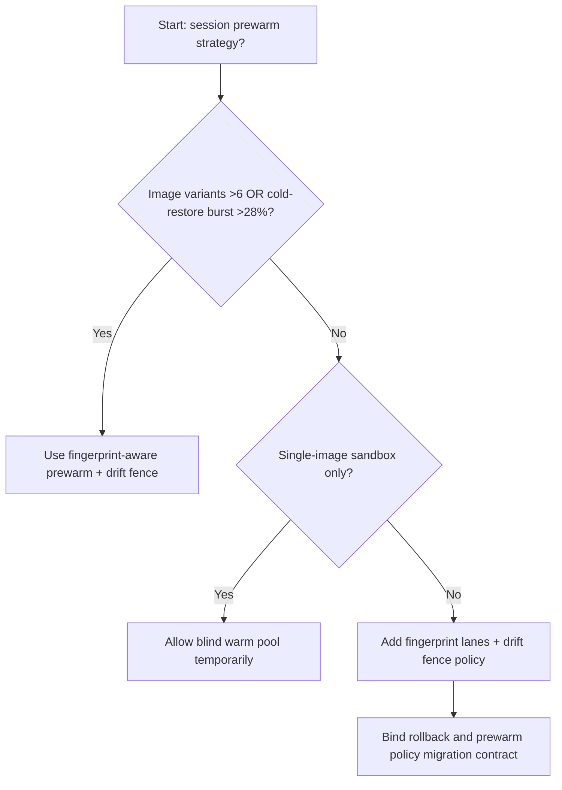
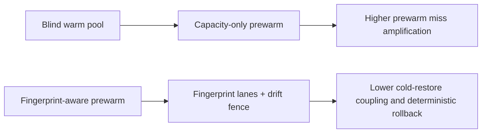
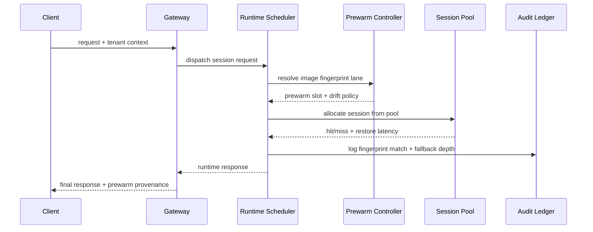

# Agent Runtime Session Image Prewarm Fingerprint 选型 FAQ（Blind Warm Pool vs Fingerprint-Aware Prewarm + Drift Fence）

## 1) 核心结论（先给负责人）
- **当镜像变体数量 >6 且会话冷恢复突发比例 >28% 时，生产默认应选 Fingerprint-Aware Prewarm + Drift Fence**；盲目热池会放大 miss。
- **当预热命中估算误差 >9% 且冷恢复回退 P95 >260ms 时，Blind Warm Pool 会进入 12.1% 失配档**，需要切换指纹感知预热。
- **当 Agent 链路依赖工具镜像版本一致性时，必须启用指纹围栏与预热漂移审计**，否则跨租户回源抖动不可控。

## 2) Q1 / Q2 / Q3（术语先通俗解释）
- **Blind Warm Pool**：只按总容量预热，不区分镜像指纹，简单但容易预热错对象。
- **Fingerprint-Aware Prewarm + Drift Fence**：按镜像指纹和租户画像预热，并在指纹漂移时触发围栏与重建。

### Q1：为什么预热指纹会影响 Agent SLA？
第一性原理：会话恢复速度取决于“预热对象是否就是你要的镜像”。指纹错配会让请求回到冷启动路径。

### Q2：什么时候还能短时用盲目热池？
仅在单镜像、低并发、低变体 PoC；进入多镜像生产后应切换指纹感知预热。

### Q3：最小闭环是什么？
镜像指纹采样 -> 预热配额分配 -> 漂移围栏校验 -> 恢复回放 -> 阈值调参。

## 3) Mermaid（决策树 / 路径对比 / 时序）
### 3.1 选型决策树

### 3.2 路径对比图

### 3.3 运行时序图

## 4) 选型决策矩阵
| 维度 | Blind Warm Pool | Fingerprint-Aware Prewarm + Drift Fence |
|---|---|---|
| 实现复杂度 | 低 | 中 |
| 预热命中稳定性 | 低-中 | 高 |
| 冷恢复长尾风险 | 高 | 低 |
| 多租户可控性 | 中-低 | 高 |
| 生产默认建议 | 仅实验短期 | 长期默认 |

## 5) 数据证据与可复算算例（含 n/分母/来源）
> 本节百分比为 `synthetic_assumed` 假设算例（hypothetical），用于机制比较；生产机制认证保持 `not_measured`。  
> 合同字段见：`workshops/azure-agent-infra/evidence/cycle-537-benchmark.json` 的 `percentage_contract`。

- 指标 A（盲目热池失配率）  
  - 定义：`n_blind_prewarm_miss / n_gateway_requests_observed`  
  - 值：`534/4410 = 12.1%`（`synthetic_assumed`）  
  - 路径：`percentage_contract.blind_prewarm_miss_rate`
- 指标 B（指纹预热失配率）  
  - 定义：`n_fingerprint_prewarm_miss / n_gateway_requests_observed`  
  - 值：`216/4410 = 4.9%`（`synthetic_assumed`）  
  - 路径：`percentage_contract.fingerprint_prewarm_miss_rate`
- 指标 C（恢复增益，百分点）  
  - 定义：`(n_recovered_fingerprint_prewarm - n_recovered_blind_prewarm) / n_gateway_requests_observed`  
  - 值：`(4058-3728)/4410 = 7.5` 个百分点（`synthetic_assumed`）  
  - 路径：`percentage_contract.fingerprint_prewarm_recovery_gain_pts`

## 6) 生产 Checklist（上线前必须打勾）
- [ ] 每个租户/镜像族有明确预热指纹槽位与漂移围栏策略
- [ ] 预热命中率、冷恢复回退深度、失配率可观测可审计
- [ ] 变更流程具备灰度、回退与分层放量能力
- [ ] 指标全部标注 `synthetic_assumed`，生产机制认证保持 `not_measured`
