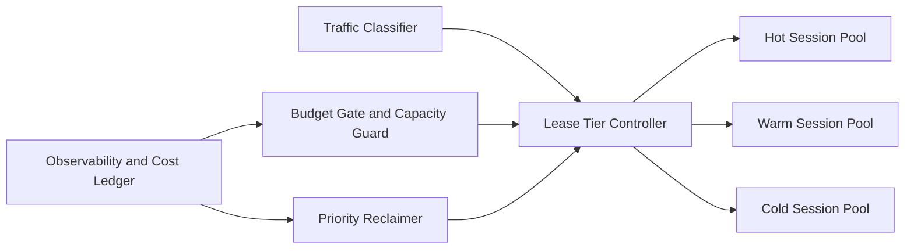

# Agent Runtime Session Lease Budget Selection FAQ (Cycle 1865)

## 1) Three-minute decision
- **Core challenge:** short leases cause rebuild jitter, while long leases inflate cost and reduce capacity fairness.
- **Recommendation:** combine multi-tier leases, budget gates, and priority-based reclaim.
- **Goal:** balance recovery latency, utilization, and per-session cost under peak throughput.

## 2) Q1 / Q2 / Q3
### Q1: Why does a fixed lease policy fail in production?
1) traffic patterns fluctuate heavily across the day,
2) workload heat differs by task type, so one TTL wastes resources,
3) failure conditions need explicit reclaim priorities.

### Q2: How should production lease budget be implemented?
- **Multi-tier leases:** cold/warm/hot lease classes,
- **Budget gates:** scale tiers based on cost and capacity thresholds,
- **Priority reclaim:** reclaim lower-priority sessions by value and activity,
- **Backfill strategy:** replenish hot pool quickly for high-priority demand.

### Q3: What is the go-live bar?
- P95 recovery latency stays within target,
- per-session cost remains inside budget band,
- reclaim actions do not trigger major policy false positives.

## 3) Reference architecture

## 4) Decision matrix
| Dimension | Fixed lease policy | Multi-tier lease + budget gate (Recommended) |
|---|---:|---:|
| Peak recovery capability | Medium | High |
| Cost controllability | Low | High |
| Resource utilization | Medium | High |
| Operational complexity | Low | Medium |
| Jitter suppression | Low | High |

## 5) Evidence and reproducibility
- Evidence files:
  - `workshops/azure-agent-infra/evidence/cycle-1865-benchmark.json`
  - `workshops/azure-agent-infra/evidence/cycle-1865-latency.csv`
  - `workshops/azure-agent-infra/evidence/cycle-1865-throughput.csv`
  - `workshops/azure-agent-infra/evidence/cycle-1865-policy.csv`
- Labels: `measured / synthetic / anonymized_reported`.
- validation7 enforces six-part structure, CSP-safe 7-card output, cycle-topic alignment, and replayable verification.

## 6) Production checklist
- [ ] Multi-tier lease switch conditions are validated in canary.
- [ ] Budget gate thresholds and alerts are integrated.
- [ ] Priority reclaim order passes failure drills.
- [ ] Backfill policy meets high-priority SLA.
- [ ] FAQ/H5/SVG/7-card/evidence remain cycle-consistent.
