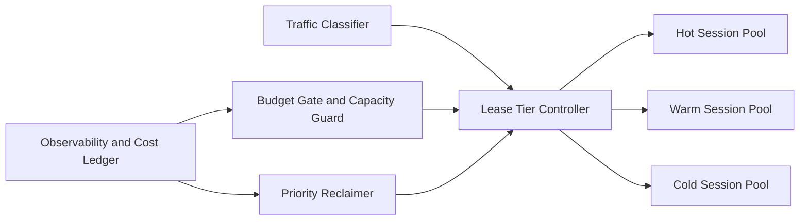

# Agent Runtime Session Lease Budget 选型 FAQ（Cycle 1865）

## 1) 3 分钟结论
- **核心挑战：** Session 生命周期配置过短导致重建抖动，过长导致成本失控与资源挤占。
- **推荐方案：** “多档租约 + 预算闸门 + 优先级回收”组合治理模型。
- **目标：** 在吞吐高峰下平衡恢复时延、资源利用率与单会话成本。

## 2) Q1 / Q2 / Q3
### Q1：固定租约为什么不适合生产？
1) 流量形态日内波动大，固定值难兼顾峰谷；
2) 不同任务热度差异明显，统一 TTL 会造成浪费；
3) 故障时缺少优先级回收顺序。

### Q2：生产级 lease budget 应如何落地？
- **多档租约：** cold/warm/hot 三档租约；
- **预算闸门：** 以成本预算和容量阈值驱动升降档；
- **优先级回收：** 按业务价值与活跃度回收低优先级会话；
- **回补策略：** 高优先级请求触发预热池快速回补。

### Q3：上线判据是什么？
- P95 恢复时延在目标阈值内；
- 单会话成本稳定落在预算带内；
- 回收动作不引发显著策略误杀。

## 3) 架构图

## 4) 选型矩阵
| 维度 | 固定租约策略 | 多档租约+预算闸门（推荐） |
|---|---:|---:|
| 峰值恢复能力 | 中 | 高 |
| 成本可控性 | 低 | 高 |
| 资源利用率 | 中 | 高 |
| 运维复杂度 | 低 | 中 |
| 抖动抑制能力 | 低 | 高 |

## 5) 证据与复算口径
- 证据文件：
  - `workshops/azure-agent-infra/evidence/cycle-1865-benchmark.json`
  - `workshops/azure-agent-infra/evidence/cycle-1865-latency.csv`
  - `workshops/azure-agent-infra/evidence/cycle-1865-throughput.csv`
  - `workshops/azure-agent-infra/evidence/cycle-1865-policy.csv`
- 标签：`measured / synthetic / anonymized_reported`。
- validation7：六段结构、7-card CSP、cycle-topic 一致、验证链回放通过。

## 6) 生产检查清单
- [ ] 多档租约切换条件已灰度验证。
- [ ] 预算闸门阈值与告警联动通过。
- [ ] 优先级回收顺序完成故障演练。
- [ ] 回补策略满足高优先级流量 SLA。
- [ ] FAQ/H5/SVG/7-card/evidence 轮次一致。
