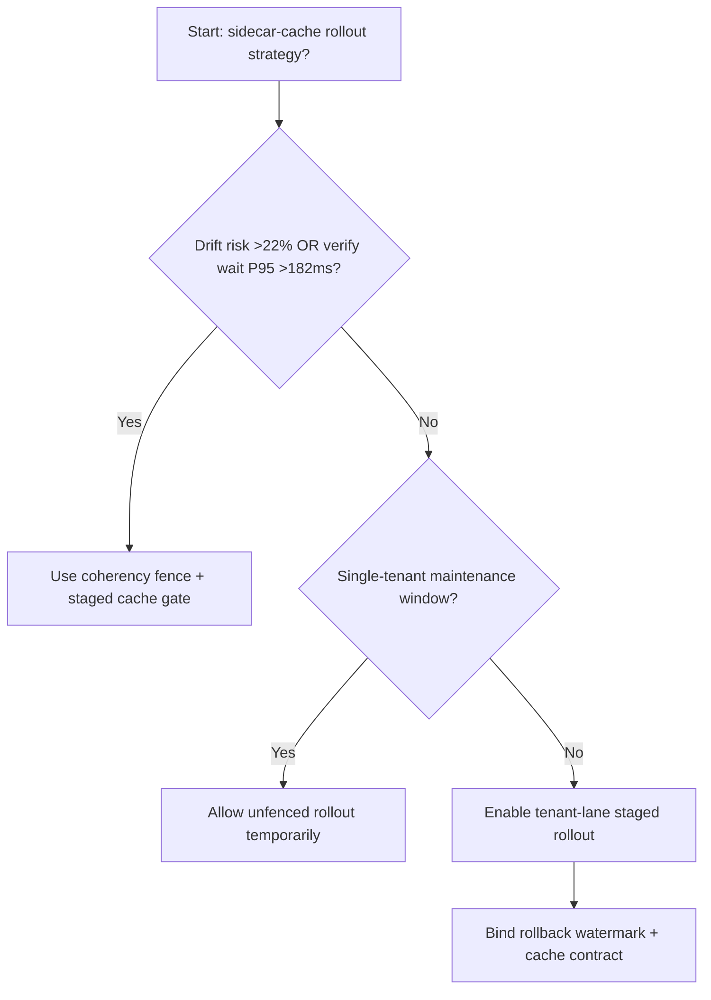
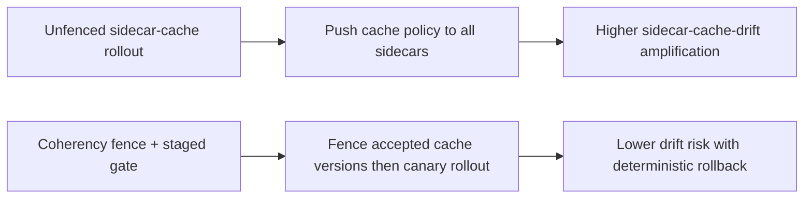
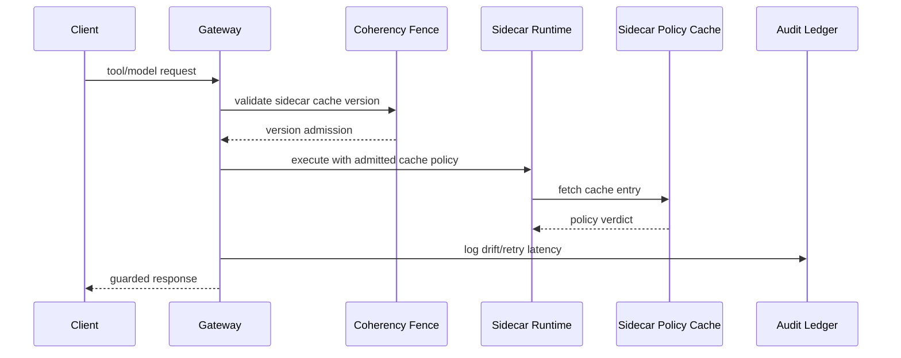

# Agent Runtime Sidecar Policy Cache Coherency Selection FAQ (Unfenced Sidecar-Cache Rollout vs Coherency Fence + Staged Cache Gate)

## 1) Core conclusions (for decision-makers first)
- **When sidecar policy-cache drift risk exceeds 22% and verification wait P95 exceeds 182ms, production should default to Coherency Fence + Staged Cache Gate**.
- **When unfenced sidecar-cache rollout drift exceeds 12% and rollback retry P95 exceeds 252ms, Unfenced Sidecar-Cache Rollout enters the 12.5% drift amplification band**.
- **Multi-tenant runtimes must bind cache-coherency fences, rollout batches, and rollback thresholds**, or policy execution and throughput stability degrade together.

## 2) Q1 / Q2 / Q3 (plain-language definitions first)
- **Unfenced Sidecar-Cache Rollout**: push new cache policy to all sidecar nodes directly; fast but risky.
- **Coherency Fence + Staged Cache Gate**: constrain accepted cache versions first, then shift traffic in batches.

### Q1: Why does sidecar cache coherency affect agent stability?
First principles: sidecars enforce policy and traffic governance. Cache-version drift causes execution divergence across nodes, amplifying retries and tail latency.

### Q2: When is unfenced rollout acceptable temporarily?
Only in single-tenant low-traffic maintenance windows. Multi-tenant production should default to coherency-fenced rollout.

### Q3: What is the minimum safe loop?
Version sampling -> fence validation -> staged rollout -> drift alerts -> automated rollback.

## 3) Mermaid (decision tree / path comparison / sequence)
### 3.1 Selection decision tree

### 3.2 Path comparison

### 3.3 Runtime sequence

## 4) Decision matrix
| Dimension | Unfenced Sidecar-Cache Rollout | Coherency Fence + Staged Cache Gate |
|---|---|---|
| Implementation complexity | Low | Medium |
| Cache-drift risk | High | Low |
| Multi-tenant controllability | Low | High |
| Rollback determinism | Medium | High |
| Default production fit | Maintenance windows only | Long-term default |

## 5) Evidence contract + recomputable examples (n/denominator/source)
> Percentages in this section are `synthetic_assumed` hypothetical examples for mechanism comparison; production mechanism validation remains `not_measured`.  
> Contract fields: `workshops/azure-agent-infra/evidence/cycle-548-benchmark.json` -> `percentage_contract`.

- Metric A (unfenced sidecar-cache drift rate)  
  - Formula: `n_unfenced_sidecar_cache_drift / n_gateway_requests_observed`  
  - Value: `551/4410 = 12.5%` (`synthetic_assumed`)  
  - Path: `percentage_contract.unfenced_sidecar_cache_drift_rate`
- Metric B (coherency-fence drift rate)  
  - Formula: `n_coherency_fence_drift / n_gateway_requests_observed`  
  - Value: `209/4410 = 4.7%` (`synthetic_assumed`)  
  - Path: `percentage_contract.coherency_fence_drift_rate`
- Metric C (recovery gain, percentage points)  
  - Formula: `(n_recovered_coherency_fence - n_recovered_unfenced) / n_gateway_requests_observed`  
  - Value: `(4132-3791)/4410 = 7.7 percentage points` (`synthetic_assumed`)  
  - Path: `percentage_contract.coherency_fence_recovery_gain_pts`

## 6) Production checklist
- [ ] Every tenant has sidecar cache-version allow-lists and rollout batches
- [ ] Drift rate, retry latency, and rollback success are observable and auditable
- [ ] Change flow supports canary rollout, fast rollback, and tiered promotion
- [ ] All metrics are tagged `synthetic_assumed`; production validation remains `not_measured`
