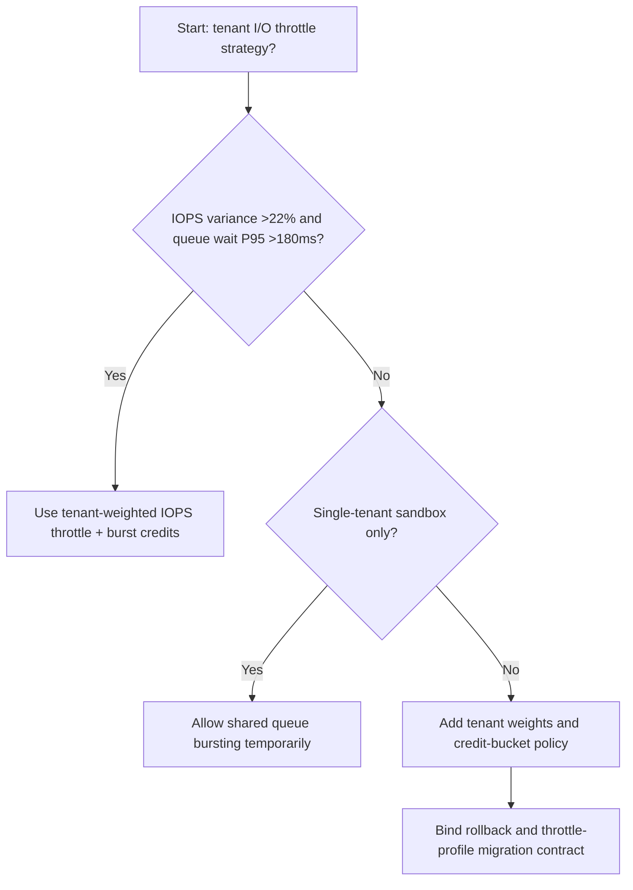
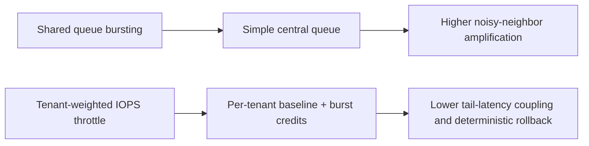
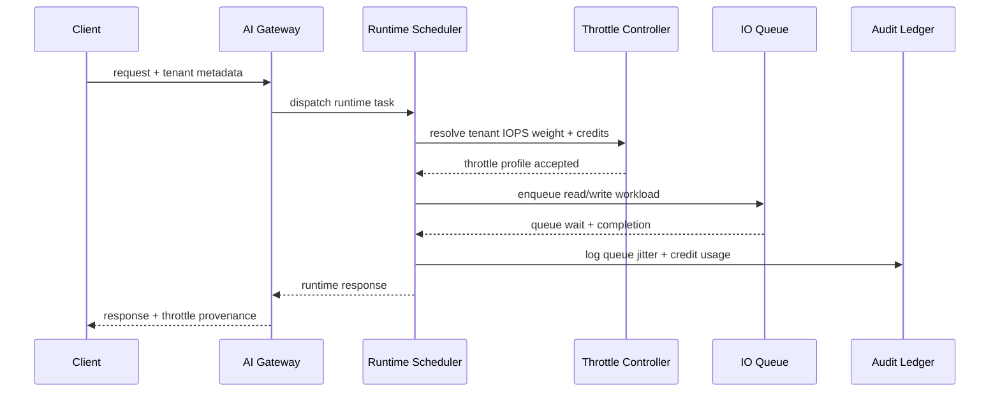

# Agent Runtime Tenant Noisy-Neighbor I/O Throttle Selection FAQ (Shared Queue Bursting vs Tenant-Weighted IOPS Throttle + Burst Credits)

## 1) Core conclusions (for decision-makers first)
- **When tenant IOPS variance is >22% and queue-wait P95 is >180ms, production should default to Tenant-Weighted IOPS Throttle + Burst Credits**; shared-queue bursting amplifies noisy neighbors.
- **When burst traffic share is >35% and fallback queueing P95 is >310ms, Shared Queue Bursting enters the 12.1% overload band**, and tenant-weighted throttling is required.
- **When tool chains include high-frequency read/write paths (logs, vector retrieval, session snapshots), tenant-level IOPS quotas and credit buckets are mandatory**, or cross-tenant tail latency becomes uncontrollable.

## 2) Q1 / Q2 / Q3 (plain-language definitions first)
- **Shared Queue Bursting**: all tenants share one I/O queue; fastest burst wins, simple but highly coupled.
- **Tenant-Weighted IOPS Throttle + Burst Credits**: each tenant receives weighted baseline IOPS plus short-term burst allowance via credits.

### Q1: Why do noisy neighbors directly hurt agent SLA?
First principles: queue wait time is added to every agent step. In shared queues, bursty tenants push others into long-tail latency, causing simultaneous tool-call and model-write timeouts.

### Q2: When is shared bursting still acceptable temporarily?
Only for single-tenant stress tests or low-concurrency demos. Switch to tenant-weighted throttling as soon as multi-tenant production traffic starts.

### Q3: What is the minimum safe loop?
Tenant profiling -> IOPS quota/weighting -> credit-bucket policy -> queue telemetry -> replay calibration.

## 3) Mermaid (decision tree / path comparison / sequence)
### 3.1 Selection decision tree

### 3.2 Path comparison

### 3.3 Runtime sequence

## 4) Decision matrix
| Dimension | Shared Queue Bursting | Tenant-Weighted IOPS Throttle + Burst Credits |
|---|---|---|
| Implementation complexity | Low | Medium |
| Multi-tenant isolation stability | Low-Medium | High |
| Tail-latency coupling risk | High | Low |
| Operational controllability | Medium-Low | High |
| Default production fit | Experimental short-term only | Long-term default |

## 5) Evidence contract + recomputable examples (n/denominator/source)
> Percentages in this section are `synthetic_assumed` hypothetical examples for mechanism comparison; production mechanism validation remains `not_measured`.  
> Contract fields: `workshops/azure-agent-infra/evidence/cycle-534-benchmark.json` -> `percentage_contract`.

- Metric A (shared-queue overload rate)  
  - Formula: `n_shared_queue_io_overrun / n_gateway_requests_observed`  
  - Value: `534/4410 = 12.1%` (`synthetic_assumed`)  
  - Path: `percentage_contract.shared_queue_io_overrun_rate`
- Metric B (tenant-weighted overload rate)  
  - Formula: `n_tenant_weighted_iops_overrun / n_gateway_requests_observed`  
  - Value: `216/4410 = 4.9%` (`synthetic_assumed`)  
  - Path: `percentage_contract.tenant_weighted_iops_overrun_rate`
- Metric C (recovery gain, percentage points)  
  - Formula: `(n_recovered_tenant_iops - n_recovered_shared_queue) / n_gateway_requests_observed`  
  - Value: `(4058-3728)/4410 = 7.5 percentage points` (`synthetic_assumed`)  
  - Path: `percentage_contract.tenant_iops_recovery_gain_pts`

## 6) Production checklist
- [ ] Every tenant has explicit IOPS baseline, cap, and credit-bucket policy
- [ ] Queue wait, credit burn, and fallback jitter are observable and auditable
- [ ] Upgrade flow supports canary rollout, rollback, and tenant-tier promotion
- [ ] All metrics are tagged `synthetic_assumed`; production validation remains `not_measured`
