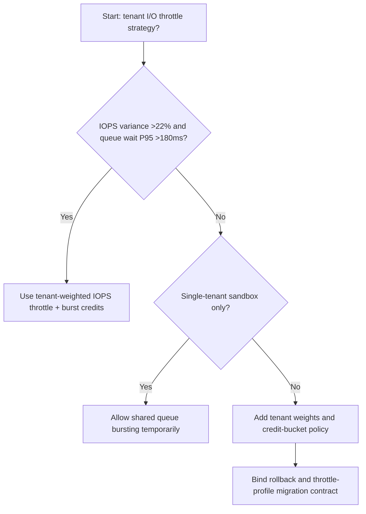
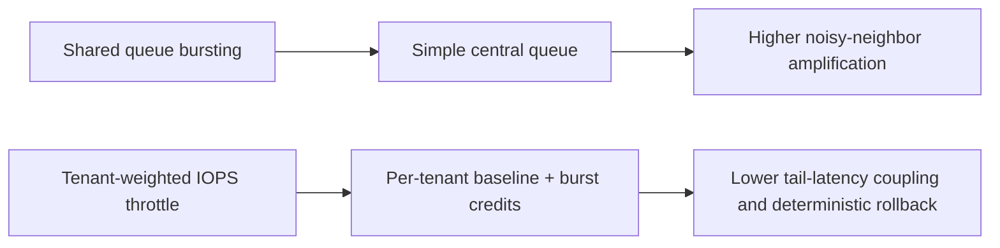
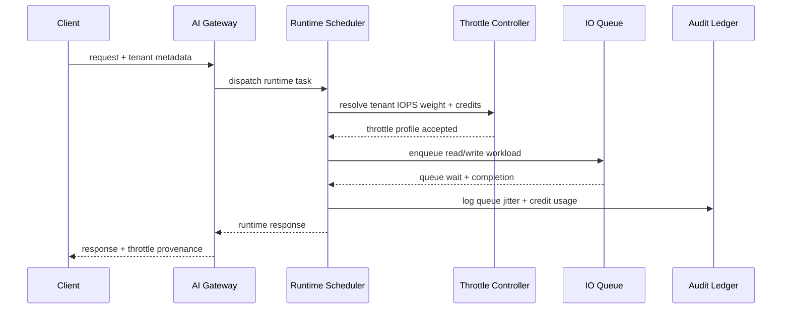

# Agent Runtime Tenant Noisy-Neighbor I/O Throttle 选型 FAQ（Shared Queue Bursting vs Tenant-Weighted IOPS Throttle + Burst Credits）

## 1) 核心结论（先给负责人）
- **当租户 IOPS 方差 >22% 且队列等待 P95 >180ms 时，生产默认应选 Tenant-Weighted IOPS Throttle + Burst Credits**；共享队列突发会放大 noisy-neighbor。
- **当突发流量占比 >35% 且回退排队 P95 >310ms 时，Shared Queue Bursting 会进入 12.1% 过载档**，需要切换租户加权节流。
- **当工具链存在高频读写（日志、向量检索、会话快照）时，必须启用租户级 IOPS 配额与信用桶**，否则跨租户尾延迟不可控。

## 2) Q1 / Q2 / Q3（术语先通俗解释）
- **Shared Queue Bursting**：所有租户共用一个 I/O 队列，谁突发谁先抢占，简单但容易互相影响。
- **Tenant-Weighted IOPS Throttle + Burst Credits**：每租户按权重分配基础 IOPS，并通过信用桶允许短时突发。

### Q1：为什么 noisy-neighbor 会直接影响 Agent SLA？
第一性原理：I/O 排队时间会直接叠加到每个 Agent 步骤。共享队列中“高突发租户”会把其他租户拖入长尾，导致工具调用和模型回写同时超时。

### Q2：什么时候还能短时用共享突发？
仅在单租户压测或低并发演示环境；进入多租户生产后应尽快切换到租户加权节流。

### Q3：最小闭环是什么？
租户画像 -> IOPS 配额/权重 -> 信用桶策略 -> 队列遥测 -> 回放校准。

## 3) Mermaid（决策树 / 路径对比 / 时序）
### 3.1 选型决策树

### 3.2 路径对比图

### 3.3 运行时序图

## 4) 选型决策矩阵
| 维度 | Shared Queue Bursting | Tenant-Weighted IOPS Throttle + Burst Credits |
|---|---|---|
| 实现复杂度 | 低 | 中 |
| 多租户隔离稳定性 | 低-中 | 高 |
| 尾延迟耦合风险 | 高 | 低 |
| 运维可控性 | 中-低 | 高 |
| 生产默认建议 | 仅实验短期 | 长期默认 |

## 5) 数据证据与可复算算例（含 n/分母/来源）
> 本节百分比为 `synthetic_assumed` 假设算例（hypothetical），用于机制比较；生产机制认证保持 `not_measured`。  
> 合同字段见：`workshops/azure-agent-infra/evidence/cycle-534-benchmark.json` 的 `percentage_contract`。

- 指标 A（共享队列过载率）  
  - 定义：`n_shared_queue_io_overrun / n_gateway_requests_observed`  
  - 值：`534/4410 = 12.1%`（`synthetic_assumed`）  
  - 路径：`percentage_contract.shared_queue_io_overrun_rate`
- 指标 B（加权节流过载率）  
  - 定义：`n_tenant_weighted_iops_overrun / n_gateway_requests_observed`  
  - 值：`216/4410 = 4.9%`（`synthetic_assumed`）  
  - 路径：`percentage_contract.tenant_weighted_iops_overrun_rate`
- 指标 C（恢复增益，百分点）  
  - 定义：`(n_recovered_tenant_iops - n_recovered_shared_queue) / n_gateway_requests_observed`  
  - 值：`(4058-3728)/4410 = 7.5` 个百分点（`synthetic_assumed`）  
  - 路径：`percentage_contract.tenant_iops_recovery_gain_pts`

## 6) 生产 Checklist（上线前必须打勾）
- [ ] 每个租户有明确 IOPS 基线、上限与信用桶策略
- [ ] 队列等待、信用消耗、回源抖动可观测可审计
- [ ] 升级流程具备灰度、回退与租户分层放量能力
- [ ] 指标全部标注 `synthetic_assumed`，生产机制认证保持 `not_measured`
