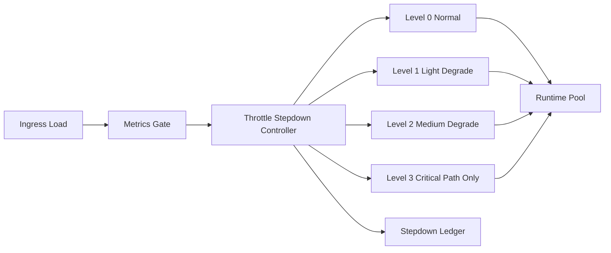

# Agent Runtime Throttle Stepdown Selection FAQ (Cycle 1828)

## 1) Three-minute decision
- **Core tension:** under surge load, single-threshold throttling often causes latency oscillation and repeated circuit events.
- **Recommendation:** stepdown throttling levels plus metric-linked gates plus smooth recovery windows.
- **Goal:** stabilize runtime behavior under pressure and avoid binary on-off thrashing.

## 2) Q1 / Q2 / Q3
### Q1: Why does fixed-threshold throttling oscillate?
1) load repeatedly crosses the boundary,
2) no hysteresis between throttle and recovery,
3) one threshold cannot fit diverse tenant traffic shapes.

### Q2: What production-ready stepdown strategy should be used?
- **L0 normal:** full capability path,
- **L1 light degrade:** compress non-critical tool usage and output length,
- **L2 medium degrade:** constrain concurrency and high-cost plugins,
- **L3 severe degrade:** keep only critical transaction paths,
- **Recovery:** step up only after sustained stability windows.

### Q3: How do we validate effective stepdown and recovery?
- controlled P95 latency and error rate at peak,
- reduced throttle-switch frequency,
- throughput and experience return near baseline post-recovery.

## 3) Reference architecture

## 4) Decision matrix
| Dimension | Single-threshold throttling | Stepdown throttling (Recommended) |
|---|---:|---:|
| Peak stability | Medium | High |
| Oscillation risk | High | Low |
| Recovery controllability | Medium | High |
| Implementation complexity | Low | Medium |
| Operational explainability | Medium | High |

## 5) Evidence and reproducibility
- Evidence files:
  - `workshops/azure-agent-infra/evidence/cycle-1828-benchmark.json`
  - `workshops/azure-agent-infra/evidence/cycle-1828-latency.csv`
  - `workshops/azure-agent-infra/evidence/cycle-1828-throughput.csv`
  - `workshops/azure-agent-infra/evidence/cycle-1828-policy.csv`
- Labels: `measured / synthetic / anonymized_reported`.
- validation7 enforces bilingual six-part structure, CSP self-contained 7-card output, strict cycle-evidence alignment, and replayability.

## 6) Production checklist
- [ ] Stepdown levels and thresholds are configured.
- [ ] Hysteresis and recovery step-up rules are integrated.
- [ ] High-cost path degradation policies are validated.
- [ ] Switch-frequency and false-trigger alerts are observable.
- [ ] FAQ/H5/SVG/7-card align with cycle evidence.
