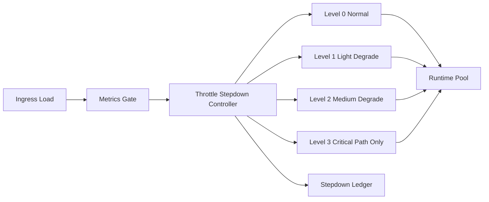

# Agent 运行时节流阶梯降档选型 FAQ（Cycle 1828）

## 1) 3 分钟结论
- **核心矛盾：** 负载上冲时若只做单点限流，容易出现时延震荡与反复熔断。
- **推荐：** 分级节流（stepdown）+ 指标门槛联动 + 平滑恢复窗口。
- **目标：** 在容量压力阶段稳定系统曲线，避免“开-关”式抖动。

## 2) Q1 / Q2 / Q3
### Q1：为什么固定阈值限流容易抖动？
1) 负载会在阈值边界来回穿越；
2) 限流与恢复没有滞回窗口，导致频繁切换；
3) 不同租户请求特征差异大，单阈值无法兼容。

### Q2：可落地的阶梯降档策略是什么？
- **L0 正常档**：全功能路径；
- **L1 轻降档**：压缩非关键工具调用与输出长度；
- **L2 中降档**：限制并发和高成本插件；
- **L3 重降档**：只保留关键事务链路与最小响应；
- **恢复策略**：连续稳定窗口后按阶梯回升。

### Q3：如何验证“降档有效且可回升”？
- 峰值期 P95 延迟与错误率受控；
- 降档切换频次下降；
- 恢复后吞吐和体验回到基线区间。

## 3) 架构图

## 4) 选型矩阵
| 维度 | 单阈值限流 | 阶梯降档节流（推荐） |
|---|---:|---:|
| 峰值稳定性 | 中 | 高 |
| 振荡风险 | 高 | 低 |
| 恢复可控性 | 中 | 高 |
| 实施复杂度 | 低 | 中 |
| 运维可解释性 | 中 | 高 |

## 5) 证据与复算口径
- 证据文件：
  - `workshops/azure-agent-infra/evidence/cycle-1828-benchmark.json`
  - `workshops/azure-agent-infra/evidence/cycle-1828-latency.csv`
  - `workshops/azure-agent-infra/evidence/cycle-1828-throughput.csv`
  - `workshops/azure-agent-infra/evidence/cycle-1828-policy.csv`
- 标签：`measured / synthetic / anonymized_reported`。
- validation7：双语六段结构、7-card CSP 自包含、轮次与 evidence 一致、可回放链路通过。

## 6) 生产检查清单
- [ ] 阶梯降档档位及门槛已配置。
- [ ] 滞回窗口与恢复回升规则已联调。
- [ ] 高成本路径降档策略已验证。
- [ ] 降档切换频次与误触发告警可观测。
- [ ] FAQ/H5/SVG/7-card 与 evidence 轮次一致。
