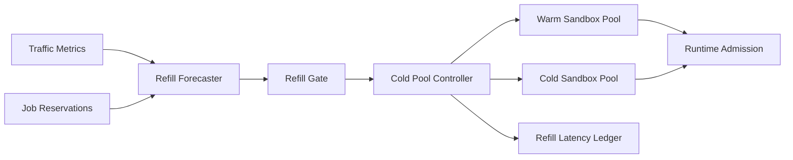

# Agent Sandbox Cold Pool Refill Latency Selection FAQ (Cycle 1836)

## 1) Three-minute decision
- **Core tension:** slow cold-pool refill amplifies cold-start jitter, while over-aggressive refill wastes capacity.
- **Recommendation:** forecast-driven refill plus tiered prewarming plus refill-rate gates.
- **Goal:** maintain controlled cold-start latency across demand swings while limiting idle cost.

## 2) Q1 / Q2 / Q3
### Q1: Why do fixed refill policies fail?
1) peak demand is bursty and static thresholds lag,
2) regional and tenant heat patterns are not synchronized,
3) fixed refill over-allocates idle instances in off-peak windows.

### Q2: What production-ready refill strategy should be used?
- **Forecast inputs:** recent request rates plus reservation signals,
- **Tiered prewarm:** warm critical-tenant sandboxes first,
- **Rate gates:** cap refill per time window to avoid spikes,
- **Reclaim linkage:** recover surplus pool capacity by priority during low demand.

### Q3: How do we validate low jitter with low idle waste?
- lower cold-start P95 latency,
- lower peak-time rejection rate,
- bounded off-peak idle ratio.

## 3) Reference architecture

## 4) Decision matrix
| Dimension | Fixed refill | Forecast-gated refill (Recommended) |
|---|---:|---:|
| Cold-start stability | Medium | High |
| Peak rejection control | Medium | High |
| Idle-cost controllability | Low | High |
| Implementation complexity | Low | Medium |
| Operational explainability | Medium | High |

## 5) Evidence and reproducibility
- Evidence files:
  - `workshops/azure-agent-infra/evidence/cycle-1836-benchmark.json`
  - `workshops/azure-agent-infra/evidence/cycle-1836-latency.csv`
  - `workshops/azure-agent-infra/evidence/cycle-1836-throughput.csv`
  - `workshops/azure-agent-infra/evidence/cycle-1836-policy.csv`
- Labels: `measured / synthetic / anonymized_reported`.
- validation7 enforces bilingual six-part structure, CSP self-contained 7-card output, strict cycle-evidence alignment, and replayability.

## 6) Production checklist
- [ ] Forecast inputs and refill-gate thresholds are configured.
- [ ] Tiered prewarm priorities and tenant mapping are integrated.
- [ ] Peak-valley reclaim strategy and alerts are validated.
- [ ] Refill ledger and latency metrics are traceable.
- [ ] FAQ/H5/SVG/7-card align with cycle evidence.
