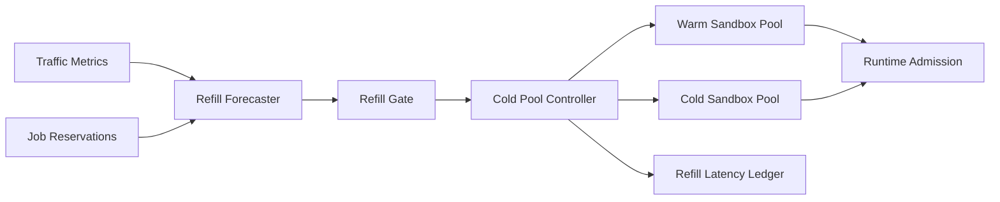

# Agent 沙盒冷池补充时延选型 FAQ（Cycle 1836）

## 1) 3 分钟结论
- **核心矛盾：** 冷池补充过慢会放大冷启动抖动，补充过激又会造成资源空耗。
- **推荐：** 预测驱动补池 + 分层预热 + 补池速率门禁。
- **目标：** 在峰谷波动中保持可控冷启动时延并控制空转成本。

## 2) Q1 / Q2 / Q3
### Q1：为什么固定补池策略容易失效？
1) 流量峰值具有突发性，静态阈值跟不上变化；
2) 区域和租户的热度分布不同步；
3) 固定补池会在低峰时段堆积闲置实例。

### Q2：可落地的冷池补充策略是什么？
- **预测输入**：结合最近窗口请求速率与预约作业信号；
- **分层预热**：关键租户优先补齐 warm sandbox，普通租户延后补充；
- **速率门禁**：限制单位时间补池上限，避免资源突增；
- **回收联动**：低峰期按优先级回收冗余冷池。

### Q3：如何验证“低抖动且低空耗”？
- 冷启动 P95 时延下降；
- 高峰拒绝率下降；
- 低峰闲置占比受控。

## 3) 架构图

## 4) 选型矩阵
| 维度 | 固定补池 | 预测门禁补池（推荐） |
|---|---:|---:|
| 冷启动稳定性 | 中 | 高 |
| 峰值拒绝控制 | 中 | 高 |
| 空转成本可控性 | 低 | 高 |
| 实施复杂度 | 低 | 中 |
| 运维可解释性 | 中 | 高 |

## 5) 证据与复算口径
- 证据文件：
  - `workshops/azure-agent-infra/evidence/cycle-1836-benchmark.json`
  - `workshops/azure-agent-infra/evidence/cycle-1836-latency.csv`
  - `workshops/azure-agent-infra/evidence/cycle-1836-throughput.csv`
  - `workshops/azure-agent-infra/evidence/cycle-1836-policy.csv`
- 标签：`measured / synthetic / anonymized_reported`。
- validation7：双语六段结构、7-card CSP 自包含、轮次与 evidence 一致、可回放链路通过。

## 6) 生产检查清单
- [ ] 预测输入与补池门禁阈值已配置。
- [ ] 分层预热优先级与租户映射已联调。
- [ ] 峰谷回收策略与告警阈值已验证。
- [ ] 补池账本和时延指标可追溯。
- [ ] FAQ/H5/SVG/7-card 与 evidence 轮次一致。
