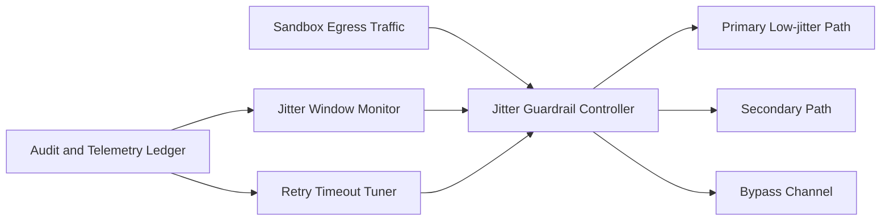

# Sandbox Egress Jitter Guardrails Selection FAQ (Cycle 1879)

## 1) Three-minute decision
- **Core issue:** sandbox egress paths can show burst jitter across zones/gateways, destabilizing tool-call latency.
- **Recommendation:** combine jitter-budget guardrails, tiered path routing, and anomaly-window bypass.
- **Goal:** keep egress jitter inside business-tolerable bounds and prevent tail-latency amplification.

## 2) Q1 / Q2 / Q3
### Q1: Why is average latency monitoring insufficient?
1) means hide short burst jitter,
2) path-switch jitter varies by zone,
3) jitter amplifies effective load via retries.

### Q2: How should production jitter guardrails be designed?
- **Jitter budgets:** define budget thresholds for critical paths,
- **Tiered routing:** prioritize low-jitter paths for critical tool calls,
- **Anomaly bypass:** shift to controlled bypass channels in jitter windows,
- **Feedback tuning:** adapt retry/timeout policy from window statistics.

### Q3: What is the go-live bar?
- critical-path jitter P95/P99 converges to target,
- task success stays stable during jitter windows,
- bypass switching does not trigger additional error storms.

## 3) Reference architecture

## 4) Decision matrix
| Dimension | Fixed egress path | Guardrailed tiered egress (Recommended) |
|---|---:|---:|
| Jitter suppression | Low | High |
| Tail-latency stability | Low | High |
| Failure recovery | Medium | High |
| Implementation complexity | Low | Medium |
| Observability | Medium | High |

## 5) Evidence and reproducibility
- Evidence files:
  - `workshops/azure-agent-infra/evidence/cycle-1879-benchmark.json`
  - `workshops/azure-agent-infra/evidence/cycle-1879-latency.csv`
  - `workshops/azure-agent-infra/evidence/cycle-1879-throughput.csv`
  - `workshops/azure-agent-infra/evidence/cycle-1879-policy.csv`
- Labels: `measured / synthetic / anonymized_reported`.
- validation7 enforces six-part structure, CSP-safe 7-card output, strict cycle-topic alignment, and replayable checks.

## 6) Production checklist
- [ ] Critical-path jitter budget thresholds are calibrated.
- [ ] Tiered routing policy passes stress tests.
- [ ] Anomaly bypass switching flow passes drills.
- [ ] Retry/timeout feedback tuning is integrated.
- [ ] FAQ/H5/SVG/7-card/evidence remain cycle-consistent.
