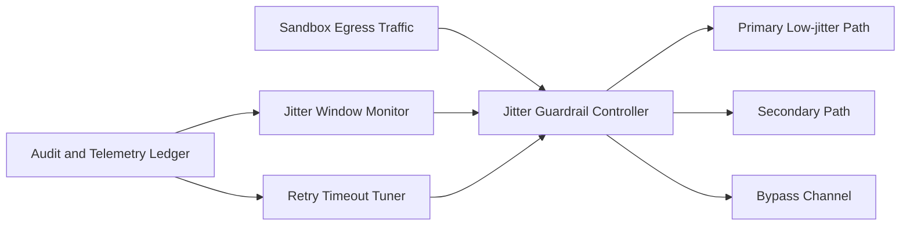

# Sandbox Egress Jitter Guardrails 选型 FAQ（Cycle 1879）

## 1) 3 分钟结论
- **核心问题：** 沙箱出站链路在跨区/跨网关场景会出现抖动尖峰，导致工具调用时延不稳定。
- **推荐方案：** “抖动预算护栏 + 路径分级路由 + 异常窗口旁路”三段治理。
- **目标：** 将 egress 抖动控制在业务可承受范围内，避免尾延迟放大。

## 2) Q1 / Q2 / Q3
### Q1：为什么仅靠平均时延监控不足？
1) 平均值无法暴露短时抖动尖峰；
2) 路径切换造成的抖动具有分区差异；
3) 抖动会联动重试放大实际负载。

### Q2：生产级 jitter guardrails 如何设计？
- **抖动预算：** 为关键路径定义 jitter budget 与触发阈值；
- **分级路由：** 低抖动路径优先承载关键工具调用；
- **异常旁路：** 检测到抖动窗口时切换到受控旁路通道；
- **反馈收敛：** 基于窗口统计动态调优重试与超时策略。

### Q3：上线判据是什么？
- 关键路径 jitter P95/P99 收敛达标；
- 抖动期任务成功率维持稳定；
- 旁路切换不引发额外错误风暴。

## 3) 架构图

## 4) 选型矩阵
| 维度 | 固定路径出站 | 护栏分级出站（推荐） |
|---|---:|---:|
| 抖动抑制能力 | 低 | 高 |
| 尾延迟稳定性 | 低 | 高 |
| 异常恢复能力 | 中 | 高 |
| 实施复杂度 | 低 | 中 |
| 可观测性 | 中 | 高 |

## 5) 证据与复算口径
- 证据文件：
  - `workshops/azure-agent-infra/evidence/cycle-1879-benchmark.json`
  - `workshops/azure-agent-infra/evidence/cycle-1879-latency.csv`
  - `workshops/azure-agent-infra/evidence/cycle-1879-throughput.csv`
  - `workshops/azure-agent-infra/evidence/cycle-1879-policy.csv`
- 标签：`measured / synthetic / anonymized_reported`。
- validation7：六段结构、7-card CSP、cycle-topic 对齐、验证链可回放。

## 6) 生产检查清单
- [ ] 关键路径 jitter budget 阈值已校准。
- [ ] 分级路由策略完成压测验证。
- [ ] 异常旁路切换流程演练通过。
- [ ] 重试/超时反馈调优策略联调通过。
- [ ] FAQ/H5/SVG/7-card/evidence 轮次一致。
