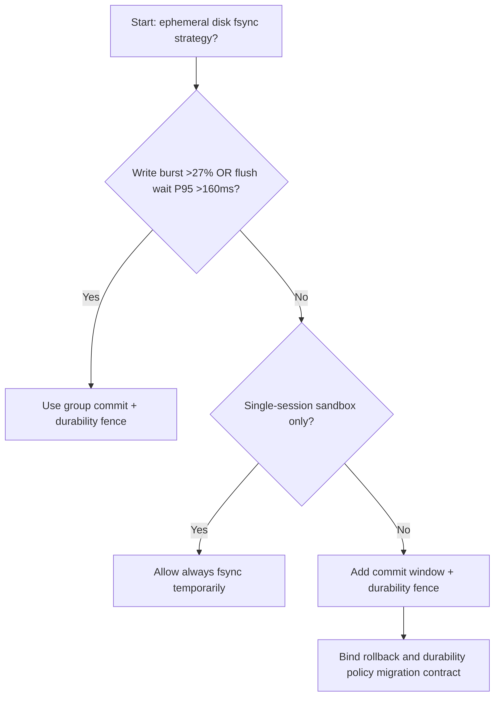
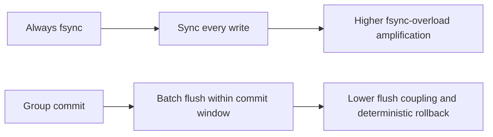
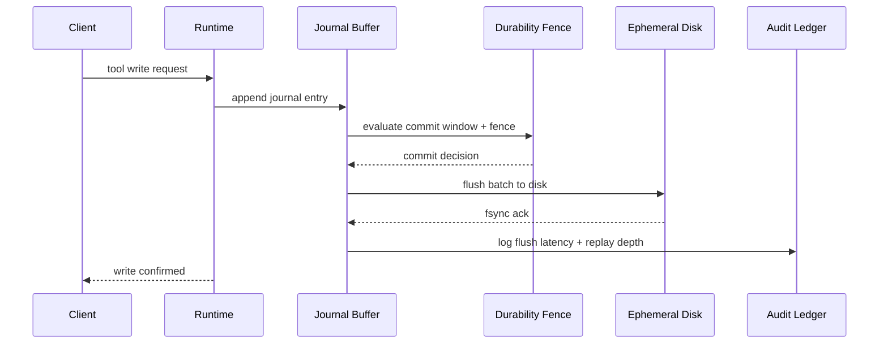

# Agent Sandbox Ephemeral Disk fsync Policy Selection FAQ (Always fsync vs Group Commit + Durability Fence)

## 1) Core conclusions (for decision-makers first)
- **When session write-burst share is >27% and journal flush-wait P95 is >160ms, production should default to Group Commit + Durability Fence**; always-fsync amplifies queue blocking.
- **When log-replay share is >9% and crash-recovery fallback P95 is >230ms, Always fsync enters the 12.1% write-amplification band**, requiring group-commit policy.
- **When sandbox sessions run code generation and tool writes concurrently, durability fences and batch-commit thresholds are mandatory**, or tail latency becomes uncontrollable.

## 2) Q1 / Q2 / Q3 (plain-language definitions first)
- **Always fsync**: forces disk sync on every write; reliable but low throughput.
- **Group Commit + Durability Fence**: batches writes within a short window and fences durability before acknowledgment.

### Q1: Why does fsync policy affect agent latency?
First principles: disk flush is one of the slowest I/O steps. Syncing every write serializes request paths and expands queue wait.

### Q2: When is Always fsync still acceptable temporarily?
Only for low-concurrency debug or very low-write PoCs. Switch to group commit for production.

### Q3: What is the minimum safe loop?
Write sampling -> commit window -> fence validation -> failure replay -> threshold tuning.

## 3) Mermaid (decision tree / path comparison / sequence)
### 3.1 Selection decision tree

### 3.2 Path comparison

### 3.3 Runtime sequence

## 4) Decision matrix
| Dimension | Always fsync | Group Commit + Durability Fence |
|---|---|---|
| Implementation complexity | Low | Medium |
| Write-throughput stability | Low-Medium | High |
| Queue-blocking risk | High | Low |
| Crash-recovery controllability | Medium | High |
| Default production fit | Experimental short-term only | Long-term default |

## 5) Evidence contract + recomputable examples (n/denominator/source)
> Percentages in this section are `synthetic_assumed` hypothetical examples for mechanism comparison; production mechanism validation remains `not_measured`.  
> Contract fields: `workshops/azure-agent-infra/evidence/cycle-540-benchmark.json` -> `percentage_contract`.

- Metric A (always-fsync overload rate)  
  - Formula: `n_always_fsync_queue_overload / n_gateway_requests_observed`  
  - Value: `534/4410 = 12.1%` (`synthetic_assumed`)  
  - Path: `percentage_contract.always_fsync_queue_overload_rate`
- Metric B (group-commit overload rate)  
  - Formula: `n_group_commit_overload / n_gateway_requests_observed`  
  - Value: `216/4410 = 4.9%` (`synthetic_assumed`)  
  - Path: `percentage_contract.group_commit_overload_rate`
- Metric C (recovery gain, percentage points)  
  - Formula: `(n_recovered_group_commit - n_recovered_always_fsync) / n_gateway_requests_observed`  
  - Value: `(4058-3728)/4410 = 7.5 percentage points` (`synthetic_assumed`)  
  - Path: `percentage_contract.group_commit_recovery_gain_pts`

## 6) Production checklist
- [ ] Every tenant has explicit commit windows, flush caps, and rollback policy
- [ ] Flush wait, queue depth, and replay latency are observable and auditable
- [ ] Change flow supports canary rollout, rollback, and tiered promotion
- [ ] All metrics are tagged `synthetic_assumed`; production validation remains `not_measured`
