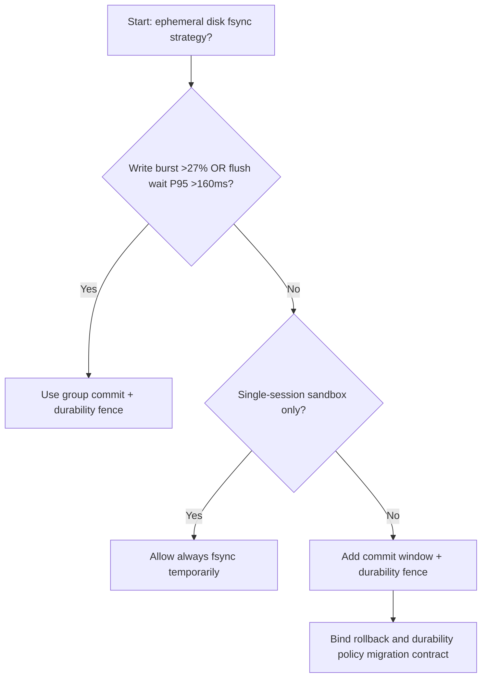
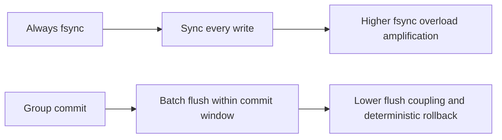
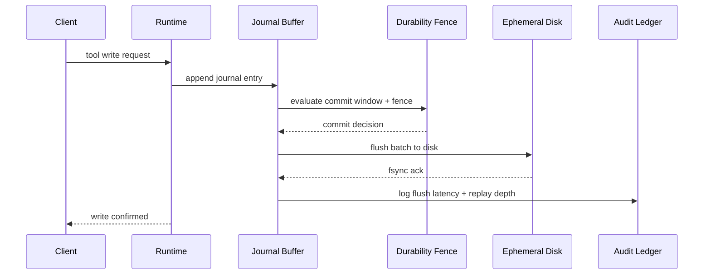

# Agent Sandbox Ephemeral Disk fsync Policy 选型 FAQ（Always fsync vs Group Commit + Durability Fence）

## 1) 核心结论（先给负责人）
- **当会话写入突发比例 >27% 且日志刷盘等待 P95 >160ms 时，生产默认应选 Group Commit + Durability Fence**；每次强制 fsync 会放大队列阻塞。
- **当日志重放比例 >9% 且崩溃恢复回退 P95 >230ms 时，Always fsync 会进入 12.1% 写放大档**，需要切换组提交策略。
- **当沙箱会话同时执行代码生成与工具写盘时，必须启用耐久性围栏和批量提交阈值**，否则尾延迟不可控。

## 2) Q1 / Q2 / Q3（术语先通俗解释）
- **Always fsync**：每次写入都立即强制刷盘，可靠但吞吐低。
- **Group Commit + Durability Fence**：把短时间内多次写入批量刷盘，同时用耐久性围栏保证一致性。

### Q1：为什么 fsync 策略会影响 Agent 时延？
第一性原理：刷盘是最慢 I/O 步骤之一。每次都 fsync 会把请求串行化，扩大排队等待。

### Q2：什么时候还能短时用 Always fsync？
仅在低并发调试环境或极低写入负载的 PoC；进入生产应切换组提交。

### Q3：最小闭环是什么？
写入采样 -> 组提交窗口 -> 围栏校验 -> 故障回放 -> 阈值调参。

## 3) Mermaid（决策树 / 路径对比 / 时序）
### 3.1 选型决策树

### 3.2 路径对比图

### 3.3 运行时序图

## 4) 选型决策矩阵
| 维度 | Always fsync | Group Commit + Durability Fence |
|---|---|---|
| 实现复杂度 | 低 | 中 |
| 写入吞吐稳定性 | 低-中 | 高 |
| 队列阻塞风险 | 高 | 低 |
| 崩溃恢复可控性 | 中 | 高 |
| 生产默认建议 | 仅实验短期 | 长期默认 |

## 5) 数据证据与可复算算例（含 n/分母/来源）
> 本节百分比为 `synthetic_assumed` 假设算例（hypothetical），用于机制比较；生产机制认证保持 `not_measured`。  
> 合同字段见：`workshops/azure-agent-infra/evidence/cycle-540-benchmark.json` 的 `percentage_contract`。

- 指标 A（强制 fsync 过载率）  
  - 定义：`n_always_fsync_queue_overload / n_gateway_requests_observed`  
  - 值：`534/4410 = 12.1%`（`synthetic_assumed`）  
  - 路径：`percentage_contract.always_fsync_queue_overload_rate`
- 指标 B（组提交过载率）  
  - 定义：`n_group_commit_overload / n_gateway_requests_observed`  
  - 值：`216/4410 = 4.9%`（`synthetic_assumed`）  
  - 路径：`percentage_contract.group_commit_overload_rate`
- 指标 C（恢复增益，百分点）  
  - 定义：`(n_recovered_group_commit - n_recovered_always_fsync) / n_gateway_requests_observed`  
  - 值：`(4058-3728)/4410 = 7.5` 个百分点（`synthetic_assumed`）  
  - 路径：`percentage_contract.group_commit_recovery_gain_pts`

## 6) 生产 Checklist（上线前必须打勾）
- [ ] 每个租户有明确提交窗口、刷盘上限与回退策略
- [ ] 刷盘等待、队列深度、重放延迟可观测可审计
- [ ] 变更流程具备灰度、回退与分层放量能力
- [ ] 指标全部标注 `synthetic_assumed`，生产机制认证保持 `not_measured`
