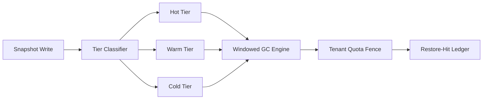

# Agent Sandbox Filesystem Snapshot GC Selection FAQ (Unbounded Retention vs Tiered Retention + Scheduled GC)

## 1) Core conclusions
- **Tiered retention with scheduled GC should be the production default for multi-tenant sandboxes**.
- **Unbounded retention amplifies disk pressure and restore jitter under burst concurrency**.
- **Snapshot policy must bind TTL, tenant quotas, and restore-hit ledgers**, or cost and consistency drift out of control.

## 2) Q1 / Q2 / Q3 (plain terms first)
- **Unbounded retention**: snapshots continue to accumulate with little or no deterministic cleanup.
- **Tiered retention + GC**: snapshots are managed across hot/warm/cold tiers with auditable reclamation windows.

### Q1: Why does “keep everything first” fail in production?
First principle: storage and metadata index capacity are bounded. Snapshot accumulation eventually degrades restore latency and throughput.

### Q2: When is short-term unbounded retention still acceptable?
Single-tenant short-lived experiments with explicit acceptance of delayed and expensive cleanup windows.

### Q3: What is the minimum safe control loop?
Snapshot write -> tier assignment -> TTL expiry scan -> quota-based eviction -> restore-hit auditing. Missing any step creates jitter or governance risk.

## 3) Mermaid (snapshot governance loop)

## 4) Decision matrix
| Dimension | Unbounded retention | Tiered retention + scheduled GC |
|---|---|---|
| Implementation complexity | Low | Medium-High |
| Disk-pressure control | Low | High |
| Restore stability | Medium-Low | High |
| Cost predictability | Low | High |
| Default production fit | Short experiments | Multi-tenant long-running workloads |

## 5) Evidence contract + recomputable examples (n/denominator/source)
> Percentages in this section are `synthetic_assumed` hypothetical examples for mechanism comparison; production mechanism validation remains `not_measured`.  
> Contract fields: `workshops/azure-agent-infra/evidence/cycle-423-benchmark.json` -> `percentage_contract`.

- Metric A (disk-pressure rate, unbounded retention)  
  - Formula: `n_disk_pressure_unbounded / n_sessions_observed`  
  - Value: `256/2000 = 12.8%` (`synthetic_assumed`)  
  - Path: `percentage_contract.unbounded_retention_disk_pressure_rate`
- Metric B (disk-pressure rate, tiered GC)  
  - Formula: `n_disk_pressure_tiered_gc / n_sessions_observed`  
  - Value: `62/2000 = 3.1%` (`synthetic_assumed`)  
  - Path: `percentage_contract.tiered_gc_disk_pressure_rate`
- Metric C (restore-hit rate gain, percentage points)  
  - Formula: `(n_restore_hit_tiered_gc - n_restore_hit_unbounded) / n_sessions_observed`  
  - Value: `(1704-1480)/2000 = 11.2 percentage points` (`synthetic_assumed`)  
  - Path: `percentage_contract.restore_hit_rate_gain_pts`

## 6) Production checklist
- [ ] Tiering policy (hot/warm/cold) is versioned with rollout and rollback controls
- [ ] GC windows, TTLs, and tenant quota thresholds are configurable and auditable
- [ ] Restore-hit and reclamation metrics are persisted in a single traceable ledger
- [ ] Metrics are tagged `synthetic_assumed` with denominator and units; production validation remains `not_measured`
