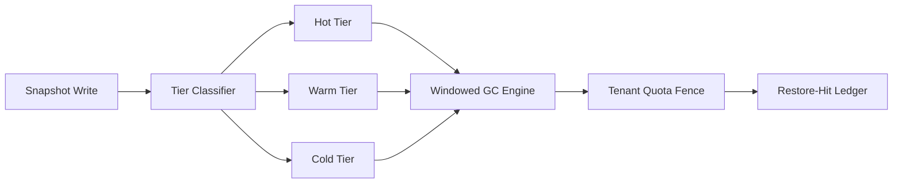

# Agent 沙箱文件系统快照 GC 选型 FAQ（无界保留 vs 分层保留+定时 GC）

## 1) 核心结论（先给负责人）
- **多租户生产默认采用分层保留 + 定时 GC**，不能长期无界保留快照。
- **无界保留会在突发并发下放大磁盘压力与恢复抖动**，拖慢关键链路恢复。
- **快照策略必须绑定 TTL、租户配额与恢复命中账本**，否则成本与一致性会失控。

## 2) Q1 / Q2 / Q3（术语先通俗解释）
- **无界保留**：快照持续累积，只做被动清理或几乎不清理。
- **分层保留+GC**：按热/温/冷分层存放快照，并在窗口内执行可审计回收。

### Q1：为什么“先全留着”在生产里常常失败？
第一性原理：存储不是无限资源。快照堆积会挤占 I/O 与元数据索引，最终反噬恢复延迟与吞吐。

### Q2：什么时候还能接受短期无界保留？
单租户、短周期实验、且可接受高成本回收窗口时可临时使用，但不应作为长期默认。

### Q3：分层保留+GC 的最小安全闭环是什么？
写入快照 -> 分层标记 -> TTL 到期扫描 -> 配额驱逐 -> 恢复命中审计；缺任一步都可能导致抖动或数据治理风险。

## 3) Mermaid（快照治理闭环）

## 4) 决策矩阵
| 维度 | 无界保留 | 分层保留 + 定时 GC |
|---|---|---|
| 实现复杂度 | 低 | 中-高 |
| 磁盘压力控制 | 低 | 高 |
| 恢复稳定性 | 中-低 | 高 |
| 成本可预测性 | 低 | 高 |
| 生产默认建议 | 短期实验 | 多租户长期运行 |

## 5) 数据证据与可复算算例（含 n/分母/来源）
> 本节百分比为 `synthetic_assumed` 假设算例（hypothetical），用于机制比较；生产机制认证仍为 `not_measured`。  
> 合同字段见：`workshops/azure-agent-infra/evidence/cycle-423-benchmark.json` 的 `percentage_contract`。

- 指标 A（磁盘压力率，无界保留）  
  - 定义：`n_disk_pressure_unbounded / n_sessions_observed`  
  - 值：`256/2000 = 12.8%`（`synthetic_assumed`）  
  - 路径：`percentage_contract.unbounded_retention_disk_pressure_rate`
- 指标 B（磁盘压力率，分层 GC）  
  - 定义：`n_disk_pressure_tiered_gc / n_sessions_observed`  
  - 值：`62/2000 = 3.1%`（`synthetic_assumed`）  
  - 路径：`percentage_contract.tiered_gc_disk_pressure_rate`
- 指标 C（恢复命中率提升，百分点）  
  - 定义：`(n_restore_hit_tiered_gc - n_restore_hit_unbounded) / n_sessions_observed`  
  - 值：`(1704-1480)/2000 = 11.2` 个百分点（`synthetic_assumed`）  
  - 路径：`percentage_contract.restore_hit_rate_gain_pts`

## 6) 生产 Checklist（上线前必须打勾）
- [ ] 快照分层策略（热/温/冷）有版本、灰度与回滚路径  
- [ ] GC 窗口、TTL 与租户配额阈值可配置且可审计  
- [ ] 恢复命中率与回收命中率纳入统一账本并可追溯  
- [ ] 指标口径已标注 `synthetic_assumed` 与分母/单位，生产机制认证保持 `not_measured`  
