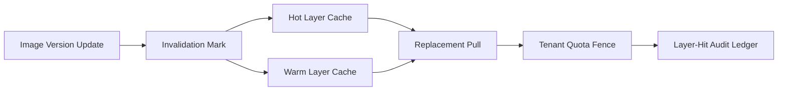

# Agent Sandbox Image Layer Cache Invalidation Selection FAQ (Passive/Low-Frequency Cleanup vs Versioned Active Invalidation)

## 1) Core conclusions
- **Versioned active invalidation should be the production default for multi-tenant sandbox image layers**.
- **Passive invalidation increases stale-layer hit rates**, causing restore paths to pull outdated dependencies.
- **Invalidation policy must bind tenant isolation, layer-version signatures, and rollback windows**, or consistency and auditability degrade.

## 2) Q1 / Q2 / Q3 (plain terms first)
- **Passive/low-frequency cleanup**: stale layers are cleaned only under pressure or on fixed low-frequency jobs.
- **Versioned active invalidation**: when base image or policy versions change, related cached layers are invalidated immediately.

### Q1: Why does passive invalidation fail under burst load?
First principle: cache-hit speed outruns human rollback speed. Once stale layers are repeatedly hit, outdated dependencies spread quickly across sessions.

### Q2: When is passive invalidation still acceptable?
Short single-tenant experiments with low image churn and explicit tolerance for temporary consistency drift.

### Q3: What is the minimum safe control loop?
Layer version publish -> invalidation mark propagation -> hot-layer replacement -> tenant quota validation -> layer-hit audit replay.

## 3) Mermaid (invalidation control loop)

## 4) Decision matrix
| Dimension | Passive/low-frequency cleanup | Versioned active invalidation |
|---|---|---|
| Implementation complexity | Low | Medium-High |
| Stale-layer control | Low | High |
| Restore consistency | Medium-Low | High |
| Audit traceability | Medium | High |
| Default production fit | Short low-risk experiments | Multi-tenant long-running workloads |

## 5) Evidence contract + recomputable examples (n/denominator/source)
> Percentages in this section are `synthetic_assumed` hypothetical examples for mechanism comparison; production mechanism validation remains `not_measured`.  
> Contract fields: `workshops/azure-agent-infra/evidence/cycle-424-benchmark.json` -> `percentage_contract`.

- Metric A (stale-layer hit rate, passive invalidation)  
  - Formula: `n_stale_layer_hits_passive / n_sessions_observed`  
  - Value: `256/2000 = 12.8%` (`synthetic_assumed`)  
  - Path: `percentage_contract.no_invalidation_stale_layer_rate`
- Metric B (stale-layer hit rate, versioned active invalidation)  
  - Formula: `n_stale_layer_hits_versioned / n_sessions_observed`  
  - Value: `62/2000 = 3.1%` (`synthetic_assumed`)  
  - Path: `percentage_contract.versioned_invalidation_stale_layer_rate`
- Metric C (cache-consistency gain, percentage points)  
  - Formula: `(n_consistent_versioned - n_consistent_passive) / n_sessions_observed`  
  - Value: `(1704-1480)/2000 = 11.2 percentage points` (`synthetic_assumed`)  
  - Path: `percentage_contract.cache_consistency_gain_pts`

## 6) Production checklist
- [ ] Layer-version signatures and invalidation-mark propagation are auditable
- [ ] Tenant isolation and quota controls are enforced on replacement paths
- [ ] Post-invalidation replacement latency and stale-hit rates are logged in one ledger
- [ ] Metrics are tagged `synthetic_assumed` with denominator and units; production validation remains `not_measured`
