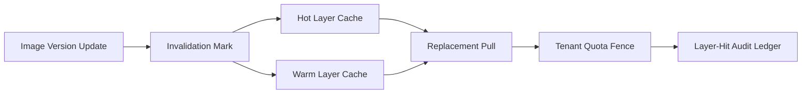

# Agent 沙箱镜像层缓存失效选型 FAQ（被动失效/低频清理 vs 版本化主动失效）

## 1) 核心结论（先给负责人）
- **多租户生产默认采用版本化主动失效策略**，不能只依赖被动失效或低频清理。
- **被动失效会放大陈旧层命中率**，导致恢复路径拿到过期层并引发执行漂移。
- **缓存失效必须绑定租户隔离、层版本签名与回滚窗口**，否则一致性与审计不可控。

## 2) Q1 / Q2 / Q3（术语先通俗解释）
- **被动失效/低频清理**：仅在缓存压力触发或固定周期才清理失效层。
- **版本化主动失效**：当基础镜像或策略版本变化时，立即标记相关缓存层不可用并触发替换。

### Q1：为什么被动失效在高并发下容易失败？
第一性原理：缓存命中速度快于人工排查速度。陈旧层一旦被反复命中，会把旧依赖迅速扩散到大量会话。

### Q2：什么时候还能接受被动失效？
单租户短时实验、镜像变化低频、且允许短时间一致性偏差时可临时使用。

### Q3：版本化主动失效的最小安全闭环是什么？
层版本发布 -> 失效标签传播 -> 热层替换 -> 租户配额校验 -> 命中审计回放；缺任一步都可能造成陈旧层复活。

## 3) Mermaid（缓存失效治理闭环）

## 4) 决策矩阵
| 维度 | 被动失效/低频清理 | 版本化主动失效 |
|---|---|---|
| 实现复杂度 | 低 | 中-高 |
| 陈旧层控制 | 低 | 高 |
| 恢复一致性 | 中-低 | 高 |
| 审计可追溯性 | 中 | 高 |
| 生产默认建议 | 短期低风险实验 | 多租户长期运行 |

## 5) 数据证据与可复算算例（含 n/分母/来源）
> 本节百分比为 `synthetic_assumed` 假设算例（hypothetical），用于机制比较；生产机制认证仍为 `not_measured`。  
> 合同字段见：`workshops/azure-agent-infra/evidence/cycle-424-benchmark.json` 的 `percentage_contract`。

- 指标 A（陈旧层命中率，被动失效）  
  - 定义：`n_stale_layer_hits_passive / n_sessions_observed`  
  - 值：`256/2000 = 12.8%`（`synthetic_assumed`）  
  - 路径：`percentage_contract.no_invalidation_stale_layer_rate`
- 指标 B（陈旧层命中率，版本化主动失效）  
  - 定义：`n_stale_layer_hits_versioned / n_sessions_observed`  
  - 值：`62/2000 = 3.1%`（`synthetic_assumed`）  
  - 路径：`percentage_contract.versioned_invalidation_stale_layer_rate`
- 指标 C（缓存一致性提升，百分点）  
  - 定义：`(n_consistent_versioned - n_consistent_passive) / n_sessions_observed`  
  - 值：`(1704-1480)/2000 = 11.2` 个百分点（`synthetic_assumed`）  
  - 路径：`percentage_contract.cache_consistency_gain_pts`

## 6) 生产 Checklist（上线前必须打勾）
- [ ] 镜像层版本签名与失效标签传播链路可审计  
- [ ] 租户隔离与配额策略在缓存替换路径生效  
- [ ] 失效后热层替换延迟和陈旧命中率纳入统一账本  
- [ ] 指标口径已标注 `synthetic_assumed` 与分母/单位，生产机制认证保持 `not_measured`  
