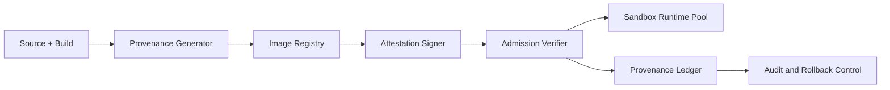

# Agent Sandbox Image Provenance and Attestation Selection FAQ (Cycle 1824)

## 1) Three-minute decision
- **Core tension:** sandboxes must start fast, but opaque image provenance introduces software supply-chain risk.
- **Recommendation:** provenance evidence + attestation signing + admission gates.
- **Goal:** keep cold-start targets while ensuring every admitted runtime image is verifiable, accountable, and rollback-ready.

## 2) Q1 / Q2 / Q3
### Q1: Why is image scanning alone insufficient?
1) scanning inspects content snapshots but not trusted build lineage,
2) mutable tags can be rewritten without non-repudiable identity,
3) without admission verification, unsigned images can still enter production pools.

### Q2: What production-ready strategy should be used?
- **Build stage:** generate provenance with builder identity, source hash, and dependency manifest,
- **Signing stage:** sign immutable image digests with policy labels,
- **Admission stage:** verify signature, provenance, and policy match before runtime,
- **Rollback stage:** keep previous trusted image for fast fallback.

### Q3: How do we validate “more secure without slower release”?
- improved interception of unsigned images,
- compliant image admission latency remains within threshold,
- rollback success rate and recovery time stay on target.

## 3) Reference architecture

## 4) Decision matrix
| Dimension | Scan-only admission | Provenance plus attestation admission (Recommended) |
|---|---:|---:|
| Supply-chain trust | Medium | High |
| Unauthorized image interception | Medium | High |
| Release-speed impact | Low | Medium-low |
| Rollback controllability | Medium | High |
| Audit traceability | Medium | High |

## 5) Evidence and reproducibility
- Evidence files:
  - `workshops/azure-agent-infra/evidence/cycle-1824-benchmark.json`
  - `workshops/azure-agent-infra/evidence/cycle-1824-latency.csv`
  - `workshops/azure-agent-infra/evidence/cycle-1824-throughput.csv`
  - `workshops/azure-agent-infra/evidence/cycle-1824-policy.csv`
- Labels: `measured / synthetic / anonymized_reported`.
- validation7 enforces bilingual six-part structure, CSP self-contained 7-card output, strict cycle-evidence alignment, and replayability.

## 6) Production checklist
- [ ] Provenance schema and signing policy are finalized.
- [ ] Admission verification supports staged rollout and hard block.
- [ ] Compliant image admission latency vs cold-start budget is validated.
- [ ] Rollback allowlist and audit trail are operational.
- [ ] FAQ/H5/SVG/7-card align with cycle evidence.
