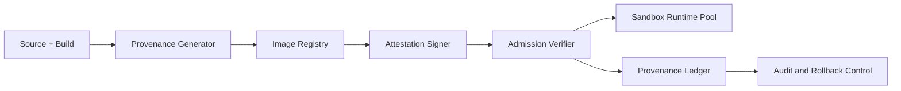

# Agent 沙盒镜像来源证明与签署选型 FAQ（Cycle 1824）

## 1) 3 分钟结论
- **核心矛盾：** 沙盒运行时需要快速拉起，但镜像来源不透明会引入供应链风险。
- **推荐：** 镜像来源证明（provenance）+ 签署验证（attestation）+ 准入门禁。
- **目标：** 在不牺牲冷启动目标的前提下，确保进入运行池的镜像可验证、可追责、可回滚。

## 2) Q1 / Q2 / Q3
### Q1：为什么只做镜像扫描还不够？
1) 扫描只能看到内容快照，不能证明构建链路可信；
2) 同一镜像标签可被重写，缺少不可抵赖身份；
3) 无准入验证时，未签署镜像仍可能进入生产池。

### Q2：可落地的签署与证明策略是什么？
- **构建端**：生成来源证明（构建器、源码哈希、依赖清单）；
- **签署端**：对镜像摘要做密钥签署并附带策略标签；
- **准入端**：运行前验证签署、证明和策略匹配；
- **回滚端**：保留上一版可信镜像并支持快速回切。

### Q3：如何验证“安全增强且不拖慢发布”？
- 未签署镜像拦截率提升；
- 合规镜像准入时延在阈值内；
- 回滚成功率与恢复时间达标。

## 3) 架构图

## 4) 选型矩阵
| 维度 | 仅扫描准入 | 证明+签署准入（推荐） |
|---|---:|---:|
| 供应链可信度 | 中 | 高 |
| 未授权镜像拦截 | 中 | 高 |
| 发布速度影响 | 低 | 中低 |
| 回滚可控性 | 中 | 高 |
| 审计可追溯 | 中 | 高 |

## 5) 证据与复算口径
- 证据文件：
  - `workshops/azure-agent-infra/evidence/cycle-1824-benchmark.json`
  - `workshops/azure-agent-infra/evidence/cycle-1824-latency.csv`
  - `workshops/azure-agent-infra/evidence/cycle-1824-throughput.csv`
  - `workshops/azure-agent-infra/evidence/cycle-1824-policy.csv`
- 标签：`measured / synthetic / anonymized_reported`。
- validation7：双语六段结构、7-card CSP 自包含、轮次与 evidence 一致、可回放链路通过。

## 6) 生产检查清单
- [ ] 构建 provenance 字段与签署策略已固化。
- [ ] 准入验证规则支持灰度发布与强制拦截。
- [ ] 合规镜像准入时延与冷启动预算已评估。
- [ ] 回滚白名单与审计链路可用。
- [ ] FAQ/H5/SVG/7-card 与 evidence 轮次一致。
