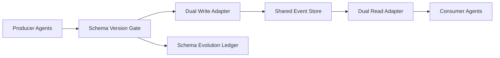

# Agent Schema Evolution Safety Selection FAQ (Cycle 1812)

## 1) Three-minute decision
- **Schema-evolution incidents are usually caused by rollout-order mismatch, not field design alone.**
- **Recommendation:** forward compatibility first + dual-write/dual-read transition + version-gated rollback.
- **Goal:** prevent parsing failures and semantic drift during multi-agent multi-service upgrades.

## 2) Q1 / Q2 / Q3
### Q1: Why is a one-shot schema switch risky?
1) downstream still consumes legacy shape,
2) historical backfill windows are insufficient,
3) some agents cache old contracts.

### Q2: What practical evolution strategy works?
- keep new fields optional with default semantics,
- run dual-write/dual-read with compatibility checks,
- tighten legacy field acceptance via version gates,
- one-click rollback to last stable version on anomalies.

### Q3: How to validate effectiveness?
- parsing error rate stays low,
- cross-version consistency checks improve,
- rollback drill duration remains predictable.

## 3) Reference architecture

## 4) Decision matrix
| Dimension | One-shot switch | Compatible evolution (Recommended) |
|---|---:|---:|
| Release safety | Low | High |
| Compatibility stability | Low | High |
| Rollback controllability | Medium | High |
| Implementation complexity | Low | Medium |
| Debug explainability | Medium | High |

## 5) Evidence and reproducibility
- Evidence files:
  - `workshops/azure-agent-infra/evidence/cycle-1812-benchmark.json`
  - `workshops/azure-agent-infra/evidence/cycle-1812-latency.csv`
  - `workshops/azure-agent-infra/evidence/cycle-1812-throughput.csv`
  - `workshops/azure-agent-infra/evidence/cycle-1812-policy.csv`
- Labels: `measured / synthetic / anonymized_reported`.
- validation7 requires bilingual structure fidelity, CSP self-contained cards, cycle-consistent evidence, and replayability checks.

## 6) Production checklist
- [ ] Schema version gate is enforced.
- [ ] Dual-write/dual-read window and retirement plan are defined.
- [ ] Compatibility checks are integrated in release pipeline.
- [ ] Rollback and repair scripts are drill-ready.
- [ ] FAQ/H5/SVG/7-card align with cycle evidence.
