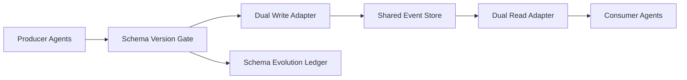

# Agent Schema 演进安全选型 FAQ（Cycle 1812）

## 1) 3 分钟结论
- **Schema 演进事故常见于“发布顺序失配”，而不是字段本身设计错误。**
- **推荐：** 前向兼容优先 + 双写双读过渡 + 版本门禁回滚。
- **目标：** 在多服务多代理协同升级时，避免解析失败和语义漂移。

## 2) Q1 / Q2 / Q3
### Q1：为什么一次性切换 Schema 风险高？
1) 下游仍消费旧结构；
2) 历史数据回填窗口不足；
3) 部分代理缓存旧契约导致异常。

### Q2：可落地演进策略是什么？
- 新增字段保持可选并提供默认语义；
- 发布窗口执行双写双读与兼容校验；
- 通过版本门禁逐步收紧旧字段；
- 发现异常可一键回滚到上个稳定版本。

### Q3：如何验证策略有效？
- 解析错误率保持低位；
- 跨版本一致性校验通过率提升；
- 回滚演练时间可预测。

## 3) 架构图

## 4) 选型矩阵
| 维度 | 一次性切换 | 兼容演进（推荐） |
|---|---:|---:|
| 发布安全性 | 低 | 高 |
| 兼容稳定性 | 低 | 高 |
| 回滚可控性 | 中 | 高 |
| 实施复杂度 | 低 | 中 |
| 调试可解释性 | 中 | 高 |

## 5) 证据与复算口径
- 证据文件：
  - `workshops/azure-agent-infra/evidence/cycle-1812-benchmark.json`
  - `workshops/azure-agent-infra/evidence/cycle-1812-latency.csv`
  - `workshops/azure-agent-infra/evidence/cycle-1812-throughput.csv`
  - `workshops/azure-agent-infra/evidence/cycle-1812-policy.csv`
- 标签：`measured / synthetic / anonymized_reported`。
- validation7：双语结构、CSP 自包含、证据轮次一致、回放链路校验通过。

## 6) 生产检查清单
- [ ] Schema 版本门禁已启用。
- [ ] 双写双读窗口与清退计划明确。
- [ ] 兼容校验作业纳入发布流水线。
- [ ] 回滚路径与数据修复脚本可演练。
- [ ] FAQ/H5/SVG/7-card 与 evidence 轮次一致。
